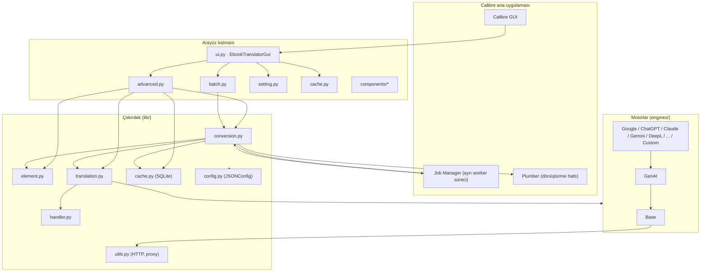
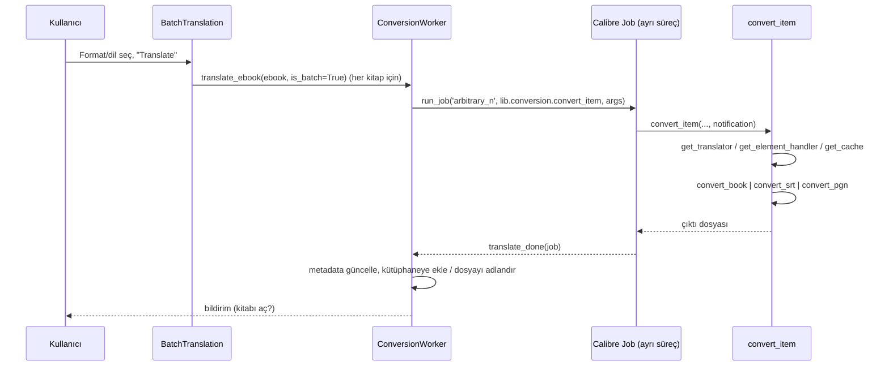
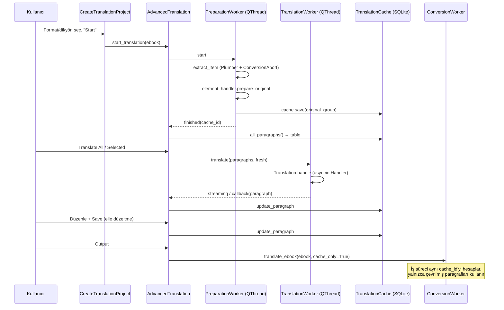
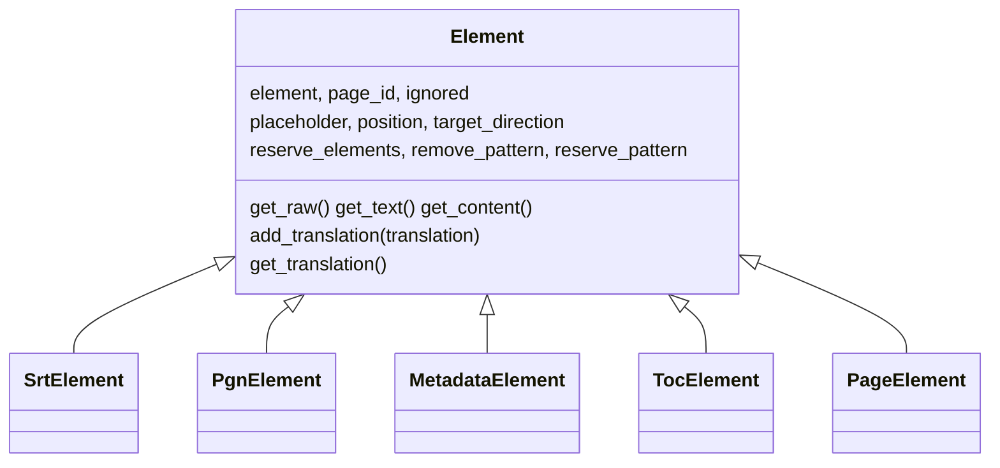
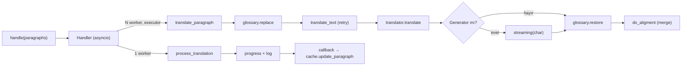
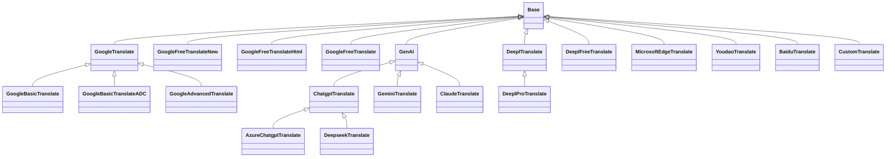
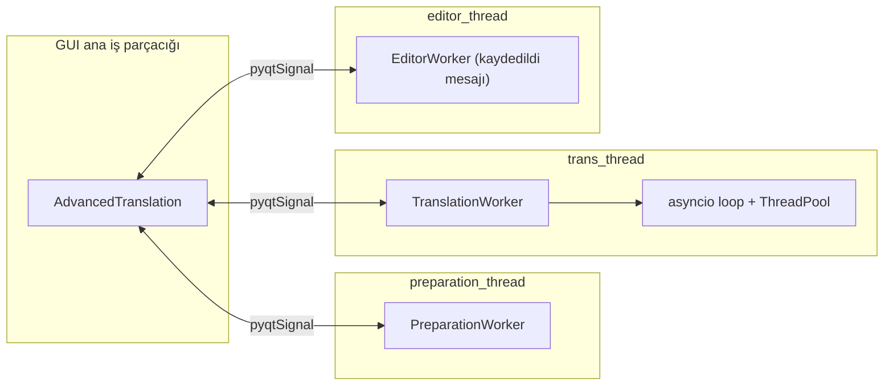

# Ebook Translator (Calibre Eklentisi) — Proje Haritası, Mimari ve Kod Referansı

> Sürüm: **v2.4.2** (`__init__.py` → `EbookTranslator.version = (2, 4, 2)`)
> Lisans: GPL v3 · Yazar: bookfere.com
> Minimum Calibre: 5.0.0 · Geliştirme Python sürümü: ≥ 3.8.5 (CI: 3.10)

---

## İçindekiler

1. [Özet](#1-özet)
2. [Çalışma Ortamı ve Bağımlılıklar](#2-çalışma-ortamı-ve-bağımlılıklar)
3. [Dizin Haritası](#3-dizin-haritası)
4. [Mimari Genel Bakış](#4-mimari-genel-bakış)
5. [Çalışma Zamanı Akışları](#5-çalışma-zamanı-akışları)
6. [Veri Modeli](#6-veri-modeli)
7. [İçerik Çıkarma ve Geri Yazma (lib/element.py)](#7-içerik-çıkarma-ve-geri-yazma-libelementpy)
8. [Çeviri Hattı (lib/translation.py + lib/handler.py)](#8-çeviri-hattı-libtranslationpy--libhandlerpy)
9. [Çeviri Motorları (engines/)](#9-çeviri-motorları-engines)
10. [Yapılandırma (lib/config.py)](#10-yapılandırma-libconfigpy)
11. [Önbellek (lib/cache.py)](#11-önbellek-libcachepy)
12. [Arayüz Katmanı ve İş Parçacığı Modeli](#12-arayüz-katmanı-ve-iş-parçacığı-modeli)
13. [Ağ Katmanı ve Proxy](#13-ağ-katmanı-ve-proxy)
14. [Uluslararasılaştırma (i18n)](#14-uluslararasılaştırma-i18n)
15. [Test, CI/CD ve Yayınlama](#15-test-cicd-ve-yayınlama)
16. [Genişletme Rehberi](#16-genişletme-rehberi)
17. [Gözlemler, Riskler ve Olası Hatalar](#17-gözlemler-riskler-ve-olası-hatalar)
18. [Kod Referansı (API Dizini)](#18-kod-referansı-api-dizini)

---

## 1. Özet

Eklenti, Calibre kütüphanesindeki bir e-kitabı (Calibre'nin desteklediği tüm girdi formatları + `.srt` altyazı ve `.pgn` satranç dosyaları) seçilen çeviri motoruyla başka bir dile çevirir. Çeviri, orijinal metnin **altına, üstüne, soluna, sağına** eklenebilir ya da orijinalin **yerine** geçebilir.

Temel fikir: Calibre'nin dönüştürme hattı (`Plumber`) çalışırken, çıktı eklentisinin `convert` metodu **monkey-patch** ile değiştirilir. Kitap OEB (ara HTML temsili) olarak ayrıştırıldıktan sonra, çıktı dosyası yazılmadan hemen önce paragraflar çıkarılır, çevrilir ve DOM'a geri yazılır.

İki kullanım modu vardır:

| Mod | Amaç | Çeviri nerede çalışır |
|---|---|---|
| **Gelişmiş Mod (Advanced)** | Tek kitap; paragraf paragraf inceleme, düzenleme, seçerek çevirme, önbellekten çıktı alma | Çeviri GUI sürecinde `QThread` içinde; çıktı Calibre iş (job) sürecinde |
| **Toplu Mod (Batch)** | Birden çok kitabı tek seferde çevirme | Tamamen Calibre iş sürecinde (`arbitrary_n`) |

---

## 2. Çalışma Ortamı ve Bağımlılıklar

Eklenti **Calibre'nin gömülü Python ortamında** çalışır; harici `pip` bağımlılığı yoktur. Kullanılan modüller:

| Kaynak | Kullanım |
|---|---|
| `calibre.*` | Eklenti API'si (`InterfaceActionBase`, `InterfaceAction`), dönüştürme (`Plumber`), metadata, `JSONConfig`, iş yöneticisi, loglama, yerelleştirme |
| `qt.core` (PyQt5/6 sarmalayıcı) | Tüm arayüz |
| `lxml.etree` | XHTML DOM işleme |
| `mechanize` | HTTP istekleri (Calibre ile gelir) |
| `sqlite3`, `asyncio`, `concurrent.futures` | Önbellek ve eşzamanlılık |
| `vendor/socks.py` | PySocks kopyası (SOCKS5 proxy) |
| `vendor/cssselect/` | cssselect kopyası (CSS seçici → XPath) |

Eklenti içi importlar `calibre_plugins.ebook_translator.*` ad alanı altında çözülür (bkz. `plugin-import-name-ebook_translator.txt`).

---

## 3. Dizin Haritası

Satır sayıları gerçek dosya satırlarıdır.

```
Ebook-Translator-Calibre-Plugin/
├── __init__.py                 (45)   Eklenti tanımı: EbookTranslator(InterfaceActionBase)
├── ui.py                       (249)  Calibre araç çubuğu eylemi, menü, pencere yönetimi
├── advanced.py                 (1303) Gelişmiş Mod: hazırlık/çeviri worker'ları + ana pencere
├── batch.py                    (225)  Toplu Mod penceresi
├── setting.py                  (1466) Ayarlar penceresi (Genel / Motor / İçerik sekmeleri)
├── cache.py                    (256)  Önbellek yöneticisi penceresi
├── about.py                    (76)   Hakkında penceresi (README'yi zip içinden okur)
├── test.py                     (40)   Test çalıştırıcı (calibre-debug test.py)
├── plugin-import-name-ebook_translator.txt   Calibre import adı işaretçisi
│
├── lib/                        Çekirdek (arayüzden bağımsız) mantık
│   ├── config.py               (221)  Varsayılanlar, Configuration sarmalayıcı, sürüm migrasyonları
│   ├── conversion.py           (364)  Plumber entegrasyonu, convert_item (iş süreci), ConversionWorker
│   ├── element.py              (941)  Element hiyerarşisi, Extraction, ElementHandler(+Merge)
│   ├── srt.py                  (255)  SRT ayrıştırma/yazma, altyazı işaretçileri, SRT handler'ları, onarım
│   ├── translation.py          (309)  Glossary, Translation, motor/çevirmen fabrikaları
│   ├── handler.py              (87)   asyncio tabanlı eşzamanlı çeviri kuyruğu
│   ├── cache.py                (345)  Paragraph modeli, SQLite TranslationCache, get_cache_id
│   ├── ebook.py                (75)   Ebook / Ebooks veri sınıfları
│   ├── utils.py                (237)  HTTP request, SOCKS yaması, CSS→XPath, trim, uid ...
│   ├── encodings.py            (60)   SRT/PGN için kodlama listesi
│   └── exception.py            (34)   Özel istisnalar
│
├── engines/                    Çeviri motorları
│   ├── __init__.py             (19)   builtin_engines demeti
│   ├── base.py                 (266)  Base: tüm motorların sözleşmesi
│   ├── genai.py                (20)   GenAI soyut sınıfı (LLM motorları)
│   ├── google.py               (545)  Google (Free New/Html/Old, Basic, Basic ADC, Advanced), Gemini
│   ├── openai.py               (304)  ChatGPT + ChatgptBatchTranslate (OpenAI Batch API)
│   ├── anthropic.py            (198)  Claude
│   ├── deepseek.py             (24)   DeepSeek (ChatGPT türevi)
│   ├── microsoft.py            (71)   Microsoft Edge (Free), ChatGPT (Azure)
│   ├── deepl.py                (105)  DeepL, DeepL Pro, DeepL Free
│   ├── youdao.py               (66)   Youdao
│   ├── baidu.py                (48)   Baidu
│   ├── custom.py               (146)  JSON tanımlı özel motor
│   ├── languages.py            (1471) Motor başına dil→kod tabloları + yön (ltr/rtl)
│   └── prompt_extensions.py    (5)    Hedef dile özel prompt ekleri (Claude)
│
├── components/                 Yeniden kullanılabilir Qt bileşenleri
│   ├── __init__.py             (10)   Dışa aktarımlar
│   ├── engine.py               (330)  EngineList, EngineTester, ManageCustomEngine
│   ├── table.py                (290)  AdvancedTranslationTable
│   ├── chatgpt.py              (332)  ChatGPT toplu çeviri yöneticisi (Batch API)
│   ├── editor.py               (99)   Satır numaralı CodeEditor
│   ├── lang.py                 (65)   SourceLang / TargetLang combobox'ları
│   ├── format.py               (51)   InputFormat / OutputFormat combobox'ları
│   ├── indicator.py            (72)   Durum renk göstergesi
│   ├── mode.py                 (65)   İlk açılış mod seçimi
│   ├── alert.py                (32)   QMessageBox sarmalayıcı
│   ├── footer.py               (36)   Alt bilgi bağlantıları
│   └── shortcut.py             (22)   Klavye kısayolu yardımcısı
│
├── vendor/                     Gömülü 3. parti kodlar (socks, cssselect)
├── tests/                      unittest testleri (318 test metodu)
├── translations/               .po/.mo (de, es, fr, he, ja, pt, tr, vi, zh_CN, zh_TW) + message.pot
├── images/                     icon.png, logo.png, örnek ekran görüntüleri
├── page/                       Jekyll landing page (translator.bookfere.com)
└── .github/                    CI (unit-testing), release, landing-page iş akışları, issue şablonları
```

---

## 4. Mimari Genel Bakış

### 4.1 Katmanlar



### 4.2 Temel tasarım kararları

- **Plumber monkey-patch'i:** `convert_book` ve `extract_book`, `plumber.output_plugin.convert` metodunu `types.MethodType` ile değiştirir. Böylece Calibre'nin tüm girdi/çıktı formatları ek kod olmadan desteklenir (`lib/conversion.py:52-89`, `164-186`).
- **Süreç izolasyonu:** Kitap çıktısı her zaman Calibre'nin `arbitrary_n` işiyle **ayrı bir süreçte** üretilir (`ConversionWorker.translate_ebook`, `lib/conversion.py:267-291`). GUI ile iş süreci arasındaki tek ortak durum **SQLite önbellek dosyası** ve **JSON yapılandırmasıdır**.
- **Önbellek = iletişim kanalı:** Gelişmiş Mod'da çeviriler önbelleğe yazılır; "Output" düğmesi `cache_only=True` ile iş başlatır ve iş süreci çevirileri önbellekten okur.
- **Motorlar sınıf düzeyinde yapılandırılır:** `get_engine_class()` motor sınıfının `config` sınıf niteliğini ayarlar; örnekler bu sınıf niteliğinden okur.
- **Placeholder mekanizması:** Çevrilmemesi gereken iç öğeler (`img`, `code`, `br`, `sup`...) ve sözlük terimleri metinden çıkarılıp yer tutucularla değiştirilir, çeviriden sonra geri konur.

---

## 5. Çalışma Zamanı Akışları

### 5.1 Eklentinin yüklenmesi

1. Calibre `__init__.py` içindeki `EbookTranslator` sınıfını okur; `actual_plugin = 'calibre_plugins.ebook_translator.ui:EbookTranslatorGui'`.
2. `DEBUG` açıksa `CALIBRE_DEBUG` ortam değişkenine yazılır (iş süreçleri `DEBUG` sabitini miras almadığı için).
3. `ui.py` import edilirken `upgrade_config()` çalışır (yapılandırma migrasyonları).
4. `EbookTranslatorGui.genesis()` menüyü kurar: *Advanced Mode, Batch Mode, Cache, Setting, About*. Simgeye tıklanınca `select_preferred_mode()` tercih edilen modu açar; tercih yoksa `ModeSelection` diyaloğu gösterilir.
5. Çalışan iş ve açık pencere durumu `self.gui.bookfere_ebook_translator` (`Status`: `jobs`, `windows`) nesnesinde Calibre GUI'ye iliştirilir.

### 5.2 Kitap seçimi (`ui.py:214-249`)

`get_selected_ebooks()` seçili satırlar için `Ebook` nesneleri üretir. Girdi formatı `get_input_format_for_book(db, book_id, 'epub')` ile belirlenir; Calibre bunu yapamazsa ek formatlar (`srt`, `pgn`) denenir.

### 5.3 Toplu Mod akışı



### 5.4 `convert_item` (iş sürecinde) — `lib/conversion.py:196-255`

1. `get_translator()` → yapılandırmadaki varsayılan motor; kaynak/hedef dil atanır.
2. `get_element_handler(placeholder, separator, direction)` → birleştirme (merge) açıksa `ElementHandlerMerge`.
3. **Önbellek kimliği:** `uid(input_path + translator.name + target_lang + merge_length + encoding)` (encoding yalnızca UTF-8 değilse eklenir).
4. `Translation` oluşturulur; geri çağırım `cache.update_paragraph` (her paragraf çevrilince önbelleğe yazılır → kesintiye dayanıklılık).
5. Formata göre dönüştürücü:
   - **Calibre formatları → `convert_book`:** Metadata + TOC + sayfa elemanları çıkarılır → `prepare_original` → `cache.save` → `cache.all_paragraphs()` → `translation.handle` → `add_translations` → asıl `_convert` ile çıktı yazılır.
   - **`srt` → `convert_srt`**, **`pgn` → `convert_pgn`:** Dosya doğrudan metin olarak işlenir.
6. `cache.done()` → kalıcı olmayan (cache kapalı) önbellek silinir.

### 5.5 `translate_done` (GUI sürecinde) — `lib/conversion.py:293-364`

- Hata varsa (`job.failed`) hata diyaloğu (DEBUG kapalıysa).
- Calibre formatlarında metadata dosyadan okunur: özel başlık, `[hedef dil]` eki (`lang_mark`), dil kodu (`lang_code`), ek konular + `Translated by Ebook Translator` etiketi.
- `to_library` açıksa yeni kitap kaydı + format eklenir; değilse dosya başlığa göre yeniden adlandırılır.
- `show_notification` açıksa "kitabı aç" bildirimi (ebook-viewer ya da sistem uygulaması).

### 5.6 Gelişmiş Mod akışı



Önemli ayrıntılar:

- Önbellek mevcut ve "taze değil"se (dosya > 50 000 bayt) çıkarma adımı atlanır, tablo doğrudan önbellekten yüklenir.
- Tablodan silinen satırlar önbellekte `ignored=True` yapılır (çevrilmez, çıktıda orijinal kalır).
- Yalnızca motor **ChatGPT** iken "Batch Translation (Beta)" düğmesi görünür (OpenAI Batch API).
- Pencere kapatılırken çalışan hazırlık/çeviri varsa onay istenir; kalıcı değilse önbellek silinir.

### 5.7 Ek formatlar (SRT / PGN)

`extra_formats` sözlüğü (`lib/conversion.py:151-160`) her ek format için `extractor` ve `convertor` tanımlar:

| Format | Çıkarıcı | Birim | Çıktı |
|---|---|---|---|
| `srt` | `get_srt_elements` → `lib/srt.py` `parse_srt` | Zaman satırına göre ayrılmış altyazı: `[numara, zaman, metin]` | `compose_srt`: her altyazı numara + zaman + çeviri olarak yeniden yazılır |
| `pgn` | `get_pgn_elements` | `{...}` içinde harf içeren yorumlar | Orijinal metin içinde `replace(..., 1)` |

Bu formatlarda çıktı formatı girdiye kilitlenir (`OutputFormat.lock_format`) ve kodlama seçilebilir (`lib/encodings.py`).

SRT için ayrı bir akış vardır (ayrıntı: [SRT_ANALYSIS.md](SRT_ANALYSIS.md) §6):

- `get_element_handler(..., input_format='srt')`, `SrtElementHandler` (altyazı başına) ya da `SrtElementHandlerMerge` (birleştirme açıkken) döndürür. Birleşik gruplarda her altyazının başına `{{id_c<no>}}` işaretçisi konur ve altyazılar `\n` ile birleştirilir; sayıya dayalı `align_paragraph` kullanılmaz.
- `Translation.set_alignment(False)` SRT'de genel hizalama onarımını kapatır. LLM motorlarına `set_prompt_extension` ile işaretçileri koruma talimatı eklenir.
- Çeviri bittikten sonra `repair_srt_groups`, işaretçileri `parse_marked_text` ile doğrulanamayan grupları önbelleği kirletmeden altyazı altyazı yeniden çevirir (`Translation.fork()`).
- Önbellek kimliği `get_cache_id` ile üretilir; SRT kimliğine `srt-v2` eklenir. Böylece eski düzende oluşmuş önbellek yeniden kullanılmaz.

---

## 6. Veri Modeli

### 6.1 `Ebook` (`lib/ebook.py`)

| Alan | Açıklama |
|---|---|
| `id` | Calibre kitap kimliği |
| `title`, `custom_title` | Başlık / kullanıcı tanımlı başlık |
| `files` | `{format: mutlak_yol}` |
| `input_format`, `output_format` | Küçük harfli format adları |
| `source_lang`, `target_lang`, `lang_code` | Dil adları ve ISO 639-1 hedef kodu |
| `encoding` | Varsayılan `utf-8` (SRT/PGN için anlamlı) |
| `target_direction` | `auto` / `ltr` / `rtl` |
| `extra_formats` | Calibre'nin dönüştüremediği ama eklentinin desteklediği formatlar |

`Ebooks` basit bir koleksiyondur; `first()` **listeden çıkararak** döner.

### 6.2 Element hiyerarşisi (`lib/element.py`)



| Sınıf | Sarmaladığı nesne | `page_id` |
|---|---|---|
| `PageElement` | lxml `_Element` (XHTML gövdesindeki blok) | Manifest öğe kimliği |
| `TocElement` | Calibre TOC düğümü (`title`) | `toc.ncx` |
| `MetadataElement` | OPF metadata öğesi (`content`) | `content.opf` |
| `SrtElement` | `[numara, zaman, metin]` listesi; `<i>`, `<font ...>` gibi etiketler ve `{\an8}` gibi ASS etiketleri 5 haneli placeholder olarak korunur, çeviriden boş satır, zaman satırı ve artık işaretçiler temizlenir | — |
| `PgnElement` | `[orijinal_yorum, çeviri]` listesi | — |

`get_raw()` = ham işaretleme, `get_text()` = düz metin, `get_content()` = **çeviriye gönderilecek metin** (silinecek öğeler çıkarılmış, korunacak öğeler placeholder'a dönüştürülmüş).

### 6.3 `Paragraph` (`lib/cache.py:21-73`)

Önbellek satırının bellek içi temsili: `id, md5, raw, original, ignored, attributes, page, translation, engine_name, target_lang` + çalışma zamanı alanları `row, is_cache, error, aligned`.

- `is_alignment(separator, placeholder=None)` / `do_aligment(separator)`: Birleştirme modunda orijinal ve çevirideki parça sayısını karşılaştırır; uyumsuzsa çeviriye boş satır ekleyerek hizalamaya çalışır. SRT grubunda (`attributes` içinde `cues` varsa) doğrulama parça sayısıyla değil altyazı işaretçileriyle yapılır.

### 6.4 SQLite şeması (her kitap+motor+dil için bir `.db`)

```sql
CREATE TABLE cache(
  id UNIQUE, md5 UNIQUE, raw, original, ignored,
  attributes DEFAULT NULL, page DEFAULT NULL,
  translation DEFAULT NULL, engine_name DEFAULT NULL, target_lang DEFAULT NULL);
CREATE TABLE info(key UNIQUE, value);
```

`info` anahtarları: `title`, `engine_name`, `target_lang`, `merge_length`, `plugin_version`, `calibre_version`, `chatgpt_batch_id`, `chatgpt_file_id`.

---

## 7. İçerik Çıkarma ve Geri Yazma (lib/element.py)

### 7.1 `Extraction` — hangi DOM düğümü bir "paragraf"tır?

1. **Sayfalar:** Manifest'te `.xhtml|.html|.htm|.xml|.xht` uzantılı ve verisi lxml elemanı olan öğeler, doğal sıralamayla (`sorted_mixed_keys`) sıralanır.
2. Her sayfanın `<body>` öğesinden başlayarak `extract_elements` özyinelemeli çalışır:
   - **Yok sayma** desenine (`pre`, `code` + `ignore_rules`) uyan → `ignored=True` olarak eklenir.
   - Eleman şu durumlardan biriyse **paragraf** kabul edilir (alt öğelere inilmez):
     - **Öncelikli** seçiciye uyuyor (`p, pre, h1-h6, blockquote` + `priority_rules`),
     - Yalnızca satır içi (inline) çocuklar içeriyor (`non_inline_elements` listesinde blok çocuk yok),
     - Kendi `text` değeri boş değil,
     - Çocuklarından birinin `tail` metni boş değil.
   - Aksi halde çocuklarına inilir. Hiçbir çocuk içerik vermezse kökün kendisi döner.
3. **Filtreleme (`filter_content`):** Boş metin atılır. Varsayılan regex yalnızca rakam/noktalama içeren metni `ignored` yapar. `filter_rules` kipine göre (`normal` = büyük/küçük harf duyarsız, `case`, `regex`) ve kapsamına göre (`text` / `html`) uygulanır.

### 7.2 Silme ve koruma desenleri (`ElementHandler`)

| Desen | Varsayılan | Etki |
|---|---|---|
| `remove_pattern` | `rt`, `rp` + `ignore_rules` | Çeviriye gönderilen içerikten tamamen çıkarılır (ruby açıklamaları vb.) |
| `reserve_pattern` | `img, code, br, hr, sub, sup, kbd, abbr, wbr, var, canvas, svg, script, style, math` + `reserve_rules` | Yer tutucuyla değiştirilir, çeviriden sonra orijinal işaretleme geri konur |

Yer tutucu biçimleri motor sınıfında tanımlıdır:

| Motor | `placeholder[0]` (yazım) | `placeholder[1]` (geri bulma regex'i) |
|---|---|---|
| Varsayılan (`Base`) | `{{id_00000}}` | `({{\s*)+id\s*_\s*{}\s*(\s*}})+` |
| DeepL / DeepL Free | `<m id=00000 />` | `<m\s+id={}\s+/>` |

Korunan öğeler 5 haneli, sözlük terimleri 6 haneli numara kullanır; regex, motorların numara arasına koyabileceği boşlukları da tolere eder.

### 7.3 `ElementHandler` vs `ElementHandlerMerge`

- **`ElementHandler.prepare_original`:** Her eleman için `(oid, md5, raw, content, ignored, attrs, page_id)` demeti üretir. `md5 = uid(oid + content)`.
- **`ElementHandlerMerge.prepare_original`:** Ardışık elemanları `separator` (`\n\n`) ile birleştirerek `merge_length` karakterini (varsayılan 1800) aşmayan gruplar üretir → daha az API çağrısı.
- **`align_paragraph`:** Birleşik çeviriyi tekrar parçalara böler. Parça sayısı eksikse: `left/right` konumunda eksikler `None` olur; diğer konumlarda tüm çeviri tek bir elemana (above → ilk, diğerleri → son) yığılır. Fazlaysa sondakiler birleştirilir.
- **`add_translations`:** Çeviri sözlüğü **orijinal metin → çeviri** eşlemesidir; eşleşme kimlikle değil **içerik metniyle** yapılır.
- **SRT:** `SrtElementHandler` / `SrtElementHandlerMerge` (`lib/srt.py`) bu sınıfların yerine geçer. Grup çevirisi işaretçilere göre altyazılara dağıtılır; işaretçiler doğrulanamazsa altyazılar çevrilmemiş kalır ve `repair_srt_groups` tarafından tek tek çevrilir.

### 7.4 Çevirinin DOM'a yazılması (`PageElement.add_translation`)

| Konum | Davranış |
|---|---|
| `below` (varsayılan; eski adı `after`) | Yeni eleman orijinalin **sonrasına** eklenir |
| `above` (eski adı `before`) | Orijinalin **öncesine** eklenir |
| `left` / `right` | 3 hücreli `<table>` (sol, boşluk, sağ) oluşturulur; `column_gap` yüzde ya da boşluk sayısı |
| `only` | Orijinal silinir, yalnızca çeviri kalır |

Özel durumlar:

- `li, th, td, caption` içinde çeviri bir `<span>` olarak hücrenin **içine** eklenir (tablo/liste yapısı bozulmasın diye).
- Satır içi öğeler (`a, em, span, ...`) `left/right` tabloya dönüştürülmez.
- Orijinal ve çeviride eşit sayıda `<br>` varsa satır satır iç içe yerleştirme yapılır (`_add_translation_for_line_breaks`).
- Yeni elemana `dir`, `lang` ve isteğe bağlı `style="color:..."` atanır; orijinal renk de ayarlanabilir.
- `_polish_translation`: `\n` → `<br/>`; aynı harfin 4'ten fazla tekrarı 4'e indirilir (rakamlar hariç).

---

## 8. Çeviri Hattı (lib/translation.py + lib/handler.py)

### 8.1 Fabrikalar

- **`get_engine_class(engine_name=None)`:** Yerleşik motorlarda adla arar; bulunamazsa `custom_engines` içinde arar ve `CustomTranslate.set_engine_data` ile **sınıfı yeniden yapılandırır**; hiçbiri değilse `GoogleFreeTranslateNew`. Son olarak `engine_class.set_config(engine_preferences[name])`.
- **`get_translator(engine_class=None)`:** Örnek oluşturur, arama yollarını, proxy'yi ve merge durumunu atar.
- **`get_translation(translator, log)`:** `Glossary` yükler (etkinse) ve `Translation` döndürür.

### 8.2 `Translation`



- **Önbellek kısayolu:** `paragraph.translation` doluysa ve `fresh=False` ise istek atılmaz (`is_cache=True`).
- **Yeniden deneme (`translate_text`):** Hata başına bekleme 5 sn artar (5, 10, 15...), `request_attempt` aşılınca `TranslationFailed`. Hata mesajı motorun `api_key_errors` listesindeki bir kodu içeriyorsa `TranslationCanceled` (anahtar sorunu → boşuna deneme yapılmaz). Motor hatayı `rejected_errors` ile eşleştirip `RequestRejected` fırlatmışsa (ör. `Google(Free)New` için HTTP 400) beklemeden ve yeniden denemeden `TranslationFailed` verilir; ardışık hata sayacı yalnızca bir artar.
- **Ardışık hata sınırı:** `max_error_count` (varsayılan 10) ardışık hatada çeviri iptal edilir (`need_stop`). Toplu modda bu durum işi başarısız sayar.
- **Akış (streaming):** Motor generator döndürürse ve yalnızca tek paragraf çevriliyorsa karakterler arayüze canlı aktarılır.

### 8.3 `Handler` (eşzamanlılık)

- `asyncio.Queue` ile `concurrency_limit` adet çeviri worker'ı + 1 işleme worker'ı.
- Her çeviri `run_in_executor(None, ...)` ile varsayılan thread havuzunda çalışır (gerçek eşzamanlılık havuz boyutuyla sınırlıdır).
- `concurrency_limit = 0` → worker sayısı = paragraf sayısı.
- Önbellekten gelmeyen her çeviriden sonra worker `request_interval` saniye bekler.
- `TranslationCanceled` alınınca kuyruklar boşaltılır.
- Windows'ta `WindowsProactorEventLoopPolicy` kullanılır.

### 8.4 Sözlük (Glossary)

Dosya biçimi: boş satırlarla ayrılmış gruplar; her grubun 1. satırı kaynak terim, 2. satırı (varsa) hedef karşılık. 2. satır yoksa terim çevrilmeden korunur. Uzun terimler önce değiştirilir (ör. "Harry Potter", "Harry"den önce).

```
Harry Potter
Harry Potter

Hogwarts
Hogwarts Cadılık ve Büyücülük Okulu
```

---

## 9. Çeviri Motorları (engines/)

### 9.1 `Base` sözleşmesi (`engines/base.py`)

Bir motor yazmak için genellikle şu metotlar geçersiz kılınır:

| Metot / nitelik | Görev |
|---|---|
| `name`, `alias`, `free` | Kimlik (config anahtarı), görünen ad, ücretsiz mi |
| `lang_codes` | `{'source': {...}, 'target': {...}}` (`load_lang_codes` tek sözlüğü ikisine kopyalar) |
| `endpoint`, `method`, `stream` | İstek hedefi |
| `get_endpoint()`, `get_headers()`, `get_body(text)` | İstek oluşturma |
| `get_result(response)` | Yanıt ayrıştırma (str ya da generator) |
| `need_api_key`, `api_key_hint`, `api_key_pattern`, `api_key_errors` | Anahtar doğrulama ve rotasyon |
| `placeholder`, `separator`, `support_html` | Yer tutucu ve birleştirme ayırıcısı |
| `concurrency_limit`, `request_interval`, `request_attempt`, `request_timeout`, `max_error_count` | Varsayılan istek politikası (config ile ezilir) |
| `get_usage()` | Kota bilgisi (yalnızca DeepL) |
| `using_tip` | Ayarlar ekranında gösterilen kullanım ipucu (HTML) |

`translate(content)` akışı: parametreleri hazırla → SOCKS5 ise `socks_proxy` bağlamında, HTTP proxy ise `proxy_uri` ile `request()` → `get_result`. Hata durumunda anahtar hatasıysa `swap_api_key()` ile sıradaki anahtara geçilip tekrar denenir; değilse `UnexpectedResult`.

### 9.2 Yerleşik motorlar

| `name` (config anahtarı) | Sınıf | Ücretsiz | Kimlik doğrulama | Varsayılan politika / not |
|---|---|---|---|---|
| `Google(Free)New` | `GoogleFreeTranslateNew` | ✓ | Gömülü genel anahtar | **Varsayılan/yedek motor** |
| `Google(Free)Html` | `GoogleFreeTranslateHtml` | ✓ | Gömülü genel anahtar | `support_html=True` |
| `Google(Free)` | `GoogleFreeTranslate` | ✓ | — | Eski uç nokta; >1800 karakterde POST |
| `Google(Basic)` | `GoogleBasicTranslate` | | API key | v2 |
| `Google(Basic)ADC` | `GoogleBasicTranslateADC` | | gcloud ADC token | v2; `gcloud` CLI gerekir |
| `Google(Advanced)` | `GoogleAdvancedTranslate` | | gcloud ADC + proje kimliği | v3 |
| `ChatGPT` | `ChatgptTranslate` (GenAI) | | Bearer | eşz. 1, aralık 20 sn, zaman aşımı 60 sn, `gpt-4o`, akış açık |
| `ChatGPT(Azure)` | `AzureChatgptTranslate` | | `api-key` başlığı | Model Azure dağıtımına bağlı |
| `Gemini` | `GeminiTranslate` (GenAI) | | `?key=` | eşz. 1, aralık 1 sn, 30 sn, `gemini-3.5-flash-lite`, güvenlik filtreleri `BLOCK_NONE` |
| `Claude` | `ClaudeTranslate` (GenAI) | | `x-api-key` | eşz. 1, aralık 12 sn, 30 sn, `claude-sonnet-4-6`; yeni modellerde örnekleme parametreleri gönderilmez |
| `DeepSeek` | `DeepseekTranslate` (ChatGPT türevi) | | Bearer | eşz. sınırsız, aralık 0; `deepseek-v4-flash` / `-pro` |
| `DeepL` | `DeeplTranslate` | | `DeepL-Auth-Key` | api-free uç noktası; kullanım sorgusu |
| `DeepL(Pro)` | `DeeplProTranslate` | | `DeepL-Auth-Key` | api.deepl.com |
| `DeepL(Free)` | `DeeplFreeTranslate` | ✓ | — | Web storefront uç noktası; eşz. 1, aralık 1 sn |
| `MicrosoftEdge(Free)` | `MicrosoftEdgeTranslate` | ✓ | — | edge.microsoft.com |
| `Youdao` | `YoudaoTranslate` | | `appid\|appsecret` (SHA-256 imza) | |
| `Baidu` | `BaiduTranslate` | | `appid\|appkey` (MD5 imza) | |

Kalıtım:



### 9.3 GenAI motorları

`GenAI` soyut sınıfı `get_models()` gerektirir; ayarlar ekranı bunu arka planda (`ModelWorker`) çağırarak model listesini doldurur. Ortak ayarlar: `prompt` (`<slang>`, `<tlang>` yer tutucuları), `endpoint`, `model`, `sampling` (`temperature` | `top_p`), `top_k`, `stream`. Merge açıkken prompt'a "`{{id_\d+}}` yer tutucularını koru" talimatı eklenir.

### 9.4 ChatGPT Batch API (`engines/openai.py:188-304`, `components/chatgpt.py`)

1. Seçili çevrilmemiş paragraflar JSONL olarak `/v1/files` adresine yüklenir (`custom_id = paragraph.md5`).
2. `/v1/batches` ile 24 saatlik pencerede iş oluşturulur; `batch_id` ve `file_id` önbellek `info` tablosunda saklanır (pencere kapansa da devam edilebilir).
3. Durum `check` ile sorgulanır; `completed` olunca "Apply" çıktı dosyasını indirip `md5` ile paragraflara eşler.

### 9.5 Özel motor (Custom) JSON biçimi

```json
{
  "name": "Benim Motorum",
  "languages": {
    "source": {"English": "en"},
    "target": {"Turkish": "tr"}
  },
  "request": {
    "url": "https://example.api/translate",
    "method": "POST",
    "headers": {"Content-Type": "application/json"},
    "data": {"source": "<source>", "target": "<target>", "text": "<text>"}
  },
  "response": "response['data']['translation']"
}
```

- `load_engine_data` doğrular: geçerli JSON, benzersiz ad (yerleşiklerle çakışmamalı), `source`/`target` birlikte, `url` zorunlu, `data` içinde `<text>` zorunlu, `data` metin ise `Content-Type` zorunlu, `response` ifadesi `response` kelimesini içermeli.
- Yanıt JSON ya da XML (lxml) olarak ayrıştırılır, ardından `response` ifadesi **`eval`** ile değerlendirilir.

---

## 10. Yapılandırma (lib/config.py)

### 10.1 Depolama konumları

| Veri | Konum |
|---|---|
| Eklenti ayarları | Calibre yapılandırma dizini → `plugins/ebook_translator.json` (`JSONConfig`) |
| Pencere boyut/konum, inceleme düzeni, sözcük kaydırma | `<plugin_dir>/ebook-translator/settings.ini` (`QSettings`) |
| Önbellek | Windows: `%LOCALAPPDATA%\calibre-cache\plugins\ebook-translator\{cache,temp}`; diğer: `<tmp>/com.bookfere.Calibre.EbookTranslator/{cache,temp}`; ya da kullanıcı tanımlı `cache_path` |

### 10.2 `Configuration` sarmalayıcısı

`get('a.b.c')` / `set('a.b.c', v)` noktalı anahtar desteği sağlar; eksik anahtarlarda `defaults` sözlüğüne düşer. `update` + `commit` (= `save`) ile diske yazılır.

### 10.3 Ayar anahtarları

| Anahtar | Varsayılan | Açıklama |
|---|---|---|
| `preferred_mode` | `None` | `advanced` / `batch` |
| `to_library` | `True` | Çıktıyı kütüphaneye ekle |
| `output_path` | `None` | `to_library=False` iken çıktı dizini |
| `input_format`, `output_format` | — | Tercih edilen formatlar |
| `translate_engine` | `None` | Varsayılan motor adı |
| `engine_preferences` | `{}` | Motor başına ayarlar (aşağıda) |
| `custom_engines` | `{}` | `{ad: JSON metni}` |
| `proxy_enabled`, `proxy_type`, `proxy_setting` | `False`, `http`, `{}` | `proxy_setting = {tip: [host, port]}` (eski sürüm: liste) |
| `cache_enabled`, `cache_path` | `True`, `None` | |
| `log_translation` | `True` | İş günlüğüne çevirileri yaz |
| `show_notification` | `True` | Bitiş bildirimi |
| `translation_position` | `None` (→ `below`) | `below/above/left/right/only` |
| `column_gap` | `{_type: percentage, percentage: 10, space_count: 6}` | Sol/sağ tablo boşluğu |
| `original_color`, `translation_color` | `None` | CSS renk |
| `priority_rules`, `ignore_rules`, `reserve_rules` | `[]` | CSS seçicileri (`element_rules` = eski `ignore_rules`) |
| `rule_mode`, `filter_scope`, `filter_rules` | `normal`, `text`, `[]` | Paragraf filtreleri |
| `glossary_enabled`, `glossary_path` | `False`, `None` | |
| `merge_enabled`, `merge_length` | `False`, `1800` | Birleştirerek çevirme |
| `ebook_metadata` | `{}` | `metadata_translation`, `lang_mark`, `lang_code`, `subjects` |
| `search_paths` | `[]` | Harici program (gcloud) arama yolları |

`engine_preferences[<motor>]` alt anahtarları: `api_keys` (liste), `source_lang`, `target_lang`, `concurrency_limit`, `request_interval`, `request_attempt`, `request_timeout`, `max_error_count`; GenAI için ek olarak `prompt`, `endpoint`, `model`, `sampling`, `temperature`, `top_p`, `top_k`, `stream`.

### 10.4 Migrasyonlar (`upgrade_config`)

| Fonksiyon | Yaptığı |
|---|---|
| `ver200_upgrade` | `chatgpt_prompt`, `preferred_language`, `api_key` → `engine_preferences` |
| `ver203_upgrade` | Geçersiz Azure modelini siler; genel istek ayarlarını motor başına taşır |
| `ver205_upgrade` | `GeminiPro` / `GeminiFlash` → `Gemini` |
| `ver240_upgrade` | `<config_dir>/bookfere.com` → `<plugin_dir>/ebook-translator`; `.ini` dosyasını `settings.ini` olarak yeniden adlandırır |

---

## 11. Önbellek (lib/cache.py)

- **Kimlik:** `md5(girdi_yolu + motor_adı + hedef_dil + merge_length + [kodlama])`. Kaynak dil ve çıkarma kuralları kimliğe dahil değildir.
- **Kalıcılık:** `cache_enabled=True` → `cache/` (kalıcı); kapalı → `temp/` (iş bitince `done()` ile silinir; GUI ile iş süreci arasındaki geçici iletişim için).
- **Tazelik:** Dosya yoksa ya da ≤ 50 000 bayt ise "taze" sayılır ve `save()` orijinalleri tekrar ekler (`ON CONFLICT DO NOTHING`).
- **`cache_only`:** Gelişmiş Mod çıktısında yalnızca çevirisi olan paragraflar döner; çevrilmemişler orijinal hâliyle kalır.
- **Sınıf düzeyi yönetim:** `move(dest)`, `count()`, `remove(filename)`, `clean()`, `get_list()` — Önbellek Yöneticisi (`cache.py`) bunları kullanır.

---

## 12. Arayüz Katmanı ve İş Parçacığı Modeli

### 12.1 Pencereler

| Pencere | Dosya | Not |
|---|---|---|
| `ModeSelection` | `components/mode.py` | İlk tıklamada mod seçtirir |
| `BatchTranslation` | `batch.py` | Kitap başına satır: kodlama, girdi/çıktı formatı, kaynak/hedef dil, yön; başlık hücresi düzenlenebilir |
| `CreateTranslationProject` | `advanced.py` | Gelişmiş Mod öncesi format/dil seçimi |
| `AdvancedTranslation` | `advanced.py` | Yükleme ekranı → tablo + İnceleme/Günlük/Hatalar sekmeleri |
| `TranslationSetting` | `setting.py` | Genel / Motor / İçerik sekmeleri; her sekme kendi "Save" düğmesiyle |
| `EngineTester` | `components/engine.py` | Motoru ayarları kaydetmeden test eder |
| `ManageCustomEngine` | `components/engine.py` | Özel motor JSON düzenleyici |
| `ChatgptBatchTranslationManager` | `components/chatgpt.py` | OpenAI Batch akışı |
| `CacheManager` | `cache.py` | Önbellek listesi, taşı/sıfırla/temizle |
| `AboutDialog` | `about.py` | Eklenti zip'indeki README'yi Markdown → HTML gösterir |

Pencereler `ui.py` tarafından `windows` sözlüğünde tutulur; aynı pencere ikinci kez açılmak istenirse öne getirilir. Gelişmiş Mod penceresinin anahtarı `advanced_<uid(input_path)>` olduğu için **farklı kitaplar için birden çok Gelişmiş Mod penceresi** açılabilir. Çalışan iş ya da açık Gelişmiş Mod penceresi varken Ayarlar ve Önbellek açılamaz.

### 12.2 İş parçacıkları



Worker'lar `QObject` + `moveToThread` desenini kullanır; GUI ile iletişim tamamen sinyal/slot üzerindendir. `TranslationSetting.model_thread`, `EngineTester.usage_thread/translation_thread` ve `ChatgptBatchTranslationManager.batch_thread` aynı deseni izler.

---

## 13. Ağ Katmanı ve Proxy

- **`request()` (`lib/utils.py:157-198`):** `mechanize.Browser`, robots.txt kapalı, doğrulamalı SSL bağlamı (oluşturulamazsa doğrulamasız). Proxy önceliği: açık `proxy_uri` → Calibre'nin sistem proxy'leri. HTTP hatalarında yanıt gövdesi istisna mesajına eklenir. `raw_object=True` akış (stream) için ham yanıtı döndürür.
- **SOCKS5 (`socks_proxy`):** `socket.socket` global olarak `socks.socksocket` ile değiştirilir; referans sayacı + kilit ile eşzamanlı istekler aynı yamayı paylaşır, son kullanıcı çıkınca geri alınır. Çakışmayı önlemek için `http_proxy`/`https_proxy` ortam değişkenleri geçici olarak kaldırılır.
- **Google ADC:** `gcloud auth application-default print-access-token` alt süreçle çalıştırılır; token 3600 sn önbelleğe alınır.

---

## 14. Uluslararasılaştırma (i18n)

- Her modül `load_translations()` çağırır; Calibre bu çağrıyla modül ad alanına `_()` fonksiyonunu ekler (bazı dosyalarda `_` açıkça import edilmez).
- `_z(message)` çevirmeden işaretleme amaçlı no-op'tur (ör. `alias = _z('Youdao')`, daha sonra `_(engine.alias)`).
- Kataloglar: `translations/<dil>.po/.mo` (de, es, fr, he, ja, pt, **tr**, vi, zh_CN, zh_TW) ve şablon `message.pot`.
- `about.py`, arayüz diline göre `README.<dil>.md` (ör. `README.zh-CN.md`) arar.

---

## 15. Test, CI/CD ve Yayınlama

### 15.1 Testler

Testler Calibre ortamı gerektirir:

```bash
calibre-customize -b .        # eklentiyi derle/yükle
calibre-debug test.py         # tüm testler
calibre-debug test.py test_element.py          # dosya filtresi
calibre-debug test.py test_merge               # metot adı deseni (*test_merge)
```

| Dosya | Sınıf | Test |
|---|---|---|
| `tests/lib/test_element.py` | 11 | 137 |
| `tests/lib/test_engine.py` | 11 | 78 |
| `tests/lib/test_srt.py` | 7 | 36 |
| `tests/lib/test_translation.py` | 3 | 27 |
| `tests/lib/test_utils.py` | 1 | 13 |
| `tests/lib/test_config.py` | 2 | 9 |
| `tests/lib/test_conversion.py` | 1 | 7 |
| `tests/lib/test_cache.py` | 1 | 5 |
| `tests/test_batch.py` | 1 | 5 |
| `tests/lib/test_encoding.py` | 1 | 1 |
| **Toplam** | **39** | **318** |

Kapsam ağırlıkla `lib/element.py` ve motorlardadır; `advanced.py`, `setting.py` ve `components/` için test neredeyse yoktur (yalnızca `test_batch.py`).

### 15.2 GitHub Actions

| İş akışı | Tetikleyici | Yaptığı |
|---|---|---|
| `unit-testing.yml` | `master` push / PR | Ubuntu + Python 3.10, Calibre kurulumu, `QT_QPA_PLATFORM=offscreen`, `calibre-debug test.py` |
| `stable-release.yml` | `v*.*.*` etiketi | `git archive` ile zip, `CHANGELOG.md`'den ilgili sürüm notları, GitHub Release |
| `landing-page.yml` | — | `page/` (Jekyll) sitesinin yayını |

Yayın paketi `git archive` ile oluşturulduğu için depodaki **tüm takip edilen dosyalar** (testler, `page/`, bu doküman dahil) eklenti zip'ine girer.

---

## 16. Genişletme Rehberi

### 16.1 Yeni bir yerleşik motor eklemek

1. `engines/<ad>.py` içinde `Base` (LLM ise `GenAI`) sınıfından türetin; `name`, `alias`, `lang_codes`, `endpoint` ve `get_headers / get_body / get_result` metotlarını tanımlayın.
2. Gerekirse `engines/languages.py` içine dil tablosu ekleyin.
3. `engines/__init__.py` içindeki import listesine ve `builtin_engines` demetine ekleyin (sıra, menüdeki sırayı belirler; ücretsizler önce gruplanır).
4. Anahtar hatalarını `api_key_errors` ile belirtin (rotasyon ve erken iptal için).
5. GenAI ise `get_models()` uygulayın; ayarlar ekranı ince ayar grubunu otomatik gösterir (`issubclass(..., GenAI)`).
6. `tests/lib/test_engine.py` içine `get_body`/`get_result` testleri ekleyin.

### 16.2 Yeni bir ek dosya formatı eklemek

1. `lib/element.py` içinde `Element`'ten türeyen bir sınıf ve `get_<fmt>_elements(path, encoding)` yazın.
2. `lib/conversion.py` içinde `convert_<fmt>` yazın ve `extra_formats` sözlüğüne `{'extractor', 'convertor'}` olarak kaydedin.
3. `ui.py`, Calibre format belirleyemediğinde `extra_formats` anahtarlarını otomatik dener; arayüz kodlama seçimi ve çıktı formatı kilidini otomatik uygular.

### 16.3 Yeni bir ayar eklemek

`lib/config.py → defaults` içine varsayılanı ekleyin, `setting.py` içindeki ilgili `layout_*` ve `update_*_config` metotlarını güncelleyin; anahtar adı değişiyorsa `upgrade_config` içine bir migrasyon ekleyin.

---

## 17. Gözlemler, Riskler ve Olası Hatalar

Aşağıdakiler kod okumasıyla tespit edilmiştir; çalışma zamanında doğrulanmamıştır.

### 17.1 Olası hatalar

1. **Sınıf düzeyinde paylaşılan `QThread` nesneleri** — `AdvancedTranslation.preparation_thread / trans_thread / editor_thread` (`advanced.py:373-375`) sınıf niteliği olarak tanımlı. Farklı kitaplar için birden çok Gelişmiş Mod penceresi açılabildiğinden, bir pencerenin `done()` metodu (`advanced.py:1291-1297`) bu ortak iş parçacıklarını `quit()` ile durdurur ve diğer açık pencerenin worker'larını etkileyebilir. Aynı desen `TranslationSetting.model_thread`, `EngineTester` ve `ChatgptBatchTranslationManager` içinde de var (bunlar modal olduğu için risk daha düşük).
2. **Sınıf üzerinde `isinstance`** — `advanced.py:899`: `not isinstance(self.current_engine, CustomTranslate)`. `current_engine` bir sınıf olduğu için ifade her zaman `True` olur; özel motorlarda da "Auto detect" seçeneği eklenir. Diğer yerlerde (`batch.py:127`, `setting.py:718`) doğru biçimde `issubclass` kullanılıyor.
3. **`OutputFormat.unlock_format`** — `components/format.py:48-51`: `removeItem()` bir indeks bekler, ancak metin (`self.locked_format`) veriliyor; ayrıca `locked_format` `None` iken `findText(None)` çağrılıyor. Toplu Mod'da bir satırın girdi formatı ek formattan normal formata çevrildiğinde hata verebilir.
4. **Prompt uyarı metni** — `setting.py:1327-1330`: Kontrol `<tlang>` için yapılıyor, ama uyarı mesajı `<slang>` zorunlu diyor.

### 17.2 Tasarım riskleri

5. **`CustomTranslate` global durumu** — `set_engine_data` sınıf niteliklerini (`name`, `request`, `lang_codes`) değiştirir. `AdvancedTranslationTable.check_line_alignment` her satır için `get_engine_class(paragraph.engine_name)` çağırır (`components/table.py:125`); bu çağrı, motor sınıflarının `config` niteliğini de yan etki olarak yeniden ayarlar. İki farklı özel motor aynı süreçte birlikte kullanılamaz.
6. **`eval` kullanımı** — `engines/custom.py:143`, özel motor yanıt ifadesini `eval` ile çalıştırır. Yerel kullanıcı yapılandırması olduğu için kabul edilebilir, ancak paylaşılan motor JSON'larını içe aktarmak keyfi kod çalıştırma anlamına gelir.
7. **Import anında yan etki** — `TranslationCache.dir_path = custom_cache_path()` sınıf tanımında çalışır ve gerekirse yapılandırmaya `cache_path` yazar (`lib/cache.py:105-119`).
8. **Önbellek kimliği kapsamı** — Kimlik kaynak dili ve çıkarma kurallarını (`priority/ignore/reserve/filter`) içermez. Önbellek oluştuktan sonra kurallar değişirse yeni çıkarılan metinler önbellekteki orijinallerle eşleşmez (eşleme metinle yapılır, bkz. §7.3) ve bu paragraflar sessizce çevrilmeden kalabilir.
9. **Gömülü genel Google anahtarları** — `engines/google.py:132, 155`. Google bu anahtarları değiştirirse ücretsiz motorlar bozulur.
10. **`concurrency_limit = 0`** — Paragraf sayısı kadar coroutine oluşturur; gerçek eşzamanlılık varsayılan thread havuzu boyutuyla sınırlıdır, ancak sınırsız istek hız limitlerine takılabilir.
11. **Değiştirilebilir varsayılan argümanlar** — `get_toc_elements(nodes, elements=[])`, `Extraction.extract_elements(..., elements=[])`, `Translation.handle(paragraphs=[])`. Çağıranlar açıkça liste geçtiği için şu an sorun çıkarmıyor, ancak kırılgan.

### 17.3 Bakım notları

- `advanced.py` (1295 satır) ve `setting.py` (1466 satır) çok büyük ve iç içe kapanış (closure) ağırlıklı; test edilebilirlik düşük.
- Birçok `TODO` (ör. paragrafın `None` gelmesi, varsayılan model seçimi) açık.
- `ui.py:88-89` pencere başlığını art arda iki kez ayarlıyor (ilki etkisiz).

---

## 18. Kod Referansı (API Dizini)

### 18.1 Kök modüller

| Sembol | Konum | Açıklama |
|---|---|---|
| `EbookTranslator` | `__init__.py:19` | Calibre eklenti tanımı (ad, sürüm, `actual_plugin`) |
| `_z(message)` | `__init__.py:16` | Çeviri işaretleyici no-op |
| `EbookTranslatorGui` | `ui.py:28` | `InterfaceAction`; menü ve pencere yönetimi |
| `.genesis()` | `ui.py:41` | Menü/simge kurulumu |
| `.select_preferred_mode()` | `ui.py:154` | Tercih edilen modu açar |
| `.add_window / show_window / get_window` | `ui.py:172-202` | Tekil pencere kaydı, boyut/konum hatırlama |
| `.has_running_jobs()` | `ui.py:204` | Çalışan iş veya açık Gelişmiş Mod var mı |
| `.get_selected_ebooks()` | `ui.py:214` | Seçili kitaplardan `Ebooks` üretir |
| `BatchTranslation` | `batch.py:23` | Toplu Mod diyaloğu; `translate_ebooks()` (`:215`) |
| `EditorWorker` | `advanced.py:35` | "Kaydedildi" mesajı için zamanlayıcı worker |
| `PreparationWorker` | `advanced.py:57` | Çıkarma + filtreleme + önbelleğe yazma |
| `TranslationWorker` | `advanced.py:160` | Seçili paragrafları çevirir |
| `CreateTranslationProject` | `advanced.py:233` | Gelişmiş Mod ön diyaloğu |
| `AdvancedTranslation` | `advanced.py:367` | Gelişmiş Mod ana penceresi |
| `.translate_all_paragraphs()` | `advanced.py:1227` | Çevrilmemişleri (yoksa tümünü) çevirir |
| `.translate_selected_paragraph()` | `advanced.py:1244` | Seçilileri yeniden çevirir |
| `.done(result)` | `advanced.py:1286` | İptal onayı, thread kapatma, önbellek temizliği |
| `ModelWorker` | `setting.py:31` | GenAI model listesini arka planda çeker |
| `layout_scroll_area(name)` | `setting.py:56` | Sekmeyi kaydırma alanı + Save düğmesiyle saran dekoratör |
| `TranslationSetting` | `setting.py:83` | Ayarlar diyaloğu |
| `.update_general_config / update_engine_config / update_content_config` | `setting.py:1250 / 1337 / 1354` | Sekme bazlı doğrulama + kayıt |
| `.get_engine_config()` | `setting.py:1290` | Arayüzdeki motor ayarlarını sözlüğe toplar |
| `CacheManager`, `CacheTableView`, `CacheTableModel` | `cache.py:20 / 160 / 208` | Önbellek yöneticisi |
| `AboutDialog` | `about.py:16` | Hakkında |

### 18.2 `lib/`

| Sembol | Konum | Açıklama |
|---|---|---|
| `defaults` | `config.py:15` | Varsayılan ayarlar |
| `Configuration` | `config.py:52` | `get/set/update/delete/refresh/commit/save` |
| `get_config()` | `config.py:103` | `JSONConfig('plugins/ebook_translator')` sarmalar |
| `upgrade_config()` | `config.py:109` | Migrasyonları sırayla çalıştırır |
| `convert_book / convert_srt / convert_pgn` | `conversion.py:52 / 92 / 122` | Format bazlı dönüştürücüler |
| `extra_formats` | `conversion.py:151` | Ek format kayıt defteri |
| `extract_item / extract_book` | `conversion.py:163 / 171` | Yalnızca çıkarma (Gelişmiş Mod hazırlığı) |
| `convert_item(...)` | `conversion.py:196` | İş süreci giriş noktası |
| `ConversionWorker` | `conversion.py:258` | `translate_ebook()` (`:267`), `translate_done()` (`:293`) |
| `Element` + alt sınıflar | `element.py:27-537` | Bkz. §6.2 |
| `Extraction` | `element.py:540` | Sayfa → paragraf çıkarma |
| `ElementHandler` | `element.py:682` | `prepare_original`, `add_translations`, kural yükleme |
| `ElementHandlerMerge` | `element.py:786` | Birleştirme + `align_paragraph` (SRT dışı formatlar) |
| `get_srt_elements / get_pgn_elements` | `element.py:865 / 870` | Ek format çıkarıcıları (`get_srt_elements`, `lib/srt.py`'ye yönlendirir) |
| `get_metadata_elements / get_toc_elements / get_page_elements` | `element.py:876 / 897 / 906` | OEB çıkarıcıları |
| `get_element_handler(...)` | `element.py:919` | Yapılandırmadan handler üretir; `input_format='srt'` için `get_srt_element_handler` |
| `parse_srt / compose_srt` | `srt.py:15 / 50` | Zaman satırına göre SRT ayrıştırma ve yeniden yazma |
| `cue_marker / parse_marked_text` | `srt.py:55 / 67` | Altyazı işaretçisi (`{{id_c<no>}}`) üretimi ve doğrulaması |
| `SrtElementHandler / SrtElementHandlerMerge` | `srt.py:106 / 144` | Altyazı başına ya da işaretçili grup halinde çeviri |
| `repair_srt_groups` | `srt.py:210` | İşaretçisi doğrulanamayan grupları altyazı altyazı yeniden çevirir |
| `Glossary` | `translation.py:23` | `load_from_file / replace / restore` |
| `ProgressBar` | `translation.py:60` | İlerleme hesabı |
| `Translation` | `translation.py:78` | `translate_text`, `translate_paragraph`, `process_translation`, `handle`; `set_alignment`, `fork` |
| `get_engine_class / get_translator / get_translation` | `translation.py:263 / 283 / 301` | Fabrikalar |
| `Handler` | `handler.py:9` | asyncio kuyruğu; `handle()` (`:78`) |
| `Paragraph` | `cache.py:21` | Önbellek satırı modeli |
| `default_cache_path / custom_cache_path` | `cache.py:76 / 105` | Önbellek dizini çözümleme |
| `TranslationCache` | `cache.py:115` | SQLite önbellek |
| `get_cache_id(...)` | `cache.py:327` | Önbellek kimliği; SRT için `srt-v2` sürüm eki |
| `get_cache(uid)` | `cache.py:343` | `cache_enabled`'a göre kalıcı/geçici önbellek |
| `Ebook`, `Ebooks` | `ebook.py:4 / 53` | Veri sınıfları |
| `ns`, `log`, `is_test` | `utils.py:24-26` | XHTML ad alanı, Calibre logger, test bayrağı |
| `css / css_to_xpath / create_xpath` | `utils.py:38 / 45 / 59` | CSS seçici → XPath (yerel ad alanı desteğiyle) |
| `uid(*args)` | `utils.py:66` | MD5 hex |
| `trim(text)` | `utils.py:73` | Boşluk/görünmez karakter normalizasyonu |
| `chunk / group / sorted_mixed_keys` | `utils.py:85 / 97 / 113` | Liste yardımcıları |
| `request(...)` | `utils.py:157` | HTTP istemcisi |
| `socks_proxy(host, port)` | `utils.py:206` | SOCKS5 bağlam yöneticisi |
| `UnexpectedResult, RequestRejected, ConversionFailed, ConversionAbort, TranslationFailed, TranslationCanceled, BadApiKeyFormat, NoAvailableApiKey, UnsupportedModel` | `exception.py` | `RequestRejected`, `UnexpectedResult`'tan türer (yeniden denenmeyen red); `BadApiKeyFormat` ve `NoAvailableApiKey`, `TranslationCanceled`'dan türer |

### 18.3 `engines/`

| Sembol | Konum | Açıklama |
|---|---|---|
| `builtin_engines` | `__init__.py:14` | Menü sırasını belirleyen motor demeti |
| `Base` | `base.py:19` | Motor sözleşmesi; `translate()` (`:211`); `set_prompt_extension` (SRT işaretçi talimatı) |
| `Base.swap_api_key / need_swap_api_key / match_error` | `base.py:119 / 128 / 134` | Anahtar rotasyonu |
| `Base.rejected_errors / is_rejected` | `base.py:36 / 143` | Yeniden denemenin işe yaramadığı hatalar → `RequestRejected` |
| `GenAI` | `genai.py:6` | Soyut LLM sınıfı (`get_models`) |
| `GoogleFreeTranslateNew` | `google.py:20` | Varsayılan motor; URL bütçesine göre parçalama (`split_text`), birleştirilmiş grupta paragraf onarımı |
| `GoogleTranslate` | `google.py:212` | ADC yardımcıları (`_get_gcloud_command`, `_get_project_id`, `_get_credential`) |
| `GeminiTranslate` | `google.py:403` | Gemini; SSE akış ayrıştırıcı |
| `ChatgptTranslate` | `openai.py:21` | OpenAI Chat Completions; SSE ayrıştırıcı |
| `ChatgptBatchTranslate` | `openai.py:188` | `upload / create / check / retrieve / cancel / delete` |
| `ClaudeTranslate` | `anthropic.py:19` | Anthropic Messages; `_accepts_sampling()` |
| `DeepseekTranslate` | `deepseek.py:6` | Sabit model listesi |
| `MicrosoftEdgeTranslate`, `AzureChatgptTranslate` | `microsoft.py:18 / 48` | |
| `DeeplTranslate`, `DeeplProTranslate`, `DeeplFreeTranslate` | `deepl.py:14 / 56 / 63` | |
| `YoudaoTranslate`, `BaiduTranslate` | `youdao.py:17`, `baidu.py:16` | İmzalı istekler |
| `create_engine_template / load_engine_data` | `custom.py:17 / 44` | Özel motor şablonu ve doğrulama |
| `CustomTranslate` | `custom.py:95` | JSON tanımlı motor |
| `google, anthropic, gemini, deepl, deepl_free, microsoft, youdao, baidu, lang_directionality` | `languages.py` | Dil tabloları |

### 18.4 `components/`

| Sembol | Konum | Açıklama |
|---|---|---|
| `EngineList` | `engine.py:23` | Ücretsiz → ücretli → özel motor combobox'ı |
| `EngineWorker`, `EngineTester` | `engine.py:50 / 93` | Motor testi + kullanım (usage) sorgusu |
| `ManageCustomEngine` | `engine.py:189` | Özel motor ekle/sil/doğrula/kaydet |
| `AdvancedTranslationTable` | `table.py:17` | Paragraf tablosu; filtreleme, seçim, silme, hizalama renkleri |
| `ChatgptBatchTranslationWorker`, `ChatgptBatchTranslationManager` | `chatgpt.py:28 / 128` | OpenAI Batch arayüzü |
| `CodeEditor`, `LineNumberArea` | `editor.py:6 / 90` | Satır numaralı düzenleyici |
| `SourceLang`, `TargetLang` | `lang.py:9 / 39` | Kitap/arayüz diline göre önerili dil listeleri |
| `InputFormat`, `OutputFormat` | `format.py:11 / 29` | Format seçicileri (`lock_format / unlock_format`) |
| `StatusColor`, `CircularStatusWidget`, `TranslationStatus` | `indicator.py:8 / 31 / 57` | Durum göstergesi |
| `ModeSelection` | `mode.py:11` | Mod seçimi |
| `AlertMessage` | `alert.py:4` | `pop()` / `ask()` → `'yes'`/`'no'` |
| `Footer` | `footer.py:9` | Alt bilgi bağlantıları |
| `set_shortcut(widget, action, callback, tip)` | `shortcut.py:14` | `save` / `search` standart kısayolları |
