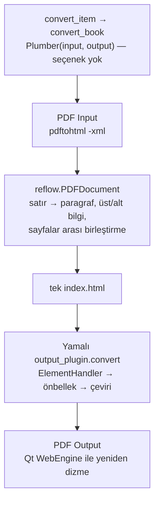
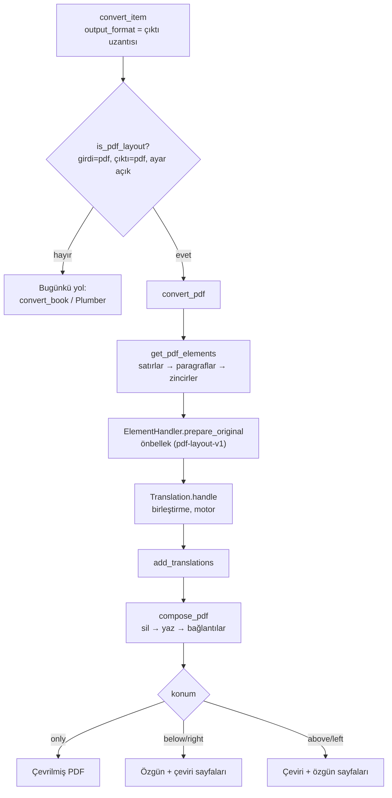

# PDF Çevirisi: Sayfa Düzenini Koruyan Tasarım ve Kodlama Kılavuzu

Bu doküman, PDF dosyalarının sayfa düzeni korunarak çevrilmesi için önerilen yeni yolu anlatır. Bu yolda çeviri, Calibre'nin dönüştürücüsü yerine metnin PDF'teki yerine yazılır. Önerilen kod repoya dokunulmadan ayrı bir kopyada yazıldı, test edildi ve gerçek PDF'lerle doğrulandı (§8). Aşağıdaki kod blokları ve farklar (diff), bu test edilmiş kopyadan bir betikle doğrudan alındı; elle kopyalanmadı.

> İlgili genel mimari için bkz. [`ARCHITECTURE.md`](ARCHITECTURE.md). Paragraf birleştirme ve uzunluk seçimi için bkz. [`SRT_ANALYSIS.md`](SRT_ANALYSIS.md) ve [`GOOGLE_FREE_NEW.md`](GOOGLE_FREE_NEW.md).

## İçindekiler

1. [Özet](#1-özet)
2. [Kapsam ve yöntem](#2-kapsam-ve-yöntem)
3. [Bugünkü PDF akışı ve sorunları](#3-bugünkü-pdf-akışı-ve-sorunları)
4. [Seçenekler ve karar](#4-seçenekler-ve-karar)
5. [Çözüm mimarisi](#5-çözüm-mimarisi)
6. [Uygulama yönergeleri (dosya dosya)](#6-uygulama-yönergeleri-dosya-dosya)
7. [Testler](#7-testler)
8. [Doğrulama sonuçları](#8-doğrulama-sonuçları)
9. [PyMuPDF bulguları ve tuzaklar](#9-pymupdf-bulguları-ve-tuzaklar)
10. [Bağımlılık, kurulum ve lisans](#10-bağımlılık-kurulum-ve-lisans)
11. [Kabul kriterleri](#11-kabul-kriterleri)
12. [Sınırlamalar ve isteğe bağlı iyileştirmeler](#12-sınırlamalar-ve-isteğe-bağlı-iyileştirmeler)
13. [Uygulama sırası (kontrol listesi)](#13-uygulama-sırası-kontrol-listesi)

---

## 1. Özet

- **Sorun.** Eklenti bugün PDF'i Calibre'nin dönüştürme hattından (`Plumber`) geçiriyor. PDF önce tek bir HTML dosyasına dönüşüyor, çeviri bu HTML'e yazılıyor ve çıktı sıfırdan yeniden diziliyor. Sonuçta sayfa boyutu (her zaman Letter), sayfa sayısı, sütunlar, görseller ve yazı tipleri orijinalden tamamen farklı oluyor. İki sütunlu sayfalarda satırlar karışıyor, sayfa sınırındaki paragraflar ikiye bölünüyor (§3).
- **Çözüm.** Girdi ve çıktı formatı PDF olduğunda ve kullanıcı ayarı açtığında, PDF Calibre'ye hiç verilmiyor. Yeni `lib/pdf.py` modülü PyMuPDF kütüphanesiyle her sayfadaki metni paragraflara ayırıyor ve bunları eklentinin normal çeviri hattına (önbellek, birleştirme, motorlar) veriyor. Ardından özgün metni sayfadan siliyor ve çeviriyi aynı alana, benzer font, boyut, renk ve hizalamayla yazıyor. Görseller, çizimler, bağlantılar, sayfa boyutu ve sayfa sayısı değişmiyor.
- **Bağımlılık.** PyMuPDF yaklaşık 60 MB ve Calibre'de yok, bu yüzden eklentiye gömülmüyor. Kullanıcı ayarların Genel sekmesindeki **Install** düğmesiyle PyPI'dan indiriyor. İndirilen dosyanın SHA-256 özeti doğrulanıyor ve dosya eklentinin yapılandırma klasörüne açılıyor (§10).
- **Paragraf çıkarma kuralları gerçek PDF'lere göre ayarlandı:**
  - satır sonu tirelerinin birleştirilmesi;
  - roman tipi girintili paragraflar;
  - sütun ve sayfa değiştiren paragrafların zincirlenmesi;
  - çizilmiş madde işaretleri;
  - çizgili tablo hücreleri;
  - üst simgeler;
  - MuPDF'in kopardığı bloklar.
- **Sığdırma.** Çeviri önce özgün alana, sonra alttaki boş alana tam boyutta yazılmaya çalışılıyor. Sığmazsa font kademeli olarak (0,9, 0,8, 0,7) küçültülüyor.
- **Doğrulama.**
  - Repodaki 318 testin hepsi geçiyor. 85 yeni testle toplam 403 test başarılı; PyMuPDF yokken 13 PDF testi atlanıyor.
  - Üç gerçek PDF (Calibre ile üretilmiş deneme kitabı, roman, arXiv makalesi) Google(Free)New ile 3000 karakter birleştirmeyle çevrildi. Sayfa sayısı ve boyutu korundu. Paragraf parçalarının %85–96'sı tam font boyutunda yazıldı. Çevrilmeden kalan kelimeler yalnızca özel adlar, e-postalar ve teknik terimler (§8.3).

---

## 2. Kapsam ve yöntem

- **İncelenen kod:** `lib/conversion.py`, `lib/element.py`, `lib/cache.py`, `advanced.py`, `setting.py`, `components/format.py` ve Calibre 9.9'un PDF girdi/çıktı kodu (`pdf_input.py`, `reflow.py`, `pdf_output.py`).
- **Deney ortamı.** Deneyler, Calibre'nin kendi Python ortamında (`calibre-debug -e`) yapıldı; eklenti modülleri doğrudan yüklendi. `CALIBRE_CONFIG_DIRECTORY` geçici bir klasöre yönlendirildi. PyMuPDF bu klasöre eklentinin kendi indiricisiyle kuruldu. Kullanıcının Calibre kurulumuna ve ayarlarına dokunulmadı.
- **Geliştirme ve kaynak.** Kod repo dışındaki bir kopyada geliştirildi. Bu dokümandaki bütün kod o kopyadan bir betikle alındı. Betik, repo ile kopya arasında fark olan her dosyanın dokümanda yer aldığını da denetliyor.
- **Canlı denemeler.** `convert_item()` çağrıldı; gerçek akış yeniden üretildi (önbellek, birleştirme, Google(Free)New, `compose_pdf`). Önbellek geçici bir klasöre yönlendirildi.

Test çalıştırma komutu (PowerShell):

```powershell
$env:CALIBRE_CONFIG_DIRECTORY = "$env:TEMP\pdf_layout_verify\calibre_config"
$env:CALIBRE_OVERRIDE_LANG = 'en'
$env:QT_QPA_PLATFORM = 'offscreen'
$env:PYTHONIOENCODING = 'utf-8'
$env:PLUGIN_REPO = '<repo dizini>'
& "<Calibre dizini>\calibre-debug.exe" -e "<run_tests.py>"
```

`run_tests.py`, `PLUGIN_REPO` dizinini `calibre_plugins.ebook_translator` paketi olarak kaydeder ve `tests/**/test_*.py` dosyalarını `unittest` ile çalıştırır. `CALIBRE_CONFIG_DIRECTORY` altında PyMuPDF kurulu değilse PDF'i gerçekten açan 13 test atlanır.

> **Önbellek uyarısı.** `custom_cache_path()` (`lib/cache.py`), ayarlardaki önbellek klasörü yoksa sessizce varsayılan (gerçek) önbelleğe döner. Canlı deneme betikleri önbellek klasörünü önceden oluşturmalı ve önbellek yolunu açık bir koşulla denetlemelidir. `assert` yeterli değildir; Calibre'nin Python'u `assert` ifadelerini atlıyor.

---

## 3. Bugünkü PDF akışı ve sorunları

Eklentide PDF'e özel bir yol yok. PDF, EPUB ile aynı genel yoldan geçiyor:



**1. Ayarlar aktarılmıyor (`convert_book`, `lib/conversion.py`).** `Plumber(input_path, output_path, log=..., report_progress=...)` hiçbir dönüştürme seçeneği almıyor. Kullanıcının Calibre'de kaydettiği PDF ayarları uygulanmıyor; her zaman Calibre'nin varsayılanları kullanılıyor:
- **Girdi:** `unwrap_factor=0.45`, otomatik üst/alt bilgi algılama.
- **Çıktı:** Letter kâğıt boyutu, 72 pt kenar boşlukları, Times font.

**2. Paragraflar Calibre'nin buluşsal kurallarından geliyor (`reflow.py`).**
- İki satır yalnızca sol kenarları aynıysa ve ilk satır sayfa genişliğinin %45'inden uzunsa aynı paragraf sayılıyor.
- Sütun algılama kodu var, ama `render()` onu kullanan `linearize()` çağrısını yorum satırına almış. Pratikte sütun desteği yok.
- Sayfa sınırındaki paragraflar yalnızca sayfanın son öğesi alta yakınsa birleşiyor. Sayfa numarası silinmediyse bu koşul tutmuyor.

**3. Çıktı yeniden diziliyor (`pdf_output.py`).** Çevrilmiş kitap HTML olarak Qt WebEngine ile yeniden sayfalanıyor. Sayfa düzeni, görsellerin konumu ve fontlar kayboluyor.

**Deney (mevcut kod, 7 sayfalık A5 deneme PDF'i).** Deneme PDF'inde üst bilgi, iki sütunlu bölüm, liste, tablo ve dipnot vardı:

| Durum | Sonuç |
|---|---|
| Sayfa boyutu ve sayısı | A5 → Letter; 7 sayfa → 10 sayfa (çeviri altta) |
| İki sütun | Her görsel satır iki sütunun parçalarını birleştirdi; çeviriye anlamsız parçalar gitti |
| Sayfadan taşan paragraf | İki ayrı paragraf olarak çevrildi; araya yetim bir sayfa numarası düştü |
| İki satırlık başlık | İki ayrı başlık |
| Tablo, liste | Her satır ayrı paragraf; tablo yapısı kayboldu |

Bu sorunlar eklentinin değil, PDF→HTML→PDF yolunun doğasından geliyor. PDF'te paragraf, sütun ve akış bilgisi yok, yalnızca konumlandırılmış glifler var. Yeniden dizme de her zaman özgün düzeni kaybettiriyor.

---

## 4. Seçenekler ve karar

| Seçenek | Düzen korunur mu? | Maliyet | Değerlendirme |
|---|---|---|---|
| Calibre'nin PDF ayarlarını `Plumber`'a aktarmak | Hayır | Düşük | Paragraf çıkarmayı biraz iyileştirir; yeniden dizme sorunu kalır |
| PDF→EPUB, sonra EPUB çevirisi | Hayır | Kullanıcıya iş | Bugün de yapılabiliyor; düzen yine kayboluyor |
| BabelDOC / PDFMathTranslate | Evet | Çok yüksek | Ayrı bir Python ortamı, düzen algılama modeli ve çok sayıda bağımlılık gerekiyor; Calibre'nin donmuş Python'una kurulamaz. Kendi çeviri katmanı olduğu için eklentinin önbelleğini ve motorlarını kullanmaz |
| **PyMuPDF ile yerinde çeviri** | **Evet** | **Orta** | Tek tekerlek (wheel) dosyası, saf Python + tek bir yerel kitaplık; Python ≥ 3.11 için hazır derlenmiş. Metin çıkarma, silme (redaction) ve HTML kutusuna yazma API'leri var |

**Karar: PyMuPDF.** Gerekçeler:
- Eklentinin bütün çeviri altyapısı (önbellek, birleştirme, motorlar, gelişmiş mod tablosu, yeniden çeviri) değişmeden kullanılıyor. PDF, SRT ve PGN gibi "ek format" yoluna yeni bir çıkarıcı ve yazıcı çiftiyle bağlanıyor.
- Çıktı özgün PDF'in kendisi. Yalnızca metin katmanı değişiyor; görseller, vektör çizimler, bağlantılar, yer imleri ve sayfa geometrisi aynı kalıyor.
- Bağımlılık isteğe bağlı. Özelliği kullanmayanlar hiçbir şey indirmiyor; eski yol (Calibre dönüştürücüsü) varsayılan olarak kalıyor.

---

## 5. Çözüm mimarisi

### 5.1 İlkeler

1. **İsteğe bağlı ve geri dönüşlü.** Yeni yol yalnızca `pdf_layout.enabled` açıkken ve hem girdi hem çıktı PDF iken devreye giriyor. Diğer bütün durumlar bugünkü kodla aynı.
2. **Bir paragraf, bir çeviri birimi.** Sütun ya da sayfa değiştiren paragraf tek birim olarak çevriliyor, çeviri parçalara orantılı bölünüyor.
3. **Önce tam boyut.** Font yalnızca çeviri ne özgün alana ne de alttaki boş alana sığmıyorsa küçültülüyor. Küçültme sabit basamaklarla yapılıyor; böylece komşu paragraflar aynı boyutta kalıyor.
4. **Belirsizlikte dokunma.** Döndürülmüş metin, rakam ve noktalamadan oluşan paragraflar (sayfa numaraları) ve çevirisi boş gelen paragraflar olduğu gibi kalıyor.
5. **Sezgi değil kanıt.** Tablo hücresi ve liste maddesi gibi ayrımlar boşluk genişliğine göre değil, sayfadaki çizimlere (dikey çizgi, madde işareti) ya da metnin kendisine (`•`, `1.`, `a)`) göre yapılıyor (§8.5'teki gerileme bunun nedenini gösteriyor).

### 5.2 Akış



### 5.3 Yönlendirme

- **`is_pdf_layout(input_format, output_format)`.** Kararın tek noktası. Şunlar tarafından kullanılıyor:
  - `convert_item` (çevirmen seçimi ve önbellek kimliği);
  - `extract_item` (gelişmiş moddaki ön çıkarma);
  - `PreparationWorker` (gelişmiş mod önbellek kimliği);
  - gelişmiş mod penceresi (çıktı formatı kilidi).
- **Çıktı formatı `convert_item`'da çıktı yolunun uzantısından okunuyor.** Böylece `ConversionWorker` ve toplu çeviri (`batch.py`) değişmeden çalışıyor.
- **Gelişmiş mod.** Çıkarılan paragraflar çıktı formatına bağlı olduğu için (PDF→PDF yerinde, PDF→EPUB Calibre ile), bu modda format kilitleniyor. Kullanıcının tablodaki paragraflarla farklı bir çıkarma yolunu karıştırması engelleniyor.

### 5.4 Satırlar: çizimlerden gelen ipuçları

PyMuPDF'in `page.get_text('dict')` çıktısında her blok satırlardan, her satır da aynı stildeki metin parçalarından (span) oluşuyor. Satırlar şu adımlardan geçiyor:

1. **`get_rules(page.get_drawings())`** iki liste döndürüyor:
   - **ince çizgiler:** kalınlığı ≤ 2 pt, uzunluğu ≥ 8 pt olan `l`/`re` öğeleri, örneğin tablo kenarları;
   - **küçük şekiller:** iki kenarı 1–8 pt arasında olan çizimler, örneğin çizilmiş madde işaretleri.

   Bir çizim bütün tablo çizgilerini tek başına taşıyabildiği için çizimin içindeki öğelere tek tek bakılıyor.
2. **`mark_lines(...)`** çizimlerden çıkan bilgiyi satırlara işliyor:
   - **Çizgi satırı kesiyorsa:** MuPDF bazen yan yana iki tablo hücresini tek satırda birleştiriyor ("Billy Bones Captain"). Satır, dikey çizgilerin konumlarından kesilip ince bir bantla (`clip`) yeniden okunuyor. Bant, komşu satırların karakterlerini dışarıda tutmak için satır ortasından geçiyor.
   - **Bir satırla öncekinin arasında dikey çizgi varsa:** satır `cell` olarak işaretleniyor.
   - **Satırın hemen solunda, aynı yükseklikte küçük bir şekil varsa:** satır `item` (liste maddesi) olarak işaretleniyor.
3. **`get_lines(block)`** her satır için şunları üretiyor:
   - metin, span listesi, kutu;
   - taban çizgisi: satırdaki en büyük puntolu span'den alınıyor; yükseltilmiş dipnot işaretleri satırı yukarı kaydırmasın diye;
   - `item` bayrağı: `•`, `-`, `*`, `1.`, `(a)` gibi başlangıçlarda da kaldırılıyor.

   Taban çizgisi aynı olan ardışık parçalar tek satırda birleştiriliyor. Qt ile dizilmiş iki yana yaslı dar sütunlarda MuPDF geniş kelime aralıklarında satırı bölüyor. `cell` işaretli parçalar birleştirilmiyor.

### 5.5 Paragraflara bölme (`split_block`)

MuPDF, aralarında boşluk olmayan paragrafları (çoğu romanda olduğu gibi) tek bloğa koyuyor. Blok şu durumlarda yeni bir paragrafla başlıyor:

| Kural | Neden |
|---|---|
| Satırlardan ikisi aynı taban çizgisindeyse her satır ayrı paragraf | Yan yana duran tablo hücreleri |
| `item` işaretli satır | Liste maddesi |
| Font boyutu 0,5 pt'den fazla değişiyor ya da kalınlık değişiyor | Başlık, ara başlık |
| Satır aralığı, bloğun ortanca satır aralığının 1,25 katından büyük | Paragraf arası boşluk |
| İlk satır girintisi kipi ve satır girintili | Roman tipi paragraflar. Bu kip girintili satırlar azınlıktaysa açılır; blok ortalıysa ya da liste maddesi içeriyorsa açılmaz |
| Asılı girinti kipi ve satır girintisiz | Asılı girintili listeler |
| Önceki satır kısa (genişliğin %75'inden az) ve cümle sonu işaretiyle bitiyor | Paragraf sonu |

`make_paragraph` her paragraf için şunları hesaplıyor:
- **Stil:** Karakter sayısına göre en yaygın font, boyut, renk, kalınlık ve italiklik.
- **Satır yüksekliği:** Ortanca taban çizgisi adımı ÷ boyut, 1 ile 2 arasında sınırlı.
- **Hizalama:** Satır merkezleri çeyrek em içinde aynıysa ortalı. Son satır hariç bütün satırlar sağ kenara 1 pt yakınsa iki yana yaslı. Diğer durumlarda sola yaslı.
- **İlk satır girintisi.**

### 5.6 Kopmuş bloklar ve zincirleme

- **Kopmuş blok (`is_broken_off`).** Bir bloğun ilk paragrafı aynı sütunda, önceki paragrafın yarım satırdan az altında başlayabilir ve aralarında çizgi olmayabilir. Metin ölçütleri de tutuyorsa (önceki paragraf cümle sonuyla bitmiyor, yeni paragraf küçük harfle başlıyor, stiller aynı, girinti yok) satırlar önceki paragrafa ekleniyor. arXiv makalesinin ortalanmış izin metninin son satırı ve dipnotun devamı böyle bağlandı.
- **Zincirleme (`chain_paragraphs`).** Bir paragraf başka bir sütunda (sayfada daha yukarıda) ya da sonraki bir sayfada devam ediyorsa ikisi tek `PdfElement` oluyor. Aynı metin ölçütleri burada da geçerli.
  - Aradaki çeviri dışı öğeler (sayfa numarası) ve en fazla iki farklı stildeki paragraf (üst bilgi, dipnot) atlanıyor.
  - Aynı stilde başka bir paragrafa rastlanınca arama duruyor.

### 5.7 Çerçeveler (`set_frames`)

Çeviri özgünden uzun olabiliyor. Bu yüzden her paragrafa özgün alanından büyük bir "çerçeve" veriliyor:
- **Aşağı doğru:** Alttaki ilk metin kutusuna, çizgiye ya da görsele kadar, çeyrek em pay bırakılarak. Altında hiçbir şey yoksa sınır, dosyanın bütün sayfalarındaki en alçak metin satırının hizası; sayfa numaraları bu hizada olduğu için alt kenar boşluğu korunuyor. Çerçeve hiçbir zaman özgün alandan küçük olmuyor.
- **Tek satırlı paragraflarda sağa doğru:** Sütunun sağ kenarına ya da aynı satırdaki ilk kutuya kadar (başlıklar, tablo hücreleri).
- **Ortalanmış tek satırlar:** Sütunun ortasındaysa her iki yana simetrik büyüyor ve ortalı yazılıyor.

### 5.8 Yazma (`compose_pdf`, `write_part`)

1. **Bölme.** Her çeviri, paragrafın parçalarına özgün uzunluklarıyla orantılı olarak en yakın boşluktan bölünüyor (`split_translation`).
2. **Silme.** Her sayfada çevrilecek satırların kutularına silme (redaction) işaretleri konuyor ve `apply_redactions` yalnızca metni siliyor. Görsellere ve çizimlere dokunulmuyor.
3. **Bağlantılar.** Metinle çakışan bağlantılar silmeyle birlikte gidiyor; `restore_links` bunları yeniden ekliyor.
4. **Sığdırma sırası.** Denemeler sırasıyla şunlar:
   - özgün alan, tam boyut;
   - çerçeve, tam boyut;
   - çerçeve, 0,9, 0,8, 0,7 ölçek;
   - son çare olarak 0,6–0,3 ölçek.

   Hiçbiri sığmazsa günlüğe uyarı yazılıyor ve MuPDF'in kendi küçültmesi kullanılıyor. Sığma denetimi `fits()` ile yapılıyor; MuPDF'in kendi raporu tek başına güvenilir değil (§9).
5. **Satır kutusu düzeltmesi.** Özgün satır kutusu yalnızca glif yüksekliği kadar. CSS ise satır aralığının yarısını satırın üstüne, yarısını altına koyuyor. Bu yüzden hedef kutu üstten ve alttan bu fark kadar büyütülüyor. Düzeltme olmadan aynı satır sayısındaki çeviriler bile 0,9 ölçeğe düşüyordu; düzeltmeyle deneme kitabında tam boyutta yazılan parça sayısı 23'ten 28'e çıktı (toplam 33).
6. **Font.** Font ailesi özgün fonttan tahmin ediliyor: serif, sans-serif ya da monospace. Bunlar MuPDF'in gömülü Times, Helvetica ve Courier fontlarına eşleniyor. Kullanıcı bunun yerine tek bir TTF/OTF dosyası seçebilir (§5.12). MuPDF, seçilen fontta olmayan karakterler için kendi Noto fontlarına geçiyor.
7. **Renk ve yön.** `translation_color` ayarı uygulanıyor. Sağdan sola yazılan hedef dillerde `dir="rtl"` ekleniyor.
8. **Kaydetme.** Her metin kutusu kendi font kopyasını gömdüğü için kaydetmeden önce `subset_fonts()` çalışıyor; dosya `garbage=4, deflate=True` ile yazılıyor.

### 5.9 Çeviri konumu ve iki dilli çıktı

| `translation_position` | Çıktı |
|---|---|
| `only` | Yalnızca çevrilmiş sayfalar; sayfa sayısı aynı |
| `below`, `right` | Her özgün sayfanın ardından çevirisi |
| `above`, `left` | Her çeviri sayfasının ardından özgünü |

İki dilli çıktıda yer imleri yeni sayfa numaralarına taşınıyor ve metadata kopyalanıyor. `left`/`right` için yan yana (iki sayfalık yayılım) düzen henüz yok (§12).

### 5.10 Önbellek kimliği

PDF→PDF yerinde çevirinin paragrafları, Calibre yolunun paragraflarından farklı. Bu yüzden `get_cache_id` bu kipte kimliğe `PDF_CACHE_VERSION` (`pdf-layout-v1`) ekliyor. Böylece:
- iki yol birbirinin önbelleğini kullanmıyor;
- paragraf çıkarma kuralları ileride değişirse sürüm artırılarak eski önbellekler devre dışı bırakılabiliyor.

Geliştirme sırasında bunun neden gerekli olduğu görüldü. Kurallar değiştikten sonra aynı kimlikle çalışan önbellekteki yeni metinli paragraflar çevrilmeden kaldı (§8.5).

### 5.11 Veri biçimi

`get_pdf_elements` her paragraf için bir sözlük üretiyor. `PdfElement.element` bu sözlüklerin listesini tutuyor; listede birden fazla sözlük olması, paragrafın başka bir sütunda ya da sayfada devam ettiği anlamına geliyor.

```python
{
    'page': 0,                        # sayfa numarası (0 tabanlı)
    'rect': [x0, y0, x1, y1],         # özgün metnin kutusu
    'frame': [x0, y0, x1, y1],        # çevirinin büyüyebileceği alan
    'lines': [[x0, y0, x1, y1], ...], # silinecek satır kutuları
    'text': 'Squire Trelawney, ...',  # tireleri birleştirilmiş metin
    'style': {
        'size': 8.2, 'family': 'serif', 'bold': False, 'italic': False,
        'color': '#000000', 'line_height': 1.1, 'align': 'justify',
        'indent': 12.4},
    'item': False,                    # liste maddesi mi
    'ignored': False,                 # çeviri dışı mı (sayfa numarası vb.)
}
```

### 5.12 Yazı tipi seçimi

Genel sekmesindeki **Keep PDF Layout (Beta)** grubunda, onay kutusunun altında bir **Font** satırı vardır. Alan boşken yer tutucu metin "Built-in fonts"tır ve §5.8'deki Times, Helvetica ve Courier eşlemesi kullanılır.

- **Choose**, `*.ttf` ve `*.otf` süzgeciyle bir dosya seçtirir. Yol `pdf_layout.font_path` anahtarına yazılır.
- **Clear** yolu siler ve gömülü fontlara döner.
- Diğer ayarlar gibi bu değer bellekte güncellenir; sekmenin **Save** düğmesiyle `ebook_translator.json` dosyasına kaydedilir.

Seçilen font çevirideki bütün metne uygulanır. Serif, sans-serif ve monospace ayrımı kalkar; punto, kalınlık, italik, renk ve hizalama paragraftan gelmeye devam eder. Dosya yoksa ya da okunamazsa uyarı yazılır, `get_font()` `None` döner ve gömülü fontlar kullanılır; çeviri hata vermez.

Aynı seçim komut satırından da verilir. `convert_item(..., font_path=...)` parametresi kayıtlı `font_path` değerinin önüne geçer ve ayar kapalı olsa bile bu çağrıda PDF'i yerinde çevirir. Parametre `notification`'dan sonra ve varsayılanlıdır; Calibre'nin iş kuyruğu onu vermez, kayıtlı ayar kullanılmaya devam eder. Ayar dosyasına yazılmaz, bu yüzden çalıştırma bitince GUI'deki seçim durur. Ayrıntı: §10.

Denemede deneme kitabı Arial ile çevrildi (§8.3). Arial, Times'tan geniş olduğu için tam puntoda kalan parça sayısı 28'den 23'e düştü; sayfa düzeni bozulmadı.

---

## 6. Uygulama yönergeleri (dosya dosya)

| Dosya | Değişiklik |
|---|---|
| `lib/pdf.py` | Yeni: çıkarma, zincirleme, yazma, PyMuPDF kurulumu |
| `lib/cache.py` | `get_cache_id` çıktı formatını alıyor ve yerinde PDF için sürüm ekliyor |
| `lib/config.py` | `pdf_layout` varsayılanları |
| `lib/conversion.py` | `convert_pdf`; `extract_item` ve `convert_item` yönlendirmesi |
| `advanced.py` | Çıktı formatının önbellek kimliğine ve çıkarmaya aktarılması; format kilidi |
| `setting.py` | Genel sekmesinde "Keep PDF Layout (Beta)" grubu ve kurulum işçisi |
| `tests/lib/test_config.py` | Yeni varsayılanlar |
| `tests/lib/test_pdf.py` | Yeni: 85 test |

### 6.1 `lib/pdf.py` (yeni dosya)

Modül dört bölümden oluşuyor:
1. **PyMuPDF'in yüklenmesi ve kurulması:** `load_pymupdf`, `find_wheel`, `install_pymupdf`.
2. **Metin çıkarma:** `get_rules`, `mark_lines`, `get_lines`, `split_block`, `make_paragraph`, `get_page_paragraphs`, `set_frames`, `chain_paragraphs`, `get_pdf_elements`.
3. **Eklentinin öğe modeline uyum:** `PdfElement`.
4. **Yazma:** `fits`, `write_part`, `restore_links`, `interleave_pages`, `compose_pdf`.

Metin çıkarma bölümündeki işlevler saf Python sözlükleri üzerinde çalışıyor; PyMuPDF gerektirmiyor ve birim testleriyle doğrudan sınanıyor.

```python
"""Translate PDF files in place, so that the result keeps the original layout.

The text of every paragraph is erased from its page and the translation is
written into the same area; images, drawings, page size and page count stay
as they are. PyMuPDF does the work. It is too large to bundle with the plugin,
so it is installed into the plugin's config directory on demand.
"""
import io
import os
import re
import sys
import json
import html
import shutil
import hashlib
import zipfile
import platform
from collections import Counter
from statistics import median

from calibre.utils.config_base import plugin_dir  # type: ignore
from calibre.utils.localization import _  # type: ignore

from .. import EbookTranslator
from .utils import log, request, socks_proxy
from .config import get_config
from .element import Element, Extraction


load_translations()  # type: ignore


PDF_CACHE_VERSION = 'pdf-layout-v1'
PYMUPDF_VERSION = '2.1'
PYMUPDF_RELEASE = 'https://pypi.org/pypi/PyMuPDF/%s/json' % PYMUPDF_VERSION

# The platform part of the wheel names that PyMuPDF publishes.
WHEEL_PLATFORMS = {
    ('windows', 'amd64'): ('win', 'amd64'),
    ('darwin', 'arm64'): ('macosx', 'arm64'),
    ('darwin', 'x86_64'): ('macosx', 'x86_64'),
    ('linux', 'x86_64'): ('manylinux', 'x86_64'),
    ('linux', 'aarch64'): ('manylinux', 'aarch64'),
}

SENTENCE_END = re.compile(r'[.!?…:;。！？：；)\]"”’»]$')
# Dashes are left out: a line may start with a dash in the middle of text.
LIST_ITEM = re.compile(r'([•◦▪●○■□‣⁃*-]|\(?\d{1,3}[.)]|\(?[a-z][.)])\s')
CJK = re.compile(r'[\u3000-\u9fff\uac00-\ud7af\uff00-\uffef]')
MONO_FONTS = re.compile(r'mono|courier|consol|menlo|code', re.I)
SANS_FONTS = re.compile(
    r'sans|arial|helvetica|calibri|verdana|tahoma|segoe|gothic|futura|'
    r'myriad|roboto|lato|inter', re.I)
SERIF_FONTS = re.compile(
    r'serif|times|roman|georgia|garamond|minion|palatino|cambria|'
    r'baskerville|caslon|book|cmr|lmroman|nimbusrom', re.I)
BOLD_FONTS = re.compile(r'bold|black|heavy|semibold|demi', re.I)
ITALIC_FONTS = re.compile(r'italic|oblique', re.I)

# MuPDF's own fonts for the generic families. Its default serif font is
# wider than Times, which most PDFs use.
BUILTIN_FONTS = {
    'serif': 'Times',
    'sans-serif': 'Helvetica',
    'monospace': 'Courier',
}

FLAG_ITALIC = 2
FLAG_SERIF = 4
FLAG_MONO = 8
FLAG_BOLD = 16

# Smaller fonts are tried in steps so that neighbouring paragraphs end up
# with the same size instead of slightly different ones. The fallback steps
# are used only when the preferred ones do not fit.
FONT_SCALES = (1.0, 0.9, 0.8, 0.7)
FALLBACK_SCALES = (0.6, 0.5, 0.4, 0.3)


def get_library_dir():
    return os.path.join(plugin_dir, EbookTranslator.identifier, 'pymupdf')


def load_pymupdf():
    """Return the PyMuPDF module, or None when it is not installed."""
    library_dir = get_library_dir()
    if not os.path.isdir(library_dir):
        return None
    if library_dir not in sys.path:
        sys.path.insert(0, library_dir)
    try:
        import pymupdf  # type: ignore
    except Exception as e:  # ImportError, or OSError from a broken binary.
        log.debug('PyMuPDF is unavailable: %s' % e)
        return None
    # A folder named pymupdf elsewhere in the path imports as an empty
    # namespace package.
    return pymupdf if hasattr(pymupdf, 'Document') else None


def get_installed_version():
    """Return the version of the installed PyMuPDF without loading it."""
    library_dir = get_library_dir()
    if os.path.isdir(library_dir):
        for name in os.listdir(library_dir):
            match = re.match(r'pymupdf-(.+)\.dist-info$', name, re.I)
            if match:
                return match.group(1)
    return None


def require_pymupdf():
    pymupdf = load_pymupdf()
    if pymupdf is None:
        raise Exception(_(
            'PyMuPDF is required to keep the layout of PDF files. Please '
            'install it in the General tab of the plugin settings.'))
    return pymupdf


def is_pdf_layout(input_format, output_format):
    """Whether a PDF is translated in place instead of being converted."""
    return input_format == 'pdf' and output_format == 'pdf' \
        and bool(get_config().get('pdf_layout.enabled'))


# uname and platform.machine() do not use one name per architecture.
MACHINE_ALIASES = {
    ('linux', 'amd64'): 'x86_64',
    ('linux', 'x64'): 'x86_64',
    ('linux', 'arm64'): 'aarch64',
    ('windows', 'x86_64'): 'amd64',
    ('darwin', 'aarch64'): 'arm64',
}


def find_wheel(files, system=None, machine=None, version=None):
    """Return the wheel of a PyPI release that this calibre can load."""
    system = (system or platform.system()).lower()
    machine = (machine or platform.machine()).lower()
    machine = MACHINE_ALIASES.get((system, machine), machine)
    version = tuple(version or sys.version_info[:2])
    target = WHEEL_PLATFORMS.get((system, machine))
    if target is None:
        return None
    prefix, arch = target
    for file in files:
        name = file['filename']
        if not name.endswith('.whl'):
            continue
        python_tag, abi_tag, platform_tag = name[:-4].split('-')[-3:]
        if not (platform_tag.startswith(prefix)
                and platform_tag.endswith(arch)):
            continue
        required = (int(python_tag[2]), int(python_tag[3:]))
        if version == required or (abi_tag == 'abi3' and version > required):
            return file
    return None


def get_proxy():
    """Return the type, host and port of the plugin's proxy, if enabled."""
    config = get_config()
    if not config.get('proxy_enabled'):
        return None
    proxy_type = config.get('proxy_type') or 'http'
    setting = config.get('proxy_setting') or {}
    # Compatible with old proxy settings stored as a list.
    if isinstance(setting, list):
        setting = {'http': setting}
    host, port = setting.get(proxy_type) or ['', '']
    if not host or not port:
        return None
    return proxy_type, host, port


def fetch(url, progress=None):
    """Download a URL through the plugin's network proxy, if any."""
    proxy = get_proxy()
    if proxy is not None and proxy[0] == 'socks5':
        with socks_proxy(proxy[1], int(proxy[2])):
            return _fetch(url, None, progress)
    proxy_uri = None
    if proxy is not None:
        proxy_uri = '%s:%s' % proxy[1:]
        if not proxy_uri.startswith('http'):
            proxy_uri = 'http://' + proxy_uri
    return _fetch(url, proxy_uri, progress)


def _fetch(url, proxy_uri, progress):
    response = request(url, timeout=60, proxy_uri=proxy_uri, raw_object=True)
    total = int(response.info().get('Content-Length') or 0)
    data = bytearray()
    while True:
        chunk = response.read(1024 * 1024)
        if not chunk:
            break
        data.extend(chunk)
        if progress is not None:
            progress(len(data), total)
    return bytes(data)


def install_pymupdf(progress=None, wheel_path=None):
    """Install PyMuPDF from PyPI, or from a given wheel file. A wheel is a
    zip archive, so unpacking it is all that pip would do here.
    """
    if 'pymupdf' in sys.modules:
        raise Exception(_(
            'PyMuPDF is in use. Please restart calibre and try again.'))
    if wheel_path is None:
        release = json.loads(fetch(PYMUPDF_RELEASE))
        wheel = find_wheel(release['urls'])
        if wheel is None:
            raise Exception(_(
                'PyMuPDF {} is not available for this system ({} {}, '
                'Python {}).').format(
                    PYMUPDF_VERSION, platform.system(), platform.machine(),
                    platform.python_version()))
        data = fetch(wheel['url'], progress)
        if hashlib.sha256(data).hexdigest() != wheel['digests']['sha256']:
            raise Exception(_(
                'The downloaded file is damaged. Please try again.'))
        archive = zipfile.ZipFile(io.BytesIO(data))
    else:
        archive = zipfile.ZipFile(wheel_path)
    library_dir = get_library_dir()
    partial_dir = library_dir + '.partial'
    shutil.rmtree(partial_dir, ignore_errors=True)
    with archive:
        archive.extractall(partial_dir)
    shutil.rmtree(library_dir, ignore_errors=True)
    os.rename(partial_dir, library_dir)
    return library_dir


def join_text(head, tail):
    """Join two lines of a paragraph, undoing hyphenation at the line end."""
    if head == '' or tail == '':
        return head or tail
    if head.endswith('\xad'):
        return head[:-1] + tail
    if head.endswith('-') and len(head) > 1 and head[-2].isalpha():
        return head[:-1] + tail if tail[0].islower() else head + tail
    if CJK.match(head[-1]) and CJK.match(tail[0]):
        return head + tail
    return head + ' ' + tail


def get_rules(drawings):
    """Return the boxes of the thin lines among the drawings of a page, such
    as the borders of table cells, and of the small shapes, such as bullets.
    """
    rules, marks = [], []
    # One drawing may hold all the lines of a table, so look at its items.
    for drawing in drawings:
        x0, y0, x1, y1 = drawing['rect']
        if max(x1 - x0, y1 - y0) <= 8 and min(x1 - x0, y1 - y0) >= 1:
            marks.append([x0, y0, x1, y1])
            continue
        for item in drawing['items']:
            if item[0] == 'l':
                x0, x1 = sorted((item[1][0], item[2][0]))
                y0, y1 = sorted((item[1][1], item[2][1]))
            elif item[0] == 're':
                x0, y0, x1, y1 = item[1]
            else:
                continue
            if min(x1 - x0, y1 - y0) <= 2 and max(x1 - x0, y1 - y0) >= 8:
                rules.append([x0, y0, x1, y1])
    return rules, marks


def mark_lines(page, data, rules, marks, flags):
    """Prepare the lines of a page with what only the drawings tell: a line
    that crosses the border of table cells is cut, a line that is a table
    cell is marked as such, and so is a line after a drawn list bullet.
    """
    verticals = [
        ((x0 + x1) / 2, y0, y1) for x0, y0, x1, y1 in rules if x1 - x0 <= 2]

    def has_rule(left, right, middle):
        return any(left < x < right and top < middle < bottom
                   for x, top, bottom in verticals)

    for block in data['blocks']:
        if block.get('type') != 0:
            continue
        lines = []
        for line in block['lines']:
            x0, y0, x1, y1 = line['bbox']
            middle = (y0 + y1) / 2
            cuts = sorted(
                x for x, top, bottom in verticals
                if x0 + 1 < x < x1 - 1 and top < middle < bottom)
            if len(cuts) == 0:
                lines.append(line)
                continue
            # A thin band keeps the characters of other lines out.
            edges = [x0 - 1] + cuts + [x1 + 1]
            for left, right in zip(edges, edges[1:]):
                clipped = page.get_text(
                    'dict', clip=(left, middle - 1, right, middle + 1),
                    flags=flags)
                for clipped_block in clipped['blocks']:
                    for item in clipped_block.get('lines', []):
                        item['cell'] = True
                        lines.append(item)
        for previous, line in zip([None] + lines, lines):
            x0, y0, x1, y1 = line['bbox']
            middle = (y0 + y1) / 2
            if previous is not None and has_rule(
                    previous['bbox'][2] - 1, x0 + 1, middle):
                line['cell'] = True
            size = line['spans'][0]['size'] if line['spans'] else 0
            if any(mark[2] <= x0 + 1 and x0 - mark[2] < 2 * size
                   and mark[1] < middle < mark[3] for mark in marks):
                line['item'] = True
        block['lines'] = lines


def get_lines(block):
    """Return the visual lines of a text block, or None if it has rotated
    text. PyMuPDF may split a visual line where words are far apart.
    """
    lines = []
    for line in block['lines']:
        if tuple(line['dir']) != (1, 0):
            return None
        text = ''.join(span['text'] for span in line['spans']).strip()
        spans = [span for span in line['spans'] if span['text'].strip()]
        if text == '':
            continue
        item = {
            'bbox': list(line['bbox']), 'text': text, 'spans': spans,
            # Superscripts sit higher than the rest of the line.
            'baseline': max(spans, key=lambda span: span['size'])[
                'origin'][1],
            'item': bool(line.get('item')) or bool(LIST_ITEM.match(text))}
        previous = lines[-1] if len(lines) > 0 else None
        if previous is not None and not line.get('cell') \
                and abs(item['baseline'] - previous['baseline']) < 1 \
                and item['bbox'][0] >= previous['bbox'][2] - 1:
            previous['text'] += ' ' + text
            previous['spans'] += spans
            previous['bbox'][2] = max(previous['bbox'][2], item['bbox'][2])
            previous['bbox'][1] = min(previous['bbox'][1], item['bbox'][1])
            previous['bbox'][3] = max(previous['bbox'][3], item['bbox'][3])
            continue
        lines.append(item)
    return lines


def dominant(spans, key):
    """Return the value of a span property that most characters have."""
    counter = Counter()
    for span in spans:
        counter[key(span)] += len(span['text'].strip())
    return counter.most_common(1)[0][0]


def share(spans, test):
    total = sum(len(span['text'].strip()) for span in spans) or 1
    return sum(
        len(span['text'].strip()) for span in spans if test(span)) / total


def is_bold(spans):
    return share(spans, lambda span: bool(span['flags'] & FLAG_BOLD)
                 or bool(BOLD_FONTS.search(span['font']))) > 0.5


def get_family(font, flags):
    if MONO_FONTS.search(font) or flags & FLAG_MONO:
        return 'monospace'
    if SANS_FONTS.search(font):
        return 'sans-serif'
    if SERIF_FONTS.search(font) or flags & FLAG_SERIF:
        return 'serif'
    return 'sans-serif'


def get_style(spans):
    """Pick the style that most of the characters of a paragraph have."""
    font = dominant(spans, lambda span: span['font'])
    flags = dominant(spans, lambda span: span['flags'])
    return {
        'size': round(dominant(spans, lambda span: span['size']), 1),
        'family': get_family(font, flags),
        'bold': is_bold(spans),
        'italic': share(spans, lambda span: bool(span['flags'] & FLAG_ITALIC)
                        or bool(ITALIC_FONTS.search(span['font']))) > 0.5,
        'color': '#%06x' % dominant(spans, lambda span: span['color']),
    }


def line_size(line):
    return dominant(line['spans'], lambda span: span['size'])


def split_block(lines):
    """Split the lines of a block into paragraphs. PyMuPDF puts paragraphs
    that are not separated by space, as in most novels, into one block.
    """
    if len(lines) < 2:
        return [lines]
    # Lines still side by side are table cells, translated one by one.
    if any(abs(b['baseline'] - a['baseline']) < 1
           for a, b in zip(lines, lines[1:])):
        return [[line] for line in lines]
    sizes = [line_size(line) for line in lines]
    size = median(sizes)
    left = min(line['bbox'][0] for line in lines)
    right = max(line['bbox'][2] for line in lines)
    steps = [b['baseline'] - a['baseline'] for a, b in zip(lines, lines[1:])]
    step = median(steps)
    indented = [line['bbox'][0] - left > 0.8 * size for line in lines]
    # First-line indent: only a few lines start further right. Hanging
    # indent, as in lists: only a few lines start at the left edge.
    # Centered lines start anywhere.
    aligned = len(lines) > 2 and get_alignment(lines, size) != 'center'
    first_line_indent = aligned and sum(indented) * 2 < len(lines) \
        and not any(line['item'] for line in lines)
    hanging_indent = aligned and sum(indented) * 2 > len(lines) \
        and not indented[0]
    paragraphs = [[lines[0]]]
    for i in range(1, len(lines)):
        previous, line = lines[i - 1], lines[i]
        short = previous['bbox'][2] - left < 0.75 * (right - left)
        if line['item'] or abs(sizes[i] - sizes[i - 1]) > 0.5 \
                or is_bold(previous['spans']) != is_bold(line['spans']) \
                or steps[i - 1] > 1.25 * step \
                or (first_line_indent and indented[i]) \
                or (hanging_indent and not indented[i]) \
                or (short and SENTENCE_END.search(previous['text'])):
            paragraphs.append([line])
        else:
            paragraphs[-1].append(line)
    return paragraphs


def get_alignment(lines, size):
    left = min(line['bbox'][0] for line in lines)
    right = max(line['bbox'][2] for line in lines)
    if len(lines) < 2:
        return 'left'
    centers = [(line['bbox'][0] + line['bbox'][2]) / 2 for line in lines]
    widths = [line['bbox'][2] - line['bbox'][0] for line in lines]
    if max(centers) - min(centers) < 0.25 * size \
            and max(widths) - min(widths) > 2:
        return 'center'
    # The last line is full when the paragraph goes on in the next column.
    if all(abs(line['bbox'][2] - right) < 1 for line in lines[:-1]) \
            and (len(lines) > 2 or lines[-1]['bbox'][2] < right - size):
        return 'justify'
    return 'left'


def make_paragraph(page, lines):
    spans = [span for line in lines for span in line['spans']]
    style = get_style(spans)
    size = style['size']
    left = min(line['bbox'][0] for line in lines)
    text = ''
    for line in lines:
        text = join_text(text, line['text'])
    line_height = 1.2
    if len(lines) > 1:
        steps = [
            b['baseline'] - a['baseline'] for a, b in zip(lines, lines[1:])]
        line_height = min(max(median(steps) / size, 1.0), 2.0)
    indent = lines[0]['bbox'][0] - left
    style.update(
        line_height=round(line_height, 2), align=get_alignment(lines, size),
        indent=round(indent, 1) if len(lines) > 1 and indent > 0.8 * size
        else 0)
    rect = [
        left, min(line['bbox'][1] for line in lines),
        max(line['bbox'][2] for line in lines),
        max(line['bbox'][3] for line in lines)]
    return {
        'page': page, 'rect': rect, 'frame': list(rect),
        'lines': [line['bbox'] for line in lines], 'text': text,
        'style': style, 'item': lines[0]['item'], 'ignored': False}


def get_page_paragraphs(page, data, rules=()):
    groups, paragraphs = [], []
    for block in data['blocks']:
        if block.get('type') != 0:
            continue
        lines = get_lines(block)
        if not lines:
            continue
        for index, group in enumerate(split_block(lines)):
            paragraph = make_paragraph(page, group)
            if index == 0 and paragraphs \
                    and is_broken_off(paragraphs[-1], paragraph, rules):
                paragraphs.pop()
                group = groups.pop() + group
                paragraph = make_paragraph(page, group)
            groups.append(group)
            paragraphs.append(paragraph)
    return paragraphs


def overlaps(a, b, axis):
    """Whether two boxes overlap horizontally (axis 0) or vertically (1)."""
    return a[axis] < b[axis + 2] and a[axis + 2] > b[axis]


def is_broken_off(head, tail, rules):
    """Whether MuPDF broke a paragraph apart: the rest starts right below,
    in the same column, with no rule between.
    """
    a, b = head['rect'], tail['rect']
    if not can_continue(head, tail) or not overlaps(a, b, 0) \
            or not -1 < b[1] - a[3] < 0.5 * head['style']['size']:
        return False
    return not any(
        overlaps(rule, b, 0)
        and a[3] - 1 <= (rule[1] + rule[3]) / 2 <= b[1] + 1 for rule in rules)


def set_frames(paragraphs, obstacles, bottom):
    """Give every paragraph a frame: the free space that its translation may
    grow into, to the right for single lines and downwards for all.
    """
    boxes = [paragraph['rect'] for paragraph in paragraphs] + obstacles
    for paragraph in paragraphs:
        rect, style = paragraph['rect'], paragraph['style']
        others = [box for box in boxes if box is not rect]
        x0, y0, x1, y1 = rect
        if len(paragraph['lines']) == 1:
            column = [box for box in others if overlaps(box, rect, 0)]
            column_left = min([x0] + [box[0] for box in column])
            column_right = max([x1] + [box[2] for box in column])
            row = [box for box in others if overlaps(box, rect, 1)]
            right = min([column_right] + [
                box[0] for box in row if box[0] >= x1 - 0.5])
            left = max([column_left] + [
                box[2] for box in row if box[2] <= x0 + 0.5])
            center = (x0 + x1) / 2
            if x0 - column_left > style['size'] \
                    and abs(center - (column_left + column_right) / 2) < 2:
                style['align'] = 'center'
                half = min(center - left, right - center)
                x0, x1 = min(x0, center - half), max(x1, center + half)
            else:
                x1 = max(x1, right)
        below = [
            box[1] for box in others
            if box[0] < x1 and box[2] > x0 and box[1] >= y1 - 0.5]
        limit = min([bottom] + below) - 0.25 * style['size']
        paragraph['frame'] = [x0, y0, x1, max(y1, limit)]


def same_style(a, b):
    return abs(a['size'] - b['size']) <= 0.5 and a['bold'] == b['bold']


def can_continue(head, tail):
    """Whether the text of a paragraph may go on in another one."""
    if SENTENCE_END.search(head['text']) or not tail['text'][:1].islower() \
            or tail.get('item'):
        return False
    return not tail['style']['indent'] \
        and same_style(head['style'], tail['style'])


def is_continuation(head, tail):
    """Whether a paragraph goes on in another column or on another page."""
    return can_continue(head, tail) and (
        tail['page'] != head['page'] or tail['rect'][1] < head['rect'][1])


def chain_paragraphs(paragraphs):
    """Group the paragraphs that continue elsewhere. Running headers,
    footnotes and the like between the two halves are skipped.
    """
    groups, consumed = [], set()
    for i, paragraph in enumerate(paragraphs):
        if i in consumed:
            continue
        group = [paragraph]
        groups.append(group)
        if paragraph['ignored']:
            continue
        skipped = 0
        for j in range(i + 1, len(paragraphs)):
            candidate = paragraphs[j]
            if j in consumed or candidate['ignored']:
                continue
            if is_continuation(group[-1], candidate):
                group.append(candidate)
                consumed.add(j)
                skipped = 0
            elif same_style(group[-1]['style'], candidate['style']):
                break
            else:
                skipped += 1
                if skipped > 2:
                    break
    return groups


def find_cut(text, target, start):
    target = max(start, min(target, len(text)))
    for distance in range(max(target - start, len(text) - target) + 1):
        for position in (target + distance, target - distance):
            if start < position < len(text) and text[position].isspace():
                return position
    return target


def split_translation(text, weights):
    """Divide a translation among the parts of a paragraph in proportion to
    the lengths of their originals, cutting at spaces where possible.
    """
    total = sum(weights) or 1
    pieces, start, done = [], 0, 0
    for weight in weights[:-1]:
        done += weight
        cut = find_cut(text, round(len(text) * done / total), start)
        pieces.append(text[start:cut].strip())
        start = cut
    pieces.append(text[start:].strip())
    return pieces


class PdfElement(Element):
    """A paragraph of a PDF file. It consists of one or more parts, more
    than one when it goes on in another column or on another page.
    """
    def __init__(self, parts, page_id=None, ignored=False):
        Element.__init__(self, parts, page_id, ignored)
        self.translation = None

    def get_raw(self):
        return self.get_text()

    def get_text(self):
        text = ''
        for part in self.element:
            text = join_text(text, part['text'])
        return text

    def get_content(self):
        return self.get_text()

    def add_translation(self, translation=None):
        if translation is not None:
            self.translation = translation.strip()

    def get_translation(self):
        return self.translation


def get_pdf_elements(path, encoding=None):
    pymupdf = require_pymupdf()
    config = get_config()
    extraction = Extraction(
        [], [], config.get('rule_mode'), config.get('filter_scope'),
        config.get('filter_rules', []), [])
    flags = pymupdf.TEXTFLAGS_DICT & ~pymupdf.TEXT_PRESERVE_IMAGES
    pages = []
    with pymupdf.open(path) as document:
        if document.needs_pass:
            raise Exception(_('The PDF file is encrypted.'))
        for page in document:
            data = page.get_text('dict', flags=flags)
            rules, marks = get_rules(page.get_drawings())
            mark_lines(page, data, rules, marks, flags)
            obstacles = rules + [
                list(info['bbox']) for info in page.get_image_info()]
            pages.append((page.number, data, rules, obstacles, page.rect.y1))
    # Translations may grow down to the lowest text line seen in the file.
    margin = min(
        [height - max([block['bbox'][3] for block in data['blocks']
                       if block.get('type') == 0] or [0])
         for _number, data, _rules, _obstacles, height in pages] or [0])
    paragraphs = []
    for number, data, rules, obstacles, height in pages:
        page_paragraphs = get_page_paragraphs(number, data, rules)
        set_frames(page_paragraphs, obstacles, height - margin)
        paragraphs.extend(page_paragraphs)
    for paragraph in paragraphs:
        element = PdfElement([paragraph])
        paragraph['ignored'] = not extraction.filter_content(element) \
            or element.ignored
    elements = []
    for group in chain_paragraphs(paragraphs):
        elements.append(PdfElement(
            group, 'page-%d' % (group[0]['page'] + 1), group[0]['ignored']))
    if len(elements) == 0:
        log.warning(_(
            'No text was found in the PDF file. Scanned pages need OCR, '
            'which is not supported.'))
    return elements


def get_font(pymupdf, path):
    """Load a user font, used for all text, in place of the built-in ones."""
    if not path or not os.path.isfile(path):
        return None
    return {
        'archive': pymupdf.Archive(os.path.dirname(path)),
        'css': '@font-face {font-family: custom; src: url("%s");}\n'
        % os.path.basename(path)}


def get_css(style, scale, font=None):
    rules = [
        'font-family: %s' % (
            'custom' if font else BUILTIN_FONTS[style['family']]),
        'font-size: %.2fpt' % (style['size'] * scale),
        'line-height: %.2f' % style['line_height'],
        'color: %s' % style['color'],
        'text-align: %s' % style['align'],
        'text-indent: %.1fpt' % (style['indent'] * scale),
        'font-weight: %s' % ('bold' if style['bold'] else 'normal'),
        'font-style: %s' % ('italic' if style['italic'] else 'normal'),
        'margin: 0', 'padding: 0']
    return (font['css'] if font else '') + '* {%s}' % '; '.join(rules)


def fits(pymupdf, rect, markup, css, archive=None):
    """Whether the markup fits the rectangle. Story.place() reports a fit
    even when not the first line fits, so the filled height is checked too.
    The margin is the one that Page.insert_htmlbox() adds.
    """
    width, height = rect[2] - rect[0], rect[3] - rect[1]
    story = pymupdf.Story(
        markup, user_css='body {margin:1px;}' + css, archive=archive)
    more, filled = story.place(
        pymupdf.Rect(0, 0, width, height),
        pymupdf.mupdf.FZ_PLACE_STORY_FLAG_NO_OVERFLOW)
    return not more and filled[3] <= height + 0.01


def write_part(page, part, text, element, font=None):
    """Write a translation into the area of its original. A smaller font is
    used only when it fits neither the original area nor the free space.
    Return the scale of the font.
    """
    pymupdf = require_pymupdf()
    style = dict(part['style'])
    if element.translation_color:
        style['color'] = element.translation_color
    direction = ' dir="rtl"' if element.target_direction == 'rtl' else ''
    # Not <p>: MuPDF keeps the default margins of <p> whatever the CSS says.
    markup = '<div%s>%s</div>' % (direction, html.escape(text))
    archive = font['archive'] if font else None
    # The original lines are as tall as their glyphs, while CSS puts half of
    # the line spacing above and below them. Make up for that, and for the
    # margin that Page.insert_htmlbox() adds.
    glyphs = part['lines'][0][3] - part['lines'][0][1]
    pad = max(0, style['size'] * style['line_height'] - glyphs) / 2 + 1
    rect, frame = ([x0 - 1, y0 - pad, x1 + 1, y1 + pad]
                   for x0, y0, x1, y1 in (part['rect'], part['frame']))
    attempts = [(rect, 1.0)]
    attempts += [(frame, scale) for scale in FONT_SCALES + FALLBACK_SCALES]
    for box, scale in attempts:
        css = get_css(style, scale, font)
        if fits(pymupdf, box, markup, css, archive):
            page.insert_htmlbox(
                box, markup, css=css, scale_low=1, archive=archive)
            return scale
    log.warning('The translation does not fit its area: %s' % text[:80])
    _spare_height, scale = page.insert_htmlbox(
        frame, markup, css=get_css(style, 1.0, font), scale_low=0,
        archive=archive)
    return scale


def restore_links(page, links):
    """Redaction removes the links that overlap the erased text."""
    def key(link):
        return tuple(round(value, 1) for value in link['from'])
    remaining = {key(link) for link in page.get_links()}
    for link in links:
        if key(link) not in remaining:
            page.insert_link(
                {k: v for k, v in link.items() if k not in ('xref', 'id')})


def interleave_pages(pymupdf, input_path, translated, position):
    """Put every translated page next to its original page."""
    original = pymupdf.open(input_path)
    document = pymupdf.open()
    translation_first = position in ('above', 'left')
    for number in range(translated.page_count):
        sources = [translated, original] if translation_first \
            else [original, translated]
        for source in sources:
            document.insert_pdf(source, from_page=number, to_page=number)
    offset = 0 if translation_first else 1
    document.set_toc([
        [level, title, page * 2 - offset]
        for level, title, page in original.get_toc() if page > 0])
    document.set_metadata(original.metadata)
    original.close()
    translated.close()
    return document


def compose_pdf(
        input_path, output_path, elements, position='below', font_path=None):
    pymupdf = require_pymupdf()
    document = pymupdf.open(input_path)
    pages = {}
    for element in elements:
        translation = element.get_translation()
        if element.ignored or not translation:
            continue
        texts = split_translation(
            translation, [len(part['text']) for part in element.element])
        for part, text in zip(element.element, texts):
            pages.setdefault(part['page'], []).append((part, text, element))
    font = get_font(pymupdf, font_path)
    scales = []
    for number, items in sorted(pages.items()):
        page = document[number]
        links = page.get_links()
        for part, _text, _element in items:
            for bbox in part['lines']:
                page.add_redact_annot(bbox)
        page.apply_redactions(
            images=pymupdf.PDF_REDACT_IMAGE_NONE,
            graphics=pymupdf.PDF_REDACT_LINE_ART_NONE,
            text=pymupdf.PDF_REDACT_TEXT_REMOVE)
        restore_links(page, links)
        for part, text, element in items:
            if text:
                scales.append(write_part(page, part, text, element, font))
    if position != 'only':
        document = interleave_pages(pymupdf, input_path, document, position)
    # Every inserted text box embeds its own copy of the fonts.
    document.subset_fonts()
    document.save(output_path, garbage=4, deflate=True)
    document.close()
    return Counter(round(scale, 1) for scale in scales)
```

### 6.2 `lib/cache.py`

`get_cache_id`, isteğe bağlı bir `output_format` parametresi alıyor. Parametre verilmezse davranış eskisiyle aynı; mevcut önbellekler etkilenmiyor. `.pdf` modülü işlev içinde içe aktarılıyor; böylece `cache` → `pdf` → `element` zincirinde döngüsel içe aktarma oluşmuyor.

```diff
--- a/lib/cache.py
+++ b/lib/cache.py
@@ -326,15 +326,20 @@
 
 def get_cache_id(
         input_path, engine_name, target_lang, merge_length, encoding,
-        input_format):
+        input_format, output_format=None):
     """The SRT version is part of the identity because the way subtitles are
-    split and merged changed; caches built before cannot be reused.
+    split and merged changed; caches built before cannot be reused. A PDF
+    translated in place is split into paragraphs differently from a PDF
+    converted by calibre, so the two cannot share a cache either.
     """
+    from .pdf import PDF_CACHE_VERSION, is_pdf_layout
     _encoding = '' if encoding.lower() == 'utf-8' else encoding.lower()
     version = ''
     if input_format == 'srt':
         from .srt import SRT_CACHE_VERSION
         version = SRT_CACHE_VERSION
+    elif is_pdf_layout(input_format, output_format):
+        version = PDF_CACHE_VERSION
     return uid(
         input_path + engine_name + target_lang + str(merge_length)
         + _encoding + version)
```

### 6.3 `lib/config.py`

```diff
--- a/lib/config.py
+++ b/lib/config.py
@@ -46,6 +46,10 @@
     'merge_length': 1800,
     'ebook_metadata': {},
     'search_paths': [],
+    'pdf_layout': {
+        'enabled': False,
+        'font_path': None,
+    },
 }
 
 
```

### 6.4 `lib/conversion.py`

- `convert_pdf`, `convert_pgn` ile aynı kalıbı izliyor: çıkar, önbelleğe yaz, çevir, ekle, yaz. Font ölçeklerinin dağılımı günlüğe yazılıyor; bu bilgi sığdırma sorunlarını ayıklamak için kullanışlı.
- `extract_item` ve `convert_item` yönlendirmesi `is_pdf_layout` ile yapılıyor. `convert_item` ayrıca `font_path` alıyor. Verildiğinde yerinde çeviri bu çağrı için açılıyor ve önbellek kimliği de `pdf-layout-v1` oluyor. Dosya bulunamazsa gömülü fontlara dönülüyor.

```diff
--- a/lib/conversion.py
+++ b/lib/conversion.py
@@ -25,6 +25,7 @@
     get_metadata_elements, get_pgn_elements)
 from .srt import (
     get_srt_elements, compose_srt, repair_srt_groups, srt_prompt_extension)
+from .pdf import is_pdf_layout, get_pdf_elements, compose_pdf
 from .translation import get_translator, get_translation
 from .exception import ConversionAbort
 
@@ -146,6 +147,33 @@
         file.write(pgn_content)
 
     log.info(_('The translation of the PGN file was completed.'))
+
+
+def convert_pdf(
+        input_path, output_path, translation, element_handler, cache,
+        debug_info, encoding, notification) -> None:
+    """Translate a PDF in place instead of converting it with calibre."""
+    log.info('Translating PDF content... (this will take a while)')
+    log.info(debug_info)
+
+    elements = get_pdf_elements(input_path, encoding)
+    original_group = element_handler.prepare_original(elements)
+    cache.save(original_group)
+
+    paragraphs = cache.all_paragraphs()
+    translation.set_progress(notification)
+    translation.handle(paragraphs)
+    element_handler.add_translations(paragraphs)
+
+    log.info(sep())
+    log.info(_('Starting to output PDF file...'))
+    log.info(sep())
+
+    scales = compose_pdf(
+        input_path, output_path, elements, element_handler.position,
+        get_config().get('pdf_layout.font_path'))
+    log.info('Font scales of the translated paragraphs: %s' % dict(scales))
+    log.info(_('The translation of the PDF file was completed.'))
 
 
 extra_formats: dict[str, dict[str, Callable]] = {
@@ -160,9 +188,13 @@
 }
 
 
-def extract_item(input_path, input_format, encoding, callback=None):
+def extract_item(
+        input_path, input_format, encoding, callback=None,
+        output_format=None):
     if callback is not None:
         log.outputs = [Stream(PrepareStream(callback))]
+    if is_pdf_layout(input_format, output_format):
+        return get_pdf_elements(input_path, encoding)
     handler = extra_formats.get(input_format)
     extractor = extract_book if handler is None else handler['extractor']
     return extractor(input_path, encoding)
@@ -213,9 +245,10 @@
         translator.get_iso639_target_code(target_lang))
 
     merge_length = str(element_handler.get_merge_length())
+    output_format = os.path.splitext(output_path)[1][1:].lower()
     cache_id = get_cache_id(
         input_path, translator.name, target_lang, merge_length, encoding,
-        format)
+        format, output_format)
     cache = get_cache(cache_id)
     cache.set_cache_only(cache_only)
     cache.set_info('title', ebook_title)
@@ -249,6 +282,8 @@
 
     handler: dict[str, Callable] | None = extra_formats.get(format)
     convertor = convert_book if handler is None else handler['convertor']
+    if is_pdf_layout(format, output_format):
+        convertor = convert_pdf
     convertor(
         input_path, output_path, translation, element_handler, cache,
         debug_info, encoding, notification)
```

### 6.5 `advanced.py`

```diff
--- a/advanced.py
+++ b/advanced.py
@@ -17,6 +17,7 @@
 from .lib.encodings import encoding_list
 from .lib.cache import Paragraph, get_cache, get_cache_id
 from .lib.srt import srt_prompt_extension, repair_srt_groups
+from .lib.pdf import is_pdf_layout
 from .lib.translation import get_engine_class, get_translator, get_translation
 from .lib.element import get_element_handler
 from .lib.conversion import extract_item, extra_formats
@@ -94,7 +95,8 @@
         merge_length = str(element_handler.get_merge_length())
         cache_id = get_cache_id(
             input_path, self.engine_class.name, self.ebook.target_lang,
-            merge_length, self.ebook.encoding, self.ebook.input_format)
+            merge_length, self.ebook.encoding, self.ebook.input_format,
+            self.ebook.output_format)
         cache = get_cache(cache_id)
 
         if cache.is_fresh() or not cache.is_persistence():
@@ -113,7 +115,7 @@
             try:
                 elements = extract_item(
                     input_path, self.ebook.input_format, self.ebook.encoding,
-                    self.progress_detail.emit)
+                    self.progress_detail.emit, self.ebook.output_format)
             except Exception:
                 self.progress_message.emit(
                     _('Failed to extract ebook content'))
@@ -916,7 +918,10 @@
 
         def change_output_format(_format):
             self.ebook.set_output_format(_format)
-        if self.ebook.is_extra_format():
+        # The extracted content depends on the output format when a PDF is
+        # translated in place, so the format cannot change afterwards.
+        if self.ebook.is_extra_format() or is_pdf_layout(
+                self.ebook.input_format, self.ebook.output_format):
             output_format.lock_format(self.ebook.input_format)
             change_output_format(self.ebook.input_format)
         else:
```

### 6.6 `setting.py`

Kurulum, model listesi işçisiyle aynı kalıpla ayrı bir `QThread`'de çalışıyor; arayüz donmuyor. İndirme ilerlemesi MB olarak gösteriliyor, hata uyarı penceresiyle bildiriliyor. Grupta onay kutusunun yanında bir **Font** satırı da vardır: **Choose** bir TTF/OTF seçer, **Clear** seçimi kaldırır (§5.12). Onay kutusu ve font yolu bellekte güncellenir; ayar, sekmenin **Save** düğmesiyle kaydedilir. Bu, birleştirme grubuyla aynı davranıştır.

```diff
--- a/setting.py
+++ b/setting.py
@@ -16,6 +16,7 @@
 from .lib.utils import (
     log, css, is_proxy_available, traceback_error, socks_proxy)
 from .lib.translation import get_engine_class, get_translator
+from .lib.pdf import PYMUPDF_VERSION, get_installed_version, install_pymupdf
 from .engines import (
     builtin_engines, GeminiTranslate, ChatgptTranslate, AzureChatgptTranslate)
 from .engines.genai import GenAI
@@ -53,6 +54,26 @@
         self.finished.emit()
 
 
+class PymupdfWorker(QObject):
+    start = pyqtSignal()
+    progress = pyqtSignal(int, int)
+    finished = pyqtSignal(str)
+
+    def __init__(self):
+        QObject.__init__(self)
+        self.start.connect(self.install)
+
+    @pyqtSlot()
+    def install(self):
+        try:
+            install_pymupdf(self.progress.emit)
+            self.finished.emit('')
+        except Exception:
+            error = traceback_error()
+            log.error('Failed to install PyMuPDF: %s' % error)
+            self.finished.emit(error)
+
+
 def layout_scroll_area(name):
     def decorator(func):
         def scroll_widget(dialog):
@@ -84,6 +105,7 @@
     save_config = pyqtSignal(int)
     fetch_models = pyqtSignal()
     model_thread = QThread()
+    pymupdf_thread = QThread()
 
     def __init__(self, plugin, parent, icon):
         QDialog.__init__(self, parent)
@@ -98,6 +120,11 @@
         self.model_worker.moveToThread(self.model_thread)
         self.model_thread.finished.connect(self.model_worker.deleteLater)
         self.model_thread.start()
+
+        self.pymupdf_worker = PymupdfWorker()
+        self.pymupdf_worker.moveToThread(self.pymupdf_thread)
+        self.pymupdf_thread.finished.connect(self.pymupdf_worker.deleteLater)
+        self.pymupdf_thread.start()
 
         self.main_layout()
 
@@ -259,6 +286,83 @@
         merge_enabled.setChecked(self.config.get('merge_enabled'))
         merge_enabled.clicked.connect(
             lambda checked: self.config.update(merge_enabled=checked))
+
+        # PDF Layout
+        pdf_group = QGroupBox(
+            '%s %s' % (_('Keep PDF Layout'), _('(Beta)')))
+        pdf_layout = QGridLayout(pdf_group)
+        pdf_enabled = QCheckBox(_(
+            'Translate PDF files in place when the output format is PDF'))
+        pdf_status = QLabel()
+        pdf_install = QPushButton()
+        pdf_font = QLineEdit()
+        pdf_font.setReadOnly(True)
+        pdf_font.setPlaceholderText(_('Built-in fonts'))
+        pdf_font_choose = QPushButton(_('Choose'))
+        pdf_font_clear = QPushButton(_('Clear'))
+        pdf_layout.addWidget(pdf_enabled, 0, 0, 1, 4)
+        pdf_layout.addWidget(pdf_status, 1, 0, 1, 3)
+        pdf_layout.addWidget(pdf_install, 1, 3)
+        pdf_layout.addWidget(QLabel(_('Font')), 2, 0)
+        pdf_layout.addWidget(pdf_font, 2, 1)
+        pdf_layout.addWidget(pdf_font_choose, 2, 2)
+        pdf_layout.addWidget(pdf_font_clear, 2, 3)
+        pdf_layout.setColumnStretch(1, 1)
+        layout.addWidget(pdf_group)
+
+        def update_pdf_layout(**kwargs):
+            pdf_config = dict(self.config.get('pdf_layout') or {})
+            pdf_config.update(kwargs)
+            self.config.update(pdf_layout=pdf_config)
+
+        def refresh_pymupdf_status():
+            version = get_installed_version()
+            if version is None:
+                pdf_status.setText(_(
+                    'PyMuPDF is not installed. It is about 60 MB.'))
+                pdf_install.setText(_('Install'))
+            else:
+                pdf_status.setText(
+                    _('PyMuPDF {} is installed.').format(version))
+                pdf_install.setText(_('Reinstall'))
+            pdf_install.setDisabled(False)
+        refresh_pymupdf_status()
+
+        def show_install_progress(received, total):
+            pdf_status.setText(_('Downloading PyMuPDF {}: {} / {} MB').format(
+                PYMUPDF_VERSION, round(received / 1048576),
+                round(total / 1048576) or '?'))
+
+        def finish_install(error):
+            refresh_pymupdf_status()
+            if error:
+                self.alert.pop(error, 'warning')
+
+        def start_install():
+            pdf_install.setDisabled(True)
+            pdf_status.setText(_('Connecting...'))
+            self.pymupdf_worker.start.emit()
+        pdf_install.clicked.connect(start_install)
+        self.pymupdf_worker.progress.connect(show_install_progress)
+        self.pymupdf_worker.finished.connect(finish_install)
+
+        pdf_enabled.setChecked(bool(self.config.get('pdf_layout.enabled')))
+        pdf_enabled.toggled.connect(
+            lambda checked: update_pdf_layout(enabled=checked))
+        pdf_font.setText(self.config.get('pdf_layout.font_path') or '')
+
+        def choose_font():
+            path = QFileDialog.getOpenFileName(
+                filter='Fonts (*.ttf *.otf)')[0]
+            if path:
+                pdf_font.setText(path)
+                update_pdf_layout(font_path=path)
+        pdf_font_choose.clicked.connect(choose_font)
+
+        def clear_font():
+            pdf_font.clear()
+            update_pdf_layout(font_path=None)
+        pdf_font_clear.clicked.connect(clear_font)
 
         # Network Proxy
         proxy_group = QGroupBox(_('Network Proxy'))
```

---

## 7. Testler

### 7.1 `tests/lib/test_config.py`

```diff
--- a/tests/lib/test_config.py
+++ b/tests/lib/test_config.py
@@ -45,6 +45,10 @@
             'merge_length': 1800,
             'ebook_metadata': {},
             'search_paths': [],
+            'pdf_layout': {
+                'enabled': False,
+                'font_path': None,
+            },
         }
 
         self.assertEqual(defaults, self.config.preferences.defaults)
```

### 7.2 Yeni test dosyası: `tests/lib/test_pdf.py`

Test sınıfları:

| Sınıf | Konu |
|---|---|
| `TestJoinText` | Satır sonu tiresi, yumuşak tire, `Jean-Paul`, CJK |
| `TestGetLines` | Aynı taban çizgisi, iki yana yaslı aralıklar, hücreler, liste, üst simge, döndürülmüş metin |
| `TestSplitBlock` | Girinti kipleri, ortalı satırlar, cümle sonu, boyut/kalınlık, tablo, liste |
| `TestRules` | Çizgi ve madde işareti ayıklama, `mark_lines`, `LIST_ITEM` |
| `TestStyle`, `TestMakeParagraph` | Font ailesi, CSS, hizalama, girinti, satır yüksekliği |
| `TestSetFrames` | Aşağı ve sağa büyüme, ortalama, engeller |
| `TestChainParagraphs` | Sütun, sayfa, kopmuş blok, dipnot atlama, durma kuralları |
| `TestSplitTranslation`, `TestPdfElement` | Orantılı bölme, öğe modeli |
| `TestRouting` | `is_pdf_layout`, önbellek kimliği, `extract_item`, `convert_item` |
| `TestFindWheel`, `TestInstallPymupdf` | Wheel seçimi, özet doğrulama, sahte wheel ile kurulum |
| `TestPdfLayout` | Gerçek PDF üretip çıkarma, yerinde yazma, iki dilli çıktı, sığdırma, sağdan sola yazım, renk, tablo, özel font (PyMuPDF yoksa atlanır) |

```python
import io
import os
import sys
import json
import shutil
import hashlib
import zipfile
import tempfile
import unittest
from unittest.mock import patch, Mock

from ...lib.cache import Paragraph, get_cache_id
from ...lib.utils import uid
from ...lib.element import ElementHandler
from ...lib.conversion import extract_item, convert_item
from ...lib.pdf import (
    PDF_CACHE_VERSION, FALLBACK_SCALES, fits, join_text, get_lines,
    split_block, get_page_paragraphs,
    get_style, get_family, make_paragraph, set_frames, is_continuation,
    chain_paragraphs, split_translation, find_wheel, install_pymupdf,
    get_installed_version, load_pymupdf, is_pdf_layout, PdfElement,
    get_pdf_elements, compose_pdf, write_part, get_css, get_rules,
    mark_lines, LIST_ITEM)
from ...engines.base import Base


module_name = 'calibre_plugins.ebook_translator.lib.pdf'
pymupdf = load_pymupdf()


def span(text, size=10, font='Times-Roman', flags=4, color=0, x=0, y=0):
    return {
        'text': text, 'size': size, 'font': font, 'flags': flags,
        'color': color, 'origin': (x, y)}


def line(text, x0, baseline, x1, size=10, **kwargs):
    return {
        'dir': (1, 0), 'bbox': (x0, baseline - size, x1, baseline + size / 4),
        'spans': [span(text, size, x=x0, y=baseline, **kwargs)]}


def block(*lines):
    return {'type': 0, 'lines': list(lines)}


def texts(paragraphs):
    return [' '.join(line['text'] for line in group) for group in paragraphs]


def paragraph(text, page=0, rect=(40, 100, 380, 140), size=10, bold=False,
              indent=0, ignored=False, lines=3):
    return {
        'page': page, 'rect': list(rect), 'frame': list(rect),
        'lines': [list(rect)] * lines, 'text': text, 'ignored': ignored,
        'style': {
            'size': size, 'bold': bold, 'indent': indent, 'align': 'left',
            'family': 'serif', 'italic': False, 'color': '#000000',
            'line_height': 1.2}}


def config(**values):
    return Mock(get=lambda key, default=None: values.get(key, default))


class TestJoinText(unittest.TestCase):
    def test_space(self):
        self.assertEqual('a b', join_text('a', 'b'))

    def test_hyphenated_word(self):
        self.assertEqual('capstan', join_text('cap-', 'stan'))

    def test_compound_name(self):
        self.assertEqual('Jean-Paul', join_text('Jean-', 'Paul'))

    def test_dash_after_number(self):
        self.assertEqual('1914- 1918', join_text('1914-', '1918'))

    def test_soft_hyphen(self):
        self.assertEqual('example', join_text('exam\xad', 'ple'))

    def test_cjk(self):
        self.assertEqual('今日は晴れ', join_text('今日は', '晴れ'))

    def test_empty(self):
        self.assertEqual('a', join_text('', 'a'))
        self.assertEqual('a', join_text('a', ''))


class TestGetLines(unittest.TestCase):
    def test_keep_spaces_between_spans(self):
        item = line('Hello', 0, 10, 30)
        item['spans'] += [span(' ', y=10), span('world', y=10)]
        lines = get_lines(block(item))
        self.assertEqual('Hello world', lines[0]['text'])
        self.assertEqual(2, len(lines[0]['spans']))

    def test_merge_lines_on_same_baseline(self):
        lines = get_lines(block(
            line('Left', 0, 10, 30), line('right', 36, 10, 90)))
        self.assertEqual(1, len(lines))
        self.assertEqual('Left right', lines[0]['text'])
        self.assertEqual(90, lines[0]['bbox'][2])

    def test_baseline_ignores_superscripts(self):
        note = line('Equal contribution and the', 46, 100, 380)
        note['spans'].insert(0, span('*', 6, x=40, y=96))
        lines = get_lines(block(
            note, line('effort to evaluate it.', 40, 112, 200)))
        self.assertEqual(100, lines[0]['baseline'])
        self.assertEqual(['*Equal contribution and the effort to '
                          'evaluate it.'], texts(split_block(lines)))

    def test_merge_wide_gaps_of_justified_text(self):
        lines = get_lines(block(
            line('him', 0, 10, 20), line('down', 60, 10, 90)))
        self.assertEqual(['him down'], [item['text'] for item in lines])

    def test_keep_table_cells_apart(self):
        cell = line('Role', 60, 10, 90)
        cell['cell'] = True
        lines = get_lines(block(line('Name', 0, 10, 30), cell))
        self.assertEqual(['Name', 'Role'], [item['text'] for item in lines])

    def test_list_item(self):
        drawn = line('First', 20, 10, 60)
        drawn['item'] = True
        lines = get_lines(block(drawn, line('• Second', 20, 22, 60),
                                line('third', 20, 34, 60)))
        self.assertEqual([True, True, False], [l['item'] for l in lines])

    def test_skip_blank_lines(self):
        lines = get_lines(block(line('a', 0, 10, 5), line(' ', 0, 22, 5)))
        self.assertEqual(['a'], [item['text'] for item in lines])

    def test_rotated_text(self):
        item = line('Up', 0, 10, 20)
        item['dir'] = (0, -1)
        self.assertIsNone(get_lines(block(item)))


class TestSplitBlock(unittest.TestCase):
    def split(self, *lines):
        return texts(split_block(get_lines(block(*lines))))

    def test_single_paragraph(self):
        self.assertEqual(['one two three'], self.split(
            line('one', 40, 100, 380), line('two', 40, 112, 380),
            line('three', 40, 124, 200)))

    def test_first_line_indent(self):
        self.assertEqual(['a b c', 'd e'], self.split(
            line('a', 52, 100, 380), line('b', 40, 112, 380),
            line('c', 40, 124, 380), line('d', 52, 136, 380),
            line('e', 40, 148, 380)))

    def test_centered_lines(self):
        self.assertEqual(['a b c'], self.split(
            line('a', 40, 100, 380), line('b', 42, 112, 378),
            line('c', 150, 124, 270)))

    def test_short_line_with_sentence_end(self):
        self.assertEqual(['a b.', 'c d'], self.split(
            line('a', 40, 100, 380), line('b.', 40, 112, 150),
            line('c', 40, 124, 380), line('d', 40, 136, 380)))

    def test_short_line_without_sentence_end(self):
        self.assertEqual(['a b c'], self.split(
            line('a', 40, 100, 380), line('b', 40, 112, 150),
            line('c', 40, 124, 380)))

    def test_font_size_change(self):
        self.assertEqual(['Title', 'a b'], self.split(
            line('Title', 40, 100, 200, size=16), line('a', 40, 118, 380),
            line('b', 40, 130, 380)))

    def test_bold_change(self):
        bold = line('Note', 40, 100, 380, flags=20)
        self.assertEqual(['Note', 'a b'], self.split(
            bold, line('a', 40, 112, 380), line('b', 40, 124, 380)))

    def test_vertical_gap(self):
        self.assertEqual(['a b', 'c d'], self.split(
            line('a', 40, 100, 380), line('b', 40, 112, 380),
            line('c', 40, 136, 380), line('d', 40, 148, 380)))

    def test_table_cells(self):
        cells = [line('Role', 120, 100, 150), line('Captain', 120, 112, 160)]
        for cell in cells:
            cell['cell'] = True
        self.assertEqual(['Name', 'Role', 'Billy Bones', 'Captain'], texts(
            split_block(get_lines(block(
                line('Name', 40, 100, 80), cells[0],
                line('Billy Bones', 40, 112, 100), cells[1])))))

    def test_list_items(self):
        second = line('Second item.', 40, 112, 110)
        second['item'] = True
        self.assertEqual(['First item of a list.', 'Second item.'], texts(
            split_block(get_lines(block(
                line('First item of a list.', 40, 100, 150), second)))))
        self.assertEqual(['1. one', '2. two two'], texts(
            split_block(get_lines(block(
                line('1. one', 40, 100, 380), line('2. two', 40, 112, 380),
                line('two', 52, 124, 380))))))

    def test_hanging_indent(self):
        self.assertEqual(['• a b', '• c d e'], self.split(
            line('• a', 40, 100, 380), line('b', 52, 112, 300),
            line('• c', 40, 124, 380), line('d', 52, 136, 380),
            line('e', 52, 148, 300)))


class TestRules(unittest.TestCase):
    def test_get_rules(self):
        drawings = [
            {'rect': (10, 10, 200, 60), 'items': [
                ('re', (100, 10, 101, 60)), ('re', (10, 10, 50, 50)),
                ('re', (100, 10, 101, 15))]},
            {'rect': (10, 20, 200, 80), 'items': [
                ('l', (200, 51), (10, 50)), ('c', (0, 0), (9, 9)),
                ('l', (30, 80), (30, 20))]},
            {'rect': (93, 79, 98, 83), 'items': [('c', (93, 81), (98, 81))]}]
        rules, marks = get_rules(drawings)
        self.assertEqual(
            [[100, 10, 101, 60], [10, 50, 200, 51], [30, 20, 30, 80]], rules)
        self.assertEqual([[93, 79, 98, 83]], marks)

    def test_mark_lines(self):
        data = {'blocks': [block(
            line('Name', 40, 100, 80), line('Role', 120, 100, 150),
            line('First', 107, 120, 150), line('Far', 160, 140, 200))]}
        rules = [[100, 85, 100, 105]]
        marks = [[93, 112, 98, 118], [93, 132, 98, 138]]
        mark_lines(None, data, rules, marks, 0)
        lines = data['blocks'][0]['lines']
        self.assertEqual(
            [False, True, False, False],
            [bool(item.get('cell')) for item in lines])
        self.assertEqual(
            [False, False, True, False],
            [bool(item.get('item')) for item in lines])

    def test_list_item_pattern(self):
        for text in ('• a', '- a', '* a', '1. a', '12) a', '(3) a', 'a) a',
                     '(b) a'):
            self.assertTrue(LIST_ITEM.match(text), text)
        for text in ('— a', '– a', 'A. Smith', '1914 was', '-5', 'ab) a'):
            self.assertFalse(LIST_ITEM.match(text), text)


class TestStyle(unittest.TestCase):
    def test_family(self):
        self.assertEqual('serif', get_family('TimesNewRomanPSMT', 0))
        self.assertEqual('sans-serif', get_family('Helvetica-Bold', 0))
        self.assertEqual('sans-serif', get_family('DejaVuSans', 4))
        self.assertEqual('monospace', get_family('CourierNewPSMT', 0))
        self.assertEqual('serif', get_family('ABCDEF+F1', 4))
        self.assertEqual('monospace', get_family('ABCDEF+F2', 8))
        self.assertEqual('sans-serif', get_family('ABCDEF+F3', 0))

    def test_dominant_values(self):
        style = get_style([
            span('Bold heading text', 12, 'Arial-BoldMT', 0, 0xff0000),
            span('x', 9, 'Arial-ItalicMT', 2, 0)])
        self.assertEqual(12, style['size'])
        self.assertEqual('#ff0000', style['color'])
        self.assertTrue(style['bold'])
        self.assertFalse(style['italic'])
        self.assertEqual('sans-serif', style['family'])

    def test_italic_by_flag(self):
        self.assertTrue(get_style([span('word', flags=6)])['italic'])

    def test_css(self):
        style = paragraph('a')['style']
        style.update(align='justify', indent=12, bold=True)
        self.assertEqual(
            '* {font-family: Times; font-size: 9.00pt; line-height: 1.20; '
            'color: #000000; text-align: justify; text-indent: 10.8pt; '
            'font-weight: bold; font-style: normal; margin: 0; padding: 0}',
            get_css(style, 0.9))
        self.assertIn('font-family: Helvetica', get_css(
            dict(style, family='sans-serif'), 1))
        self.assertIn('font-family: Courier', get_css(
            dict(style, family='monospace'), 1))
        font = {'css': '@font-face {font-family: custom; src: url("a.ttf");}\n'}
        css = get_css(style, 1, font)
        self.assertTrue(css.startswith('@font-face'))
        self.assertIn('font-family: custom;', css)


class TestMakeParagraph(unittest.TestCase):
    def test_justified_paragraph_with_indent(self):
        lines = get_lines(block(
            line('He was a tall, strong, heavy,', 52, 100, 380),
            line('nut-brown man; his tarry pig-', 40, 112, 380),
            line('tail fell over his coat.', 40, 124, 200)))
        result = make_paragraph(3, lines)
        self.assertEqual(3, result['page'])
        self.assertEqual(
            'He was a tall, strong, heavy, nut-brown man; his tarry '
            'pigtail fell over his coat.', result['text'])
        self.assertEqual([40, 90, 380, 126.5], result['rect'])
        self.assertEqual(3, len(result['lines']))
        self.assertEqual('justify', result['style']['align'])
        self.assertEqual(12, result['style']['indent'])
        self.assertEqual(1.2, result['style']['line_height'])

    def test_justified_paragraph_going_on(self):
        lines = get_lines(block(
            line('a', 40, 100, 380), line('b', 40, 112, 380),
            line('c', 40, 124, 380)))
        self.assertEqual(
            'justify', make_paragraph(0, lines)['style']['align'])

    def test_ragged_paragraph(self):
        lines = get_lines(block(
            line('a', 40, 100, 370), line('b', 40, 112, 380),
            line('c', 40, 124, 300)))
        self.assertEqual('left', make_paragraph(0, lines)['style']['align'])

    def test_single_line(self):
        result = make_paragraph(0, get_lines(block(line('Hi', 40, 100, 60))))
        self.assertEqual('left', result['style']['align'])
        self.assertEqual(0, result['style']['indent'])
        self.assertEqual(1.2, result['style']['line_height'])

    def test_centered_lines(self):
        lines = get_lines(block(
            line('a long centered line', 100, 100, 300),
            line('short one', 150, 112, 250)))
        self.assertEqual(
            'center', make_paragraph(0, lines)['style']['align'])


class TestSetFrames(unittest.TestCase):
    def test_grow_down_to_next_paragraph(self):
        first = paragraph('a', rect=(40, 100, 380, 140))
        second = paragraph('b', rect=(40, 160, 380, 200))
        set_frames([first, second], [], 560)
        self.assertEqual([40, 100, 380, 157.5], first['frame'])
        self.assertEqual([40, 160, 380, 557.5], second['frame'])

    def test_never_shrink(self):
        first = paragraph('a', rect=(40, 100, 380, 140))
        set_frames([first], [], 120)
        self.assertEqual([40, 100, 380, 140], first['frame'])

    def test_image_is_an_obstacle(self):
        first = paragraph('a', rect=(40, 100, 380, 140))
        set_frames([first], [[200, 300, 300, 400]], 560)
        self.assertEqual(297.5, first['frame'][3])

    def test_columns_do_not_block_each_other(self):
        left = paragraph('a', rect=(40, 100, 200, 140))
        right = paragraph('b', rect=(220, 50, 380, 300))
        set_frames([left, right], [], 560)
        self.assertEqual([40, 100, 200, 557.5], left['frame'])

    def test_single_line_grows_right_until_neighbour(self):
        body = paragraph('body', rect=(40, 200, 380, 300))
        label = paragraph('label', rect=(40, 100, 90, 110), lines=1)
        value = paragraph('value', rect=(150, 100, 200, 110), lines=1)
        set_frames([body, label, value], [], 560)
        self.assertEqual(150, label['frame'][2])
        self.assertEqual(380, value['frame'][2])

    def test_centered_single_line(self):
        body = paragraph('body', rect=(40, 200, 380, 300))
        title = paragraph('title', rect=(180, 100, 240, 116), lines=1)
        set_frames([body, title], [], 560)
        self.assertEqual('center', title['style']['align'])
        self.assertEqual([40, 100, 380], title['frame'][:3])


class TestChainParagraphs(unittest.TestCase):
    def test_across_pages(self):
        head = paragraph('as he came plodding to the inn door, his')
        number = paragraph('1', rect=(200, 560, 210, 570), ignored=True)
        tail = paragraph('sea-chest following him.', page=1)
        groups = chain_paragraphs([head, number, tail])
        self.assertEqual([[head, tail], [number]], groups)

    def test_across_columns(self):
        head = paragraph('and then', rect=(40, 400, 200, 540))
        tail = paragraph('he left.', rect=(220, 40, 380, 100))
        self.assertTrue(is_continuation(head, tail))

    def test_same_column_below(self):
        head = paragraph('and then', rect=(40, 100, 380, 140))
        tail = paragraph('he left.', rect=(40, 160, 380, 200))
        self.assertFalse(is_continuation(head, tail))

    def test_broken_off_block(self):
        data = {'blocks': [
            block(line('Provided proper attribution, it grants the', 40, 100,
                       380),
                  line('right to use the tables in journalistic or', 42, 112,
                       378)),
            block(line('scholarly works.', 170, 124, 250)),
            block(line('next block', 40, 150, 380))]}
        paragraphs = get_page_paragraphs(0, data)
        self.assertEqual(
            ['Provided proper attribution, it grants the right to use the '
             'tables in journalistic or scholarly works.', 'next block'],
            [item['text'] for item in paragraphs])
        self.assertEqual(3, len(paragraphs[0]['lines']))
        self.assertEqual('center', paragraphs[0]['style']['align'])
        self.assertEqual([40, 90, 380, 126.5], paragraphs[0]['rect'])
        self.assertEqual(3, len(get_page_paragraphs(
            0, data, [[40, 114.5, 380, 115]])))

    def test_not_continued(self):
        cases = [
            (paragraph('It ended.'), paragraph('next', page=1)),
            (paragraph('and then'), paragraph('Next', page=1)),
            (paragraph('and then'), paragraph('next', page=1, indent=12)),
            (paragraph('and then'), paragraph('next', page=1, size=12)),
            (paragraph('and then'), paragraph('next', page=1, bold=True)),
            (paragraph('and then'), dict(paragraph('next', page=1),
                                         item=True)),
        ]
        for head, tail in cases:
            self.assertFalse(is_continuation(head, tail), tail['text'])

    def test_skip_footnote(self):
        head = paragraph('as he came')
        footnote = paragraph('1. A note.', size=8, rect=(40, 520, 380, 540))
        tail = paragraph('to the door.', page=1)
        groups = chain_paragraphs([head, footnote, tail])
        self.assertEqual([[head, tail], [footnote]], groups)

    def test_stop_at_other_body_paragraph(self):
        head = paragraph('as he came')
        other = paragraph('Another one.', page=1)
        tail = paragraph('to the door.', page=1, rect=(40, 300, 380, 340))
        groups = chain_paragraphs([head, other, tail])
        self.assertEqual([[head], [other], [tail]], groups)

    def test_three_parts(self):
        parts = [paragraph('one and', page=0), paragraph('two and', page=1),
                 paragraph('three.', page=2)]
        self.assertEqual([parts], chain_paragraphs(parts))


class TestSplitTranslation(unittest.TestCase):
    def test_single_part(self):
        self.assertEqual(['abc def'], split_translation('abc def', [3]))

    def test_cut_at_nearest_space(self):
        self.assertEqual(
            ['aaaa bbbb', 'cccc dddd'],
            split_translation('aaaa bbbb cccc dddd', [10, 10]))

    def test_keep_every_word(self):
        text = 'one two three four five six seven eight nine ten'
        pieces = split_translation(text, [5, 30, 10])
        self.assertEqual(3, len(pieces))
        self.assertEqual(text, ' '.join(pieces))

    def test_text_without_spaces(self):
        self.assertEqual(
            ['今日は', '晴れです'], split_translation('今日は晴れです', [3, 4]))


class TestPdfElement(unittest.TestCase):
    def test_text(self):
        element = PdfElement([
            paragraph('his sea-chest follow-'), paragraph('ing him')])
        self.assertEqual('his sea-chest following him', element.get_text())
        self.assertEqual(element.get_text(), element.get_raw())
        self.assertEqual(element.get_text(), element.get_content())

    def test_add_translation(self):
        element = PdfElement([paragraph('a')])
        element.add_translation()
        self.assertIsNone(element.get_translation())
        element.add_translation(' b \n')
        self.assertEqual('b', element.get_translation())

    def test_element_handler(self):
        elements = [
            PdfElement([paragraph('Hello')], 'page-1'),
            PdfElement([paragraph('12')], 'page-1', True)]
        handler = ElementHandler(Base.placeholder, Base.separator, 'only')
        originals = handler.prepare_original(elements)
        self.assertEqual(
            [(0, uid('0Hello'), 'Hello', 'Hello', False, None, 'page-1'),
             (1, uid('112'), '12', '12', True, None, 'page-1')], originals)
        handler.add_translations([
            Paragraph(0, uid('0Hello'), 'Hello', 'Hello', translation='Merhaba')])
        self.assertEqual('Merhaba', elements[0].get_translation())
        self.assertIsNone(elements[1].get_translation())


class TestRouting(unittest.TestCase):
    @patch(module_name + '.get_config')
    def test_is_pdf_layout(self, mock_config):
        mock_config.return_value = config(**{'pdf_layout.enabled': True})
        self.assertTrue(is_pdf_layout('pdf', 'pdf'))
        self.assertFalse(is_pdf_layout('pdf', 'epub'))
        self.assertFalse(is_pdf_layout('epub', 'pdf'))
        self.assertFalse(is_pdf_layout('pdf', None))
        mock_config.return_value = config()
        self.assertFalse(is_pdf_layout('pdf', 'pdf'))

    @patch(module_name + '.get_config')
    def test_get_cache_id(self, mock_config):
        mock_config.return_value = config(**{'pdf_layout.enabled': True})
        self.assertEqual(
            uid('/a.pdfGoogleTurkish0' + PDF_CACHE_VERSION),
            get_cache_id('/a.pdf', 'Google', 'Turkish', '0', 'utf-8', 'pdf',
                         'pdf'))
        self.assertEqual(
            uid('/a.pdfGoogleTurkish0'),
            get_cache_id('/a.pdf', 'Google', 'Turkish', '0', 'utf-8', 'pdf',
                         'epub'))
        self.assertEqual(
            uid('/a.pdfGoogleTurkish0'),
            get_cache_id('/a.pdf', 'Google', 'Turkish', '0', 'utf-8', 'pdf'))

    @patch('calibre_plugins.ebook_translator.lib.conversion.extract_book')
    @patch('calibre_plugins.ebook_translator.lib.conversion.get_pdf_elements')
    @patch(module_name + '.get_config')
    def test_extract_item(self, mock_config, mock_pdf, mock_book):
        mock_config.return_value = config(**{'pdf_layout.enabled': True})
        extract_item('/a.pdf', 'pdf', 'utf-8', output_format='pdf')
        mock_pdf.assert_called_once_with('/a.pdf', 'utf-8')
        mock_book.assert_not_called()
        extract_item('/a.pdf', 'pdf', 'utf-8', output_format='epub')
        mock_book.assert_called_once_with('/a.pdf', 'utf-8')

    @patch('calibre_plugins.ebook_translator.lib.conversion.convert_book')
    @patch('calibre_plugins.ebook_translator.lib.conversion.convert_pdf')
    @patch('calibre_plugins.ebook_translator.lib.conversion.get_translation')
    @patch('calibre_plugins.ebook_translator.lib.conversion.get_cache')
    @patch('calibre_plugins.ebook_translator.lib.conversion'
           '.get_element_handler')
    @patch('calibre_plugins.ebook_translator.lib.conversion.get_translator')
    @patch(module_name + '.get_config')
    def test_convert_item(
            self, mock_config, mock_translator, mock_handler, mock_cache,
            mock_translation, mock_pdf, mock_book):
        mock_config.return_value = config(**{'pdf_layout.enabled': True})
        mock_translator.return_value.name = 'Google'
        mock_handler.return_value.get_merge_length.return_value = 0
        for output_path in ('/b.pdf', '/b.epub'):
            convert_item(
                'Title', '/a.pdf', output_path, 'English', 'Turkish', False,
                False, 'pdf', 'utf-8', 'auto', Mock())
        self.assertEqual('/b.pdf', mock_pdf.call_args[0][1])
        self.assertEqual('/b.epub', mock_book.call_args[0][1])
        self.assertEqual(1, mock_pdf.call_count)
        self.assertEqual(1, mock_book.call_count)


RELEASE = [{'filename': name, 'url': 'https://files/' + name}
           for name in (
               'pymupdf-2.1-cp311-abi3-macosx_11_0_arm64.whl',
               'pymupdf-2.1-cp311-abi3-manylinux_2_28_aarch64.whl',
               'pymupdf-2.1-cp311-abi3-manylinux_2_28_x86_64.whl',
               'pymupdf-2.1-cp311-abi3-win_amd64.whl',
               'pymupdf-2.1.tar.gz')]


class TestFindWheel(unittest.TestCase):
    def find(self, system, machine, version):
        wheel = find_wheel(RELEASE, system, machine, version)
        return wheel and wheel['filename']

    def test_supported(self):
        self.assertEqual(
            'pymupdf-2.1-cp311-abi3-win_amd64.whl',
            self.find('Windows', 'AMD64', (3, 14)))
        self.assertEqual(
            'pymupdf-2.1-cp311-abi3-macosx_11_0_arm64.whl',
            self.find('Darwin', 'arm64', (3, 11)))
        self.assertEqual(
            'pymupdf-2.1-cp311-abi3-manylinux_2_28_x86_64.whl',
            self.find('Linux', 'x86_64', (3, 12)))
        self.assertEqual(
            'pymupdf-2.1-cp311-abi3-manylinux_2_28_aarch64.whl',
            self.find('Linux', 'aarch64', (3, 13)))

    def test_unsupported(self):
        self.assertIsNone(self.find('Windows', 'AMD64', (3, 10)))
        self.assertIsNone(self.find('Darwin', 'x86_64', (3, 14)))
        self.assertIsNone(self.find('Windows', 'x86', (3, 14)))
        self.assertIsNone(self.find('FreeBSD', 'amd64', (3, 14)))

    def test_version_specific_wheel(self):
        files = [{'filename': 'x-1-cp312-cp312-win_amd64.whl'}]
        self.assertIsNotNone(find_wheel(files, 'Windows', 'AMD64', (3, 12)))
        self.assertIsNone(find_wheel(files, 'Windows', 'AMD64', (3, 13)))


def fake_wheel(version='9.9'):
    data = io.BytesIO()
    with zipfile.ZipFile(data, 'w') as archive:
        archive.writestr('pymupdf_fake/__init__.py', 'VALUE = 1\n')
        archive.writestr('pymupdf-%s.dist-info/METADATA' % version, '')
    return data.getvalue()


class TestInstallPymupdf(unittest.TestCase):
    def setUp(self):
        self.temp_dir = tempfile.mkdtemp()
        self.library_dir = os.path.join(self.temp_dir, 'pymupdf')
        patcher = patch(module_name + '.get_library_dir',
                        return_value=self.library_dir)
        patcher.start()
        self.addCleanup(patcher.stop)
        modules = patch.dict('sys.modules')
        modules.start()
        self.addCleanup(modules.stop)
        sys.modules.pop('pymupdf', None)

    def tearDown(self):
        shutil.rmtree(self.temp_dir, ignore_errors=True)

    def test_from_file(self):
        path = os.path.join(self.temp_dir, 'fake.whl')
        with open(path, 'wb') as file:
            file.write(fake_wheel())
        self.assertIsNone(get_installed_version())
        self.assertEqual(self.library_dir, install_pymupdf(wheel_path=path))
        self.assertTrue(os.path.isfile(os.path.join(
            self.library_dir, 'pymupdf_fake', '__init__.py')))
        self.assertEqual('9.9', get_installed_version())
        self.assertFalse(os.path.exists(self.library_dir + '.partial'))

    def test_replace_old_version(self):
        path = os.path.join(self.temp_dir, 'fake.whl')
        for version in ('1.0', '2.0'):
            with open(path, 'wb') as file:
                file.write(fake_wheel(version))
            install_pymupdf(wheel_path=path)
        self.assertEqual('2.0', get_installed_version())

    @patch(module_name + '.fetch')
    def test_download(self, mock_fetch):
        wheel = fake_wheel()
        release = {'urls': [{
            'filename': 'pymupdf-2.1-cp311-abi3-win_amd64.whl',
            'url': 'https://files/wheel',
            'digests': {'sha256': hashlib.sha256(wheel).hexdigest()}}]}
        mock_fetch.side_effect = [json.dumps(release).encode(), wheel]
        progress = Mock()
        with patch(module_name + '.find_wheel',
                   return_value=release['urls'][0]):
            install_pymupdf(progress)
        mock_fetch.assert_called_with('https://files/wheel', progress)
        self.assertEqual('9.9', get_installed_version())

    @patch(module_name + '.fetch')
    def test_damaged_download(self, mock_fetch):
        release = {'urls': [{
            'filename': 'pymupdf-2.1-cp311-abi3-win_amd64.whl',
            'url': 'https://files/wheel', 'digests': {'sha256': '0'}}]}
        mock_fetch.side_effect = [json.dumps(release).encode(), fake_wheel()]
        with patch(module_name + '.find_wheel',
                   return_value=release['urls'][0]):
            self.assertRaisesRegex(
                Exception, 'damaged', install_pymupdf)
        self.assertIsNone(get_installed_version())

    @patch(module_name + '.fetch')
    def test_unsupported_system(self, mock_fetch):
        mock_fetch.return_value = json.dumps({'urls': []}).encode()
        self.assertRaisesRegex(
            Exception, 'not available for this system', install_pymupdf)

    def test_in_use(self):
        sys.modules['pymupdf'] = Mock()
        self.assertRaisesRegex(Exception, 'restart', install_pymupdf)


SOURCE_LINES = [
    (90, 40, 'Squire Trelawney asked me to write down the whole'),
    (102, 40, 'story from the beginning to the end, keeping nothing'),
    (114, 40, 'back but the bearings of the island.'),
    (126, 52, 'I remember him as if it were yesterday, as he came'),
    (138, 40, 'plodding to the inn door, his sea-chest following him'),
]


def build_pdf(path):
    document = pymupdf.open()
    first = document.new_page(width=420, height=595)
    first.insert_text((40, 60), 'The Old Sea Dog', fontsize=16,
                      fontname='tibo')
    for baseline, x, text in SOURCE_LINES:
        first.insert_text((x, baseline), text, fontsize=10, fontname='tiro')
    first.insert_text((205, 570), '1', fontsize=9, fontname='tiro')
    first.insert_link({
        'kind': pymupdf.LINK_URI, 'from': pymupdf.Rect(40, 80, 120, 92),
        'uri': 'https://example.com/'})
    image = pymupdf.Pixmap(pymupdf.csRGB, pymupdf.IRect(0, 0, 8, 8), False)
    image.set_rect(image.irect, (200, 30, 30))
    first.insert_image(pymupdf.Rect(300, 200, 360, 260), pixmap=image)
    second = document.new_page(width=420, height=595)
    second.insert_text((40, 60), 'in a hand-barrow; a tall, strong man.',
                       fontsize=10, fontname='tiro')
    second.insert_text((205, 570), '2', fontsize=9, fontname='tiro')
    document.set_toc([[1, 'The Old Sea Dog', 1]])
    document.save(path)
    document.close()


def page_text(document, number):
    return ' '.join(document[number].get_text().split())


@unittest.skipIf(pymupdf is None, 'PyMuPDF is not installed.')
class TestPdfLayout(unittest.TestCase):
    def setUp(self):
        self.temp_dir = tempfile.mkdtemp()
        self.source = os.path.join(self.temp_dir, 'source.pdf')
        self.output = os.path.join(self.temp_dir, 'output.pdf')
        build_pdf(self.source)
        patcher = patch(module_name + '.get_config', return_value=config(
            rule_mode='normal', filter_scope='text', filter_rules=[]))
        patcher.start()
        self.addCleanup(patcher.stop)

    def tearDown(self):
        shutil.rmtree(self.temp_dir, ignore_errors=True)

    def translate(self, elements):
        for element in elements:
            if not element.ignored:
                element.add_translation(element.get_text().upper() + ' ĞŞİ')
        return elements

    def test_get_pdf_elements(self):
        elements = get_pdf_elements(self.source)
        self.assertEqual([
            ('The Old Sea Dog', 1, False),
            ('Squire Trelawney asked me to write down the whole story from '
             'the beginning to the end, keeping nothing back but the '
             'bearings of the island.', 1, False),
            ('I remember him as if it were yesterday, as he came plodding '
             'to the inn door, his sea-chest following him in a '
             'hand-barrow; a tall, strong man.', 2, False),
            ('1', 1, True),
            ('2', 1, True),
        ], [(e.get_text(), len(e.element), e.ignored) for e in elements])
        heading, first, second = elements[:3]
        self.assertTrue(heading.element[0]['style']['bold'])
        self.assertEqual(16, heading.element[0]['style']['size'])
        self.assertEqual('serif', first.element[0]['style']['family'])
        self.assertEqual(12, second.element[0]['style']['indent'])
        self.assertEqual([0, 1], [part['page'] for part in second.element])

    def test_table_cells_joined_by_mupdf(self):
        document = pymupdf.open()
        page = document.new_page(width=420, height=595)
        page.insert_text((42, 60), 'Billy Bones Captain', fontsize=10,
                         fontname='tiro')
        x = 42 + pymupdf.get_text_length(
            'Billy Bones ', fontname='tiro', fontsize=10) - 1.5
        for start, end in (((40, 48), (40, 64)), ((x, 48), (x, 64)),
                           ((140, 48), (140, 64)), ((40, 48), (140, 48)),
                           ((40, 64), (140, 64))):
            page.draw_line(start, end)
        document.save(self.source)
        document.close()
        elements = get_pdf_elements(self.source)
        self.assertEqual(
            ['Billy Bones', 'Captain'], [e.get_text() for e in elements])
        self.assertLessEqual(elements[0].element[0]['frame'][2], x + 0.01)

    def test_compose_in_place(self):
        elements = self.translate(get_pdf_elements(self.source))
        scales = compose_pdf(self.source, self.output, elements, 'only')
        self.assertEqual(4, sum(scales.values()))
        with pymupdf.open(self.output) as document:
            self.assertEqual(2, document.page_count)
            self.assertEqual(pymupdf.Rect(0, 0, 420, 595), document[0].rect)
            first, second = page_text(document, 0), page_text(document, 1)
            self.assertIn('THE OLD SEA DOG ĞŞİ', first)
            self.assertIn('SQUIRE TRELAWNEY ASKED', first)
            self.assertNotIn('asked me', first)
            self.assertNotIn('plodding', first)
            self.assertIn('STRONG MAN. ĞŞİ', second)
            self.assertNotIn('hand-barrow', second)
            for number in (0, 1):
                self.assertEqual(str(number + 1), document[number].get_text(
                    clip=(190, 555, 230, 580)).strip())
            self.assertEqual(1, len(document[0].get_images()))
            self.assertEqual(
                ['https://example.com/'],
                [link['uri'] for link in document[0].get_links()])
            self.assertEqual([[1, 'The Old Sea Dog', 1]], document.get_toc())
            fonts = {}
            for page in document:
                for font in page.get_fonts():
                    fonts.setdefault(font[3].split('+')[-1], set()).add(
                        font[0])
            self.assertIn('Nimbus Roman Regular', fonts)
            self.assertEqual({1}, {len(xrefs) for xrefs in fonts.values()})

    def test_compose_untranslated(self):
        elements = get_pdf_elements(self.source)
        compose_pdf(self.source, self.output, elements, 'only')
        with pymupdf.open(self.output) as document:
            self.assertIn('asked me to write', page_text(document, 0))

    def test_compose_bilingual(self):
        for position, original, toc_page in (('below', 0, 1), ('above', 1, 2)):
            elements = self.translate(get_pdf_elements(self.source))
            compose_pdf(self.source, self.output, elements, position)
            with pymupdf.open(self.output) as document:
                self.assertEqual(4, document.page_count)
                self.assertIn('asked me', page_text(document, original))
                self.assertIn('ASKED ME', page_text(document, 1 - original))
                self.assertIn('hand-barrow', page_text(document, 2 + original))
                self.assertEqual(
                    [[1, 'The Old Sea Dog', toc_page]], document.get_toc())

    def write(self, text, rect=(40, 40, 200, 60), **kwargs):
        document = pymupdf.open()
        page = document.new_page(width=420, height=595)
        part = paragraph('x', rect=rect, lines=1)
        part['frame'] = kwargs.pop('frame', list(rect))
        element = PdfElement([part])
        for name, value in kwargs.items():
            setattr(element, name, value)
        scale = write_part(page, part, text, element, kwargs.get('font'))
        return scale, page

    def test_write_part_fits(self):
        scale, page = self.write('Kısa metin')
        self.assertEqual(1.0, scale)
        self.assertEqual(1, page.get_text().count('Kısa metin'))

    def test_write_part_uses_free_space(self):
        scale, page = self.write(
            'Bu çeviri özgün satırdan çok daha uzun bir metin',
            frame=[40, 40, 200, 100])
        self.assertEqual(1.0, scale)

    def test_write_part_shrinks_in_steps(self):
        text = 'Bu çeviri özgün satırdan biraz daha uzun'
        _scale, page = self.write(text, rect=(40, 40, 400, 53))
        x0, _y0, x1, _y1 = page.get_text('blocks')[0][:4]
        scale, page = self.write(text, rect=(40, 40, 40 + (x1 - x0) * 0.85, 53))
        self.assertEqual(0.8, scale)
        self.assertEqual(1, page.get_text().count('uzun'))

    def test_write_part_below_minimum(self):
        scale, page = self.write('uzun ' * 60)
        self.assertIn(scale, FALLBACK_SCALES)
        self.assertEqual(60, page.get_text().count('uzun'))

    def test_fits_checks_first_line(self):
        css = '* {font-size: 10pt; line-height: 1.2}'
        self.assertTrue(fits(pymupdf, (0, 0, 400, 14), 'a b', css))
        self.assertFalse(fits(pymupdf, (0, 0, 400, 13), 'a b', css))
        self.assertFalse(fits(pymupdf, (0, 0, 8, 100), 'abcdefgh', css))

    def test_write_part_rtl(self):
        scale, page = self.write('مرحبا بالعالم', target_direction='rtl')
        fonts = [span['font'] for block in page.get_text('dict')['blocks']
                 for line in block['lines'] for span in line['spans']]
        self.assertTrue(any('Arabic' in font for font in fonts), fonts)

    def test_write_part_color(self):
        scale, page = self.write('Renkli', translation_color='#ff0000')
        spans = page.get_text('dict')['blocks'][0]['lines'][0]['spans']
        self.assertEqual(0xff0000, spans[0]['color'])

    @unittest.skipUnless(
        os.path.isfile('C:/Windows/Fonts/arial.ttf'), 'Arial is missing.')
    def test_custom_font(self):
        elements = self.translate(get_pdf_elements(self.source))
        compose_pdf(self.source, self.output, elements, 'only',
                    'C:/Windows/Fonts/arial.ttf')
        with pymupdf.open(self.output) as document:
            fonts = [font[3] for font in document[0].get_fonts()]
            self.assertTrue(any('Arial' in font for font in fonts), fonts)
```

---

## 8. Doğrulama sonuçları

### 8.1 Test paketi

| Ortam | Sonuç |
|---|---|
| PyMuPDF 2.1 kurulu | 403 test, hepsi başarılı |
| PyMuPDF kurulu değil | 403 test, 13'ü atlandı, kalanı başarılı |
| Yalnızca `test_pdf.py` | 85 test, hepsi başarılı |

### 8.2 Örnek dosyalar

| Örnek | Üretim | Özellikler |
|---|---|---|
| Deneme kitabı (7 s., A5) | Calibre (Qt) | Üst bilgi, iki sütun, sayfa ve sütun değiştiren paragraflar, satır sonu tiresi, çizilmiş madde işaretli liste, çizgili tablo, dipnot, bağlantı |
| Roman (3 s., A5) | Calibre (`ebook-convert`) | *Define Adası* 1. bölüm; girintili, iki yana yaslı, aralarında boşluk olmayan paragraflar; ortalı başlık; sayfa numarası |
| Makale (3 s., Letter) | pdfTeX (arXiv 1706.03762v7) | Ortalı kırmızı izin metni, yazar bloğu, özet, dipnotlar, vektör şekil, satır içi matematik, bağlantılar, yer imleri |

### 8.3 Canlı çeviri (Google(Free)New, İngilizce → Türkçe, 3000 karakter birleştirme)

| Örnek | Konum | Sayfa | Dosya boyutu (bayt) | Font ölçekleri (parça sayısı) | Çevrilmeden kalan kelimeler |
|---|---|---|---|---|---|
| Deneme kitabı | `only` | 7 → 7 | 97.735 → 105.766 | 1,0: 28 · 0,9: 4 · 0,8: 1 | 9 (Benbow, Bones, Bristol, Livesey, Trelawney…) |
| Deneme kitabı, Arial | `only` | 7 → 7 | 97.735 → 135.090 | 1,0: 23 · 0,9: 9 · 0,8: 1 | 9 |
| Roman | `only` | 3 → 3 | 94.571 → 154.394 | 1,0: 25 · 0,9: 1 | 9 (Admiral, Benbow, Bristol…) |
| Roman | `below` | 3 → 6 | 94.571 → 186.421 | 1,0: 25 · 0,9: 1 | — |
| Makale | `only` | 3 → 3 | 290.595 → 263.431 | 1,0: 37 · 0,8: 5 | 30 (yazar adları, e-postalar, Google Brain, Transformer, LayerNorm…) |

Ölçülen diğer sonuçlar:
- **Sayfa boyutu:** bütün çıktılarda özgünle aynı.
- **Korunan öğeler:** makalenin görseli, iki bağlantısı ve 5 girişlik yer imi ağacı.
- **Süre:** Boş önbellekle bir çeviri, bütün dosya için 1–5 saniye sürdü. Önbellekten yeniden üretme (çıkarma ve yazma) bütün dosya için 0,3–0,6 saniye.

Görsel karşılaştırmada (özgün ve çeviri yan yana):
- **Deneme kitabı:**
  - 1. sayfa özgüne çok yakın: başlık kalın ve büyük, gövde Times ve iki yana yaslı.
  - İki sütunlu 5. sayfada sol sütunun son paragrafı sağ sütunda doğru yerden devam ediyor.
  - 7. sayfadaki liste iki ayrı madde, tablo hücreleri doğru ("İsim | Rol", "Billy Bones | Kaptan"); dipnot ve tireli satırlar doğru birleşmiş.
- **Roman:** İlk satır girintileri korunmuş (özgünde ve çıktıda 67,6 pt; diğer satırlar 55,2 pt).
- **Makale:**
  - İzin metni üç satır, ortalı ve tam boyutta.
  - Dipnot tek paragraf.
  - 3. sayfada şekil olduğu gibi duruyor; şekil yazısı ve bölüm başlıkları çevrilmiş.

### 8.4 Calibre ile tümleşme

- **Metadata.** `ConversionWorker.translate_done`, çıktı PDF'inin başlığını ve etiketlerini Calibre'nin `get_metadata`/`set_metadata` işlevleriyle yeniden yazıyor. Bu adım üç çıktıda da çalıştırıldı. Başlık ve etiketler yazıldı; sayfa sayısı, sayfa metni ve yer imleri değişmedi.
- **Ayarlar arayüzü.** Grup, ekransız Qt kipinde (`QT_QPA_PLATFORM=offscreen`) kuruldu ve denendi:
  - PyMuPDF kurulu değilken "PyMuPDF is not installed. It is about 60 MB." metni ve **Install** düğmesi görünüyor; kuruluyken "PyMuPDF 2.1 is installed." metni ve **Reinstall** düğmesi.
  - Onay kutusu ve **Clear** ayarı güncelliyor.
  - İlerleme metni "Downloading PyMuPDF 2.1: 5 / 60 MB" biçiminde.
- **Kurulum.** Kurulum, eklentinin indiricisiyle gerçekten yapıldı: PyPI'dan Windows wheel'i indirildi, SHA-256 doğrulandı ve dosya açıldı; toplam 119,9 saniye sürdü.

### 8.5 Geliştirme sırasında yakalanan hatalar

Bu hatalar gerçek PDF'lerle bulundu ve her biri için bir test eklendi. Kuralları değiştirecek olanlar için yol gösterici:

| Belirti | Kök neden | Çözüm |
|---|---|---|
| Küçük metin hiç sığmıyor | MuPDF `<p>` öğesinin varsayılan 1em kenar boşluğunu CSS'e rağmen koruyor | `<div>` kullanmak |
| Sığdı denen metin kırpılıyor | `Story.place`, ilk satır sığmasa da metni zorla yerleştirip "sığdı" diyor | `fits()`: dolu yüksekliği de denetlemek |
| Çıktı 1,46 MB (özgünü 98 KB) | Her `insert_htmlbox` kendi font kopyasını gömüyor | `subset_fonts()` + `garbage=4` (yaklaşık 106 KB) |
| Çeviri gereğinden geniş | MuPDF'in varsayılan serif fontu (Charis SIL) Times'tan yaklaşık %5 geniş | Aileleri Times/Helvetica/Courier'e eşlemek |
| Sütunda devam eden paragraf iki yana yaslı algılanmıyor | Son satır da dolu | Üçten fazla satırda son satırı yok saymak |
| Tablo hücreleri birleşiyor | MuPDF satırdaki hücreleri tek satır yapıyor | Dikey çizgiden kesmek, `cell` bayrağı |
| 194 ayrı parça, sütun metni parçalanmış (gerileme) | "Geniş boşluk = hücre" kuralı, Qt'nin iki yana yaslı dar sütunlarındaki geniş kelime aralıklarını hücre sandı | Yalnızca araya çizgi girmişse ayırmak |
| İki madde tek paragraf | Kısa satır kuralı listelerde işe yaramıyor; sayfa genişliğine dayalı kural iki sütunlu sayfalarda bozuldu | Çizilmiş madde işareti + `LIST_ITEM` |
| Gereksiz 0,9 ölçek | Glif kutusu ile CSS satır kutusu arasındaki fark | Hedef kutuyu satır aralığının yarısı kadar büyütmek |
| Dipnotun ilk satırı ayrı ve minik | Taban çizgisi yükseltilmiş `∗` işaretinden alınıyordu | En büyük puntolu span'in taban çizgisi |
| Ortalı metnin son satırı ayrı paragraf | Kısa son satır "ilk satır girintisi" sanıldı; MuPDF son satırı ayrı blok yapmıştı | Ortalı bloklarda girinti kuralını kapatmak; kopmuş bloğu birleştirmek |
| Kurallar değişince paragraflar çevrilmeden kaldı | Önbellek kimliği aynı, metinler farklı | Önbellek sürümü (§5.10) |

---

## 9. PyMuPDF bulguları ve tuzaklar

- **`Page.insert_htmlbox`:**
  - Metni sığdırmak için `Story.fit_scale` ile küçültme yapıyor. `scale_low=1` küçültmeyi kapatıyor.
  - Gövdeye `body {margin:1px;}` ekliyor. `fits()` aynı kenar boşluğunu kullanıyor; hedef kutular da her yönde 1 pt büyütülüyor.
  - Metni `show_pdf_page` ile yerleştiriyor; her çağrı kendi font kopyasını gömüyor.
- **`Story.place`:** Kutu ilk satırdan kısa olsa bile metni yerleştiriyor ve `more=0` döndürüyor; ancak dolu yükseklik kutuyu aşıyor.
- **CSS:** `<p>` öğesinin varsayılan kenar boşlukları CSS ile kaldırılamıyor.
- **Fontlar:**
  - CSS'teki `Times` NimbusRoman'a, `Helvetica`/`Arial` NimbusSans'a, `Courier` NimbusMonoPS'e eşleniyor. Türkçe karakterler bu fontlarda var.
  - Arapça için NotoNaskhArabic'e geçiliyor ve `dir="rtl"` ile doğru çiziliyor. Ancak yazılan Arapçanın geri okunması bozuk (sunum biçimleri); bu, MuPDF'in ToUnicode sınırı. Testler bu yüzden metni değil fontu denetliyor.
- **`page.find_tables()`:** numpy gerektiriyor; Calibre'de numpy yok. Bu yüzden tablolar çizimlerden algılanıyor.
- **Metin ve çizimler:**
  - `get_text('dict', clip=...)` kutuyla kesişen karakterleri döndürüyor. Satır ortasından geçen ince bir bant komşu satırları dışarıda tutuyor.
  - `get_drawings()` hızlı: 15 sayfada 0,13 saniye. Bir çizim birden fazla öğe (`l`, `re`, `c`) taşıyabiliyor.
  - Qt/Calibre ile üretilmiş PDF'lerde liste işaretleri metin değil, 5×4 pt'lik vektör çizimler.
- **İçe aktarma:** Yol üzerinde `pymupdf` adlı bir klasör varsa (örneğin çalışma dizininde), `import pymupdf` boş bir isim alanı paketi döndürüyor. `load_pymupdf` bu yüzden `Document` özelliğini denetliyor.

---

## 10. Bağımlılık, kurulum ve lisans

- **Sürüm.** PyMuPDF 2.1 sabitlendi (`PYMUPDF_VERSION`). Yeni bir sürüme geçmeden önce testler ve §8'deki canlı denemeler tekrarlanmalı.
- **Wheel dosyaları.** Bütün wheel'ler `cp311-abi3`, yani Python ≥ 3.11 ile çalışıyor. Calibre 7 ve sonrası bu koşulu sağlıyor.

  | Sistem | Wheel | Durum |
  |---|---|---|
  | Windows x64 | `win_amd64` | Denendi |
  | macOS Apple Silicon | `macosx_11_0_arm64` | Denenmedi; Calibre'nin kitaplık doğrulaması (library validation) imzasız kitaplığı reddedebilir |
  | macOS Intel | — | Wheel yok; kullanıcıya açık bir hata gösteriliyor |
  | Linux x86_64 / aarch64 | `manylinux_2_28` | Denenmedi; glibc ≥ 2.28 gerekli |

- **Kurulum (`install_pymupdf`).**
  - PyPI JSON API'sinden sürümün dosya listesi alınıyor ve `find_wheel` sisteme uyan wheel'i seçiyor.
  - Wheel, eklentinin vekil sunucu (proxy) ayarıyla indiriliyor; SOCKS5 de destekleniyor. SHA-256 özeti doğrulanıyor.
  - Wheel bir zip arşivi; Calibre yapılandırma klasöründeki `plugins/ebook-translator/pymupdf.partial` klasörüne açılıyor, ardından eski `pymupdf` klasörünün yerine taşınıyor.
  - PyMuPDF bu süreçte yüklendiyse kurulum reddediliyor ve Calibre'yi yeniden başlatmak isteniyor; Windows'ta yüklü bir DLL'in üzerine yazılamaz.
- **Ayarlar penceresi zorunlu değil.** Genel sekmesindeki **Install** düğmesi yalnızca `install_pymupdf()` işlevini çağırıyor. İndirme, SHA-256 doğrulaması ve dosyayı açma bu işlevin içinde. `pip install pymupdf` işe yaramaz: eklenti kütüphaneyi Calibre'nin paketlerinden değil, `plugins/ebook-translator/pymupdf` klasöründen ve Calibre'nin Python'uyla yüklüyor.
- **Komut satırından kurulum.** Güncellenmiş eklenti Calibre'ye kurulduktan sonra (kaynak repodaki kod tek başına yetmez) kurulum Calibre'nin Python'uyla bir kez yapılır:

  ```text
  calibre-debug -c "from calibre_plugins.ebook_translator.lib.pdf import install_pymupdf, get_installed_version; install_pymupdf(lambda received, total: print(received, total)); print(get_installed_version())"
  ```

  Wheel dosyası eldeyse PyPI'ya bağlanmadan da kurulur: `install_pymupdf(wheel_path=r'D:\indirilen\pymupdf-2.1-….whl')`. Eklentide kayıtlı vekil sunucu varsa indirme oradan geçer. Kurulan kopyayı hem Calibre arayüzü hem komut satırı kullanır.
- **Komut satırı aracı.** Ayrı bir CLI (`translator-cli.py`) eklentiyi `convert_item()` ile çağırıyor ve ayarları geçici olarak `ebook_translator.json` dosyasına yazıp iş bitince geri yüklüyor. `--install-pymupdf` aynı `install_pymupdf()` işlevini çağırır; istenen sürüm kuruluysa yeniden indirmez, `--force` yeniden kurar, `--wheel` eldeki dosyayı kullanır. Windows'ta `x86_64`, Linux'ta `amd64` ve `arm64` bildiren sistemler de doğru wheel'i seçer. GUI'de özellik açıksa CLI'deki PDF→PDF çeviri de yerinde yapılır. Kapalıysa `--keep-layout` bu çalıştırma için açar: girdi ve çıktı PDF ise `pdf_layout.enabled` geçici olarak yazılır, kayıtlı `font_path` korunur ve iş bitince dosya eski haline döner. Parametre yoksa ve ayar kapalıysa eski yol kullanılır. Çıktı PDF değilse bu ayarın etkisi yoktur.

  `--font dosya.ttf` bu çalıştırmanın yazı tipini seçer. Dosya yoksa ya da uzantısı `.ttf`/`.otf` değilse CLI çeviriye başlamadan çıkar. Girdi ve çıktı PDF değilse uyarı verilir ve parametre yok sayılır. İkisi de PDF ise `convert_item(..., font_path=...)` çağrılır: ayar kapalı olsa bile bu çalıştırma yerinde yapılır ve kayıtlı fontun yerine verilen dosya kullanılır. `ebook_translator.json` değişmez; iş bitince GUI'deki seçim durur. Kayıtlı fontu bir çalıştırma için kapatmanın parametresi yoktur.
- **Lisans.** PyMuPDF AGPL-3.0 (ya da ticari) lisanslı; eklenti GPL-3.0. PyMuPDF eklentiyle dağıtılmıyor, kullanıcı kendi isteğiyle PyPI'dan indiriyor. Bunun yine de README'de ve ayarlar grubunda belirtilmesi önerilir. Eklenti ileride PyMuPDF ile birlikte paketlenirse lisans koşulları yeniden değerlendirilmeli.

---

## 11. Kabul kriterleri

- **Ayar kapalıyken, ya da girdi veya çıktı PDF değilken:** davranış ve önbellek kimlikleri bugünküyle bayt bayt aynı.
- **Ayar açık, PDF→PDF:**
  - Sayfa sayısı (`only` kipinde) ve sayfa boyutu aynı.
  - Görseller, çizimler, bağlantılar ve yer imleri korunuyor.
  - Çevrilmeyen öğeler (sayfa numarası vb.) özgün haliyle kalıyor.
- **Paragraflar:**
  - Sütun ya da sayfa değiştiren paragraf tek birim olarak çevriliyor.
  - Tireyle bölünmüş kelimeler birleşiyor.
  - Liste maddeleri ve tablo hücreleri ayrı birimler.
- **Font ölçeği:** Gövde paragraflarının büyük çoğunluğu tam boyutta. Ölçek 0,7'nin altına yalnızca uyarıyla iniyor.
- **Hata durumları:** PyMuPDF yoksa, PDF şifreliyse ya da metin katmanı yoksa kullanıcıya anlaşılır bir hata ya da uyarı gösteriliyor.
- **Gelişmiş mod:** Bu kipte çıktı formatı kilitli. Tablodaki paragraflar çeviride kullanılanlarla aynı.

---

## 12. Sınırlamalar ve isteğe bağlı iyileştirmeler

| Sınırlama | Açıklama | Olası iyileştirme |
|---|---|---|
| Satır içi biçim | Paragrafın baskın stili kullanılıyor; satır içi kalın, italik, üst simge ("1") ve matematik düz metne dönüşüyor | Span'leri işaretçilerle çeviriye taşımak (SRT'deki `{{id_…}}` gibi) |
| Kısa çeviriler | Çeviri özgünden kısaysa paragraflar arasında boşluk kalıyor | Sütun içinde paragrafları yukarı kaydırmak (akış düzeni) |
| Dar, iki yana yaslı sütunlar | Kelime aralıkları geniş görünebiliyor (özgünde de öyle) | Tireleme |
| Çizgisiz tablolar | Satır satır çevriliyor | Sütun hizasından tablo algılama |
| Yer imleri | Yer imi başlıkları çevrilmiyor | Başlıkları da öğe olarak çevirmek |
| Taranmış PDF | Metin katmanı yoksa çevrilecek bir şey yok; uyarı veriliyor | OCR (kapsam dışı) |
| `left`/`right` | İki dilli çıktı sayfa sırasıyla yapılıyor, yan yana değil | İki sayfalık yayılım ya da tek sayfada yan yana |
| CJK, dikey yazım | Denenmedi; döndürülmüş metin atlanıyor | Gerçek CJK PDF'leriyle doğrulama |
| macOS, Linux | Denenmedi (§10) | Bu sistemlerde kurulum ve çeviri denemesi |

---

## 13. Uygulama sırası (kontrol listesi)

- [ ] `lib/pdf.py` dosyasını ekle (§6.1).
- [ ] `lib/config.py` varsayılanlarını ve `tests/lib/test_config.py` beklentisini güncelle (§6.3, §7.1).
- [ ] `lib/cache.py` içinde `get_cache_id`'yi güncelle (§6.2).
- [ ] `lib/conversion.py` içinde `convert_pdf`'i ekle; `extract_item` ve `convert_item`'ı yönlendir (§6.4).
- [ ] `advanced.py` içinde çıktı formatını aktar ve formatı kilitle (§6.5).
- [ ] `setting.py` içinde ayar grubunu ve kurulum işçisini ekle (§6.6).
- [ ] `tests/lib/test_pdf.py` dosyasını ekle ve paketi PyMuPDF'li ve PyMuPDF'siz çalıştır (§8.1).
- [ ] PyMuPDF'i ayarlardan ya da komut satırından kur (§10). Bir PDF'i PDF çıktıyla, `only` ve `below` konumlarında çevir; sayfa sayısını, görselleri ve bağlantıları denetle (§8.3).
- [ ] Gelişmiş modda bir PDF açıp çıktı formatının kilitlendiğini ve çevirinin yerinde yapıldığını denetle.
- [ ] README'ye özelliği ve PyMuPDF lisans notunu ekle (§10).
