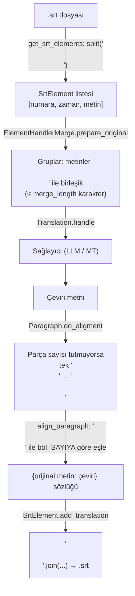
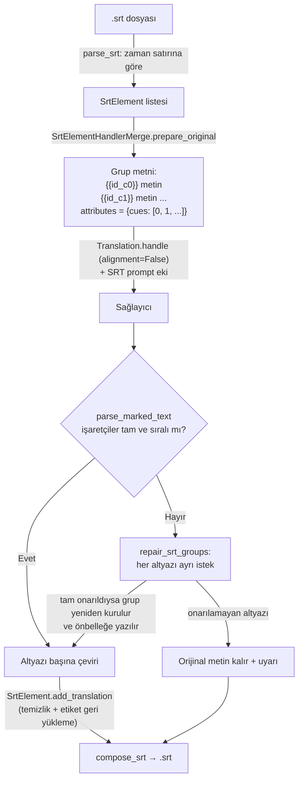

# SRT Çevirisi: Sorun Analizi ve Çözüm Kılavuzu

Bu doküman, eklentinin SRT altyazı dosyalarını çevirirken (özellikle **paragraf birleştirme** açıkken) yaşadığı sorunları, kök nedenlerini ve önerilen kalıcı çözümü anlatır. Çözüm önce ayrı bir kopyada, ardından bu repoda uygulanıp test edildi ve gerçek bir altyazı dosyasıyla canlı olarak doğrulandı (§8.4). Aşağıdaki kod blokları repodaki kodun aynısıdır.

> İlgili genel mimari için bkz. [`ARCHITECTURE.md`](ARCHITECTURE.md).

## İçindekiler

1. [Özet](#1-özet)
2. [Kapsam ve yöntem](#2-kapsam-ve-yöntem)
3. [Bugünkü SRT akışı](#3-bugünkü-srt-akışı)
4. [Tespit edilen sorunlar ve kök nedenler](#4-tespit-edilen-sorunlar-ve-kök-nedenler)
5. [Çözüm mimarisi](#5-çözüm-mimarisi)
6. [Uygulama yönergeleri (dosya dosya)](#6-uygulama-yönergeleri-dosya-dosya)
7. [Testler](#7-testler)
8. [Doğrulama sonuçları](#8-doğrulama-sonuçları)
9. [Önbellek uyumluluğu ve geçiş](#9-önbellek-uyumluluğu-ve-geçiş)
10. [Kabul kriterleri](#10-kabul-kriterleri)
11. [Sınırlamalar ve isteğe bağlı iyileştirmeler](#11-sınırlamalar-ve-isteğe-bağlı-iyileştirmeler)
12. [Uygulama sırası (kontrol listesi)](#12-uygulama-sırası-kontrol-listesi)

---

## 1. Özet

- **Sorun gerçek.** Birleştirme açıkken (örneğin 3000 karakter), farklı zamanlardaki diyaloglar tek bir zaman damgasının altına yazılabiliyor, çeviriler bir altyazı kayabiliyor ve SRT yapısı bozulabiliyor. Bu davranış eklentinin kendi koduyla ve sahte LLM yanıtlarıyla tekrar üretildi.
- **Neden blok kesilmesi değil.** Eklenti bloğu hiçbir zaman bir altyazının ortasından bölmüyor. Düzgün ayrıştırılmış dosyada numara ve zaman satırları sağlayıcıya hiç gitmiyor. Asıl sorun geri dağıtmada. Çeviri boş satırlara (`\n\n`) göre bölünüyor ve **parça sayısına** göre altyazılara eşleniyor. Sağlayıcı parça sayısını birebir korumazsa eşleme bozuluyor.
- **Zaman damgası sızıntısının nedeni ayrıştırıcı.** `get_srt_elements` dosyayı yalnızca `split('\n\n')` ile bölüyor. Fazladan boş satır, yalnızca boşluk içeren satır ya da boş altyazı varsa numara ve zaman satırı metne karışıp sağlayıcıya gidiyor. LLM bu satırları "çevirip" bozuyor.
- **Önerilen çözümün dört parçası var:**
  1. Zaman satırına göre çalışan sağlam bir ayrıştırıcı.
  2. Altyazı başına numaralı işaretçi (`{{id_c12}}`) ve kimliğe dayalı eşleme.
  3. Katı doğrulama: işaretçilerden biri bile eksikse, yer değiştirmişse ya da tekrarlanmışsa grup kabul edilmiyor.
  4. Bozuk grupların altyazı altyazı yeniden çevrilmesi (yedek akış).

  Bunlara ek olarak çeviri temizliği yapılıyor (boş satır ve zaman satırları siliniyor), etiketler (`<i>`, `{\an8}`) korunuyor ve önbellek sürümleniyor (`srt-v2`).
- **Doğrulama.** Mevcut 268 testin hepsi geçiyor. Kırılan tek test güncellendi ve 36 yeni test eklendi; toplam 304 test başarılı. [`GOOGLE_FREE_NEW.md`](GOOGLE_FREE_NEW.md) çözümüyle birlikte repoda 318 test başarılı. Eski hata senaryolarının hepsi yeni kodla doğru çıktı veriyor.
- **Canlı doğrulama.** 600 altyazılık gerçek bir bölüm, Google(Free)New ile 1800 karakter birleştirmeyle çevrildi. 600 altyazının tamamı kendi zaman damgasıyla çıktı; karakter adları %98 oranında korundu (eski eklentide %33). Ayrıntı: §8.4.

---

## 2. Kapsam ve yöntem

- İncelenen kod: `lib/element.py`, `lib/cache.py`, `lib/translation.py`, `lib/conversion.py`, `advanced.py`, `components/table.py`, `engines/*`.
- Deneyler, Calibre'nin kendi Python ortamında (`calibre-debug -e`) eklenti modülleri doğrudan yüklenerek yapıldı. Ağ isteği atılmadı; sağlayıcı yerine LLM'lerin tipik hatalarını taklit eden sahte çevirmenler kullanıldı.
- Kullanıcının Calibre kurulumuna dokunulmadı. `CALIBRE_CONFIG_DIRECTORY` geçici bir dizine yönlendirildi.
- Çözüm önce ayrı bir kopyada geliştirilip test edildi, ardından §6'daki kodun aynısı bu repoya uygulandı. Repodaki test paketi ve gerçek dosyayla yapılan canlı doğrulama §8'de.

Test çalıştırma komutu (PowerShell):

```powershell
$env:CALIBRE_CONFIG_DIRECTORY = "$env:TEMP\srt_merge_probe\calibre_config"
$env:CALIBRE_OVERRIDE_LANG = 'en'
$env:QT_QPA_PLATFORM = 'offscreen'
$env:PYTHONIOENCODING = 'utf-8'
$env:PLUGIN_REPO = '<repo dizini>'
& "<Calibre dizini>\calibre-debug.exe" -e "$env:TEMP\srt_merge_probe\run_tests.py"
```

`run_tests.py`, `PLUGIN_REPO` dizinini `calibre_plugins.ebook_translator` paketi olarak kaydeder ve `tests/**/test_*.py` dosyalarını `unittest` ile çalıştırır.

---

## 3. Bugünkü SRT akışı

> §3 ve §4, çözüm öncesindeki eski akışı anlatır. Bu bölümlerdeki satır numaraları çözüm öncesi `d312d6d` commit'ine aittir.



İlgili mevcut kod noktaları:

| Konum | Görev |
|---|---|
| `lib/element.py:822-831` | `get_srt_elements`: dosyayı `split('\n\n')` ile böler |
| `lib/element.py:105-125` | `SrtElement`: çeviriyi temizlemeden ekler |
| `lib/element.py:744-778` | `ElementHandlerMerge.prepare_original`: metinleri `\n\n` ile birleştirip gruplar |
| `lib/element.py:780-813` | `align_paragraph`: çeviriyi böler ve parça **sayısına** göre eşler |
| `lib/element.py:815-819` | `prepare_translation`: çevirileri orijinal metin anahtarlı `dict` içinde tutar |
| `lib/cache.py:46-68` | `Paragraph.is_alignment` ve `do_aligment` |
| `lib/translation.py:187` | Birleştirme açıksa `do_aligment` çağrısı |
| `lib/conversion.py:90-112` | `convert_srt` |
| `lib/conversion.py:205-210`, `advanced.py:93-99` | Önbellek kimliği hesabı (iki yerde tekrarlanmış) |
| `components/table.py:126` | Gelişmiş moddaki "Non-aligned" kontrolü |
| `engines/openai.py:80-82` (benzerleri Claude ve Gemini'de) | Birleştirme prompt ipucu |

Geri dağıtmanın özü:

```823:856:lib/element.py
    def align_paragraph(self, paragraph):
        # Compatible with using the placeholder as the separator.
        if paragraph.original[-2:] != self.separator:
            pattern = re.compile(
                r'\s*%s\s*' % self.placeholder[1].format(r'(0|[^0]\d*)'))
            paragraph.original = pattern.sub(
                self.separator, paragraph.original)
            if paragraph.translation is not None:
                paragraph.translation = pattern.sub(
                    self.separator, paragraph.translation)
        # Ensure the translation count matches the actual elements count.
        originals = paragraph.original.strip().split(self.separator)
        if paragraph.translation is None:
            return list(zip(originals, [None] * len(originals)))
        pattern = re.compile('%s+' % self.separator)
        translation = pattern.sub(self.separator, paragraph.translation)
        translations: list[Any] = translation.strip().split(self.separator)
        offset = len(originals) - len(translations)
        if offset > 0:
            if self.position in ['left', 'right']:
                addition = [None] * offset
                translations += addition
            else:
                merged_translations = '\n\n'.join(translations)
                translations = [None] * (len(originals) - 1)
                if self.position in ['above']:
                    translations.insert(0, merged_translations)
                else:
                    translations.append(merged_translations)
        elif offset < 0:
            offset = len(originals) - 1
            translations = translations[:offset] + [
                '\n\n'.join(translations[offset:])]
        return list(zip(originals, translations))
```

Yani parça eksikse bloğun tüm çevirisi son altyazıya ("above" modunda ilk altyazıya) yazılır; parça fazlaysa artan bütün parçalar son altyazıya yığılır. İki durumda da tahmin yapılır ama hata bildirilmez.

---

## 4. Tespit edilen sorunlar ve kök nedenler

### 4.1 Deney sonuçları (mevcut kod)

Test dosyası 6 altyazıdan oluşuyor. 2. ve 3. altyazı tek bir cümleyi bölüyor; 4. ve 6. altyazının metni aynı ("Yes."). Sahte LLM her parçayı `TR<...>` biçiminde çeviriyor.

| Senaryo | LLM / dosya davranışı | Sonuç |
|---|---|---|
| B | İki altyazıyı tek cümlede birleştiriyor (bir `\n\n` eksik) | Bloğun **tamamı** tek bir altyazının altına yazılıyor; diğer altyazılar çevrilmeden kalıyor. Aynı metinli altyazılar ("Yes.") da bu bloğu kopyalıyor |
| C | İki satırlı bir altyazının satırları arasına boş satır koyuyor | Çeviriler **bir altyazı kayıyor**; "it was closed." çevirisi kayboluyor |
| D | Yalnızca tek `\n` kullanıyor | `do_aligment` her satırı ayrı parça sayıyor ve yine kayma oluyor |
| F | Birleştirme kapalı, motor boş satırlı çeviri döndürüyor | Çevirinin ikinci kısmı numarasız ve zamansız kalıyor; SRT yapısı bozuluyor |
| E / E2 | Altyazılar arasında yalnızca boşluk içeren satır var | İki altyazı tek altyazı olarak okunuyor; ikincinin numarası ve zaman satırı sağlayıcıya **metin** olarak gidiyor |
| G / H | Fazladan boş satır ya da metni boş altyazı var | Zaman satırı metne karışıyor |
| H2 | H + "With no original" modu | LLM zaman satırını `00:00:08.000 - 00:00:09.000` biçimine çevirdi. Bu geçersiz bir satır; oynatıcı altyazıyı atlar |

Senaryo B'nin gerçek çıktısından bir kesit:

```
4
00:00:08,000 --> 00:00:09,000
Yes.
TR<Where were you last night?>

TR<I was going to / the store, but> TR<it was closed.>

TR<Yes.>
...
```

1. saniye ile 1:34 arasındaki bütün diyaloglar 00:00:08'in altına yazılmış. Ayrıca çevirideki boş satırlar SRT'de "altyazı bitti" anlamına geliyor; oynatıcı bu satırları numarasız ve zamansız bloklar olarak görüp atlıyor ya da dosyayı hiç ayrıştıramıyor.

Bir isteğin etki alanı (gerçekçi 600 altyazılık dosyada ölçüm):

| `merge_length` | İstek başına altyazı (mevcut kod) | Video süresi karşılığı |
|---|---|---|
| 1800 | ~54 | ~1,5–2 dk |
| 3000 | ~85 | ~2–4 dk |
| 6000 | ~150 | ~5–6 dk |

Tek bir sınır hatası bu aralığın tamamını etkiliyor.

### 4.2 Kök nedenler

| # | Kök neden | Konum | Etki |
|---|---|---|---|
| K1 | Eşleme **parça sayısına** dayanıyor; LLM'ler altyazı sınırlarına sadık kalmıyor | `align_paragraph` | Eksik parça: blok tek altyazıya yığılır. Fazla parça: kayma |
| K2 | Çeviriler **orijinal metin anahtarlı** `dict` içinde tutuluyor | `prepare_translation` (`dict(translations)`) | Aynı metinli altyazılar birbirinin çevirisini eziyor; hata yayılıyor ve bağlama göre farklı çeviri mümkün olmuyor |
| K3 | `do_aligment`, tek `\n` karakterlerini parça ayırıcısına çeviriyor | `lib/cache.py:54-68`, `lib/translation.py:187` | HTML'de işe yarıyor; SRT'de iki satırlı altyazıları bölüp kaymaya yol açıyor |
| K4 | Çeviri SRT'ye temizlenmeden yazılıyor | `SrtElement.add_translation` | Çevirideki boş satır ve zaman satırları yapıyı bozuyor (birleştirme kapalıyken de) |
| K5 | Ayrıştırıcı `split('\n\n')` kullanıyor | `get_srt_elements` | Numara ve zaman satırları metne sızıyor. Metni boş son altyazıda `IndexError` alınıyor (koddan çıkarım) |
| K6 | Kırpılmış yanıt başarılı sayılıyor | `engines/anthropic.py:132` (`max_tokens: 4096`, `stop_reason` kontrolü yok), akış kesilmeleri | Eksik çeviri K1'e düşüyor (koddan çıkarım; 3000 karakterde risk düşük) |
| K7 | Prompt yapıyı korumayı istemiyor; yalnızca SRT'de hiç kullanılmayan `{{id_\d+}}` yer tutucularından bahsediyor | `engines/openai.py:80-82` vb. | LLM boş satır sayısını korumak için bir talimat almıyor |
| K8 | Uyarı zayıf | Toplu mod; `components/table.py:126` | Toplu modda bozuk dosya sessizce kaydediliyor. Kaymada parça sayısı tuttuğu için "Non-aligned" bile yakalamıyor |
| K9 | Etiketler korunmuyor | `SrtElement.get_content` | `<i>`, `<font>`, `{\an8}` gibi etiketler sağlayıcıya ham gidiyor ve bozulabiliyor |

---

## 5. Çözüm mimarisi

### 5.1 İlkeler

1. **Yapı asla sağlayıcıya emanet edilmez.** Numara ve zaman satırları bellekte kalır; sağlayıcıya yalnızca metin gider. Çıktı her zaman bellekteki yapıdan yeniden üretilir.
2. **Eşleme kimliğe dayanır.** Her altyazının metnine numaralı bir işaretçi eklenir: `{{id_c<altyazı no>}}` (DeepL için `<m id=c<no> />`). Geri dönüşte metin, işaretçilere göre altyazılara dağıtılır. Parça sayısı ya da metin eşitliği kullanılmaz.
3. **Doğrulanmayan çeviri kabul edilmez.** Beklenen işaretçilerin hepsi tam bir kez, doğru sırada ve boş olmayan metinle gelmiyorsa grubun tamamı reddedilir. Tahmine dayalı "onarım" (`do_aligment`) SRT için kapatılır.
4. **Reddedilen grup küçük parçalarla yeniden denenir.** Bozuk grubun her altyazısı ayrı bir istekle çevrilir. Grup tamamen onarılırsa önbelleğe işaretçili biçimde geri yazılır.
5. **Yazmadan önce temizlenir.** Çeviriden boş satırlar, zaman satırı benzeri satırlar ve artakalan işaretçiler silinir; korunan etiketler geri konur.
6. **Önbellek sürümlenir.** SRT önbellek kimliğine `srt-v2` eklenir. Eski biçimdeki önbellekler yeni akışa karışmaz. SRT dışındaki formatların kimliği değişmez.

### 5.2 Yeni akış



### 5.3 Veri biçimleri

**Grup paragrafı (önbellekteki bir satır):**

| Alan | Değer |
|---|---|
| `id` | Grup sırası (0, 1, 2…) |
| `md5` | `uid('<grup no><grup metni>')` |
| `raw` | Gruptaki altyazıların ham metinlerinin `\n\n` ile birleşimi (yalnızca görüntüleme için) |
| `original` | `{{id_c0}} metin\n{{id_c1}} metin\n...` |
| `attributes` | `{"cues": [0, 1, ...]}` (JSON) |

Birleştirme kapalıyken her altyazı kendi paragrafıdır: `id` altyazı sırasıdır, işaretçi ve `attributes` yoktur.

**İşaretçi biçimi:** motorun `placeholder` şablonuna `c<no>` verilerek üretilir. Etiketlerin (5 haneli) ve sözlük terimlerinin (6 haneli) numaralarıyla çakışmaması için başta `c` harfi vardır:

| Motor | Şablon | Örnek |
|---|---|---|
| Varsayılan (`Base`) | `{{id_{}}}` | `{{id_c12}}` |
| DeepL | `<m id={} />` | `<m id=c12 />` |

Çözümleme deseni, motorun toleranslı desenini (`placeholder[1]`) kullanır. `{ id_c 12 }` ve `{{id _ c12}}` gibi bozulmalar da tanınır.

**Doğrulama kuralları (`parse_marked_text`)** — sonuç `None` ise grup bozuk sayılır:

- Çeviri `None`.
- İlk işaretçiden önce metin var (örneğin "Here is the translation: …").
- Bulunan işaretçi sırası beklenen listeyle birebir aynı değil (eksik, fazla, tekrar ya da yer değiştirme).
- İki işaretçi arasındaki metin boş.
- İstisna: tek altyazı bekleniyorsa ve hiç işaretçi yoksa, metnin tamamı o altyazıya ait sayılır.

---

## 6. Uygulama yönergeleri (dosya dosya)

Değişiklik özeti:

| Dosya | Değişiklik |
|---|---|
| `lib/srt.py` | **Yeni.** Ayrıştırıcı, işaretçiler, doğrulama, SRT handler'ları, onarım akışı |
| `lib/element.py` | `SrtElement` yeniden yazıldı; `get_srt_elements` ve `get_element_handler` yeni modüle yönlendirildi |
| `lib/cache.py` | `is_alignment` işaretçi desteği; ortak `get_cache_id` |
| `lib/translation.py` | `set_alignment`, `fork` |
| `engines/base.py`, `openai.py`, `anthropic.py`, `google.py` | `set_prompt_extension` ve prompt'a eklenmesi |
| `lib/conversion.py` | `convert_item` ve `convert_srt` yeni akışı kullanıyor |
| `advanced.py` | Hazırlık ve çeviri worker'ları yeni akışı kullanıyor |
| `components/table.py` | "Non-aligned" kontrolüne placeholder geçiliyor |
| `tests/lib/test_element.py` | `test_get_srt_elements` güncellendi |
| `tests/lib/test_srt.py` | **Yeni.** 36 test |

### 6.1 `lib/srt.py` (yeni dosya)

Döngüsel import olmaması için bu modül `element`, `cache`, `config` ve `utils` modüllerini import eder. `element.py` ve `cache.py` ise bu modülü yalnızca fonksiyon içinde (lazy) import eder.

<!-- code:lib/srt.py -->
```python
import re
import json

from .utils import log, uid, dummy, open_file
from .config import get_config
from .cache import Paragraph
from .element import SrtElement, ElementHandler, SRT_TIMING_RE as TIMING_RE


SRT_CACHE_VERSION = 'srt-v2'

INDEX_RE = re.compile(r'^\s*\d+\s*$')


def parse_srt(content: str) -> list[SrtElement]:
    """Split subtitles by their timing lines instead of by blank lines, so
    that missing indexes, extra blank lines, whitespace-only lines and empty
    cues cannot leak an index or a timing line into the translatable text.
    """
    content = content.lstrip('\ufeff').replace('\r\n', '\n').replace('\r', '\n')
    lines = content.split('\n')
    timing_rows = [row for row, line in enumerate(lines) if TIMING_RE.match(line)]
    if not timing_rows:
        raise ValueError('No valid SRT timing line was found.')
    elements = []
    for number, row in enumerate(timing_rows):
        is_last = number + 1 == len(timing_rows)
        end = len(lines) if is_last else timing_rows[number + 1]
        body = lines[row + 1:end]
        # The index of the next cue sits right before its timing line and
        # after a blank line (or directly after the timing line).
        if not is_last and body and INDEX_RE.match(body[-1]) and (
                len(body) == 1 or body[-2].strip() == ''):
            body = body[:-1]
        index = ''
        if row > 0 and INDEX_RE.match(lines[row - 1]) and (
                row == 1 or lines[row - 2].strip() == ''
                or TIMING_RE.match(lines[row - 2])):
            index = lines[row - 1].strip()
        text = '\n'.join(line.rstrip() for line in body if line.strip())
        elements.append(SrtElement(
            [index or str(number + 1), lines[row].strip(), text]))
    return elements


def get_srt_elements(path, encoding):
    return parse_srt(open_file(path, encoding))


def compose_srt(elements) -> str:
    return '\n\n'.join(element.get_translation() for element in elements) \
        + '\n'


def cue_marker(placeholder, cue_id: int) -> str:
    return placeholder[0].format('c%d' % cue_id)


def cue_marker_pattern(placeholder):
    return re.compile(placeholder[1].format(r'c\s*(?P<cue>\d+)'))


def strip_cue_markers(text, placeholder):
    return cue_marker_pattern(placeholder).sub('', text)


def parse_marked_text(text, placeholder, expected) -> dict[int, str] | None:
    """Map a marked text back to its cues. Return None unless every expected
    cue marker appears exactly once, in order, with non-empty text, and
    nothing precedes the first marker.
    """
    if text is None:
        return None
    expected = list(expected)
    matches = list(cue_marker_pattern(placeholder).finditer(text))
    if not matches:
        if len(expected) == 1 and text.strip():
            return {expected[0]: text.strip()}
        return None
    if text[:matches[0].start()].strip():
        return None
    found = [int(match.group('cue')) for match in matches]
    if found != expected:
        return None
    result = {}
    for number, match in enumerate(matches):
        end = len(text) if number + 1 == len(matches) \
            else matches[number + 1].start()
        chunk = text[match.end():end].strip()
        if not chunk:
            return None
        result[found[number]] = chunk
    return result


def srt_prompt_extension(placeholder):
    return (
        'The content is a sequence of subtitle cues. Each cue begins with a '
        'marker such as %s. Translate the text of every cue and keep each '
        'marker exactly once, unchanged and in the original order, at the '
        'beginning of its translation. Never merge, split, drop or reorder '
        'cues, even when a sentence continues into the next cue. Do not add '
        'blank lines.' % cue_marker(placeholder, 0))


class SrtElementHandler(ElementHandler):
    """Translate one cue per request and map translations by cue id."""

    def __init__(self, placeholder, separator, position):
        ElementHandler.__init__(self, placeholder, separator, position)
        self.cues: list[SrtElement] = []

    def _setup_element(self, element):
        element.set_placeholder(self.placeholder)
        element.set_position(self.position)
        element.set_target_direction(self.target_direction)
        element.set_translation_lang(self.translation_lang)

    def _prepare_cues(self, elements):
        self.cues = list(elements)
        for element in self.cues:
            self._setup_element(element)
            if element.get_text().strip() == '':
                element.set_ignored(True)

    def prepare_original(self, elements):
        self._prepare_cues(elements)
        for cue_id, element in enumerate(self.cues):
            content = element.get_content()
            self.originals.append((
                cue_id, uid('%s%s' % (cue_id, content)), element.get_raw(),
                content, element.ignored, None, None))
        return self.originals

    def add_translations(self, paragraphs, overrides=None):
        for paragraph in paragraphs:
            if paragraph.translation is None:
                continue
            element = self.cues[paragraph.id]
            if not element.ignored:
                element.add_translation(paragraph.translation)


class SrtElementHandlerMerge(SrtElementHandler):
    """Send several cues per request, each prefixed with a numbered marker,
    and only accept a translation whose markers all survived.
    """

    def prepare_original(self, elements):
        self._prepare_cues(elements)
        groups: list[list[tuple[int, str]]] = []
        current: list[tuple[int, str]] = []
        size = 0
        for cue_id, element in enumerate(self.cues):
            if element.ignored:
                continue
            unit = '%s %s' % (
                cue_marker(self.placeholder, cue_id), element.get_content())
            if current and size + len(unit) + 1 > self.merge_length:
                groups.append(current)
                current, size = [], 0
            current.append((cue_id, unit))
            size += len(unit) + 1
        if current:
            groups.append(current)
        for group_id, group in enumerate(groups):
            cue_ids = [cue_id for cue_id, _ in group]
            text = '\n'.join(unit for _, unit in group)
            raw = '\n\n'.join(self.cues[cue_id].get_raw() for cue_id in cue_ids)
            self.originals.append((
                group_id, uid('%s%s' % (group_id, text)), raw, text, False,
                json.dumps({'cues': cue_ids}), None))
        return self.originals

    def add_translations(self, paragraphs, overrides=None):
        overrides = overrides or {}
        skipped = 0
        for paragraph in paragraphs:
            cue_ids = paragraph.get_attributes().get('cues') or []
            mapping = parse_marked_text(
                paragraph.translation, self.placeholder, cue_ids)
            if mapping is None:
                mapping = {
                    cue_id: overrides[cue_id] for cue_id in cue_ids
                    if cue_id in overrides}
                skipped += len(cue_ids) - len(mapping)
            for cue_id, text in mapping.items():
                self.cues[cue_id].add_translation(text)
        if skipped > 0:
            log.warn(
                '%d subtitle cue(s) were left untranslated because their '
                'markers could not be matched.' % skipped)


def get_srt_element_handler(placeholder, separator, direction):
    config = get_config()
    position_alias = {'before': 'above', 'after': 'below'}
    position = config.get('translation_position') or 'below'
    position = position_alias.get(position) or position
    handler: SrtElementHandler
    if config.get('merge_enabled'):
        handler = SrtElementHandlerMerge(placeholder, separator, position)
        handler.set_merge_length(config.get('merge_length'))
    else:
        handler = SrtElementHandler(placeholder, separator, position)
    handler.set_target_direction(direction)
    return handler


def repair_srt_groups(translation, paragraphs, placeholder, save=dummy):
    """Re-translate, one request per cue, every merged group whose markers
    did not survive. Complete groups are rebuilt and saved; the returned
    mapping also covers cues of groups that could only be partially repaired.
    """
    if translation.cancel_request() or translation.need_stop():
        return {}
    broken = []
    for paragraph in paragraphs:
        cue_ids = paragraph.get_attributes().get('cues')
        if cue_ids is not None and parse_marked_text(
                paragraph.translation, placeholder, cue_ids) is None:
            broken.append(paragraph)
    if not broken:
        return {}
    units = []
    for paragraph in broken:
        cue_ids = paragraph.get_attributes()['cues']
        originals = parse_marked_text(paragraph.original, placeholder, cue_ids)
        if originals is None:
            continue
        for cue_id in cue_ids:
            text = originals[cue_id]
            units.append(Paragraph(
                cue_id, uid('repair', str(cue_id), text), text, text,
                attributes=json.dumps({'cues': [cue_id]})))
    if not units:
        return {}
    log.info('Re-translating %d cue(s) of %d misaligned group(s) one by one.'
             % (len(units), len(broken)))
    fallback = translation.fork()
    fallback.handle(units)
    repaired = {}
    for unit in units:
        mapping = parse_marked_text(unit.translation, placeholder, [unit.id])
        if mapping is not None:
            repaired.update(mapping)
    for paragraph in broken:
        cue_ids = paragraph.get_attributes()['cues']
        if all(cue_id in repaired for cue_id in cue_ids):
            paragraph.translation = '\n'.join(
                '%s %s' % (cue_marker(placeholder, cue_id), repaired[cue_id])
                for cue_id in cue_ids)
            paragraph.error = None
            save(paragraph)
    return repaired
```

Tasarım notları:

- **`parse_srt`**
  - Altyazılar, `-->` içeren zaman satırlarına göre ayrılır. Boş satırlar yalnızca bir sonraki altyazının numarasını tanımak için kullanılır.
  - Numara satırı, zaman satırından hemen önce gelen ve öncesinde boş satır (ya da dosya başı) olan, yalnızca rakamdan oluşan satırdır.
  - Numarası olmayan altyazılara sıra numarası verilir.
  - Metindeki boş ve yalnızca boşluk içeren satırlar atılır. Bu, SRT'de altyazı içinde boş satır olamayacağı kuralıyla uyumludur.
  - Dosyada hiç zaman satırı yoksa `ValueError` fırlatılır; sessizce bozuk çıktı üretilmez.
- **Gruplama:** Bir grup en az bir altyazı içerir. Tek başına `merge_length` sınırını aşan uzun bir altyazı yine de kendi grubunda gönderilir. Altyazılar grup içinde tek `\n` ile ayrılır, çünkü yapı artık işaretçilerle taşınıyor.
- **Metni boş altyazılar** (`ignored`) gruplara alınmaz; çıktıda aynen kalır.
- **`overrides`:** Onarım akışından gelen altyazı bazlı çevirilerdir. Grup çevirisi doğrulanamazsa önce bunlar kullanılır; bunlar da yoksa altyazı orijinal hâliyle kalır ve uyarı loglanır.
- **Onarım istekleri** işaretçisiz düz metin gönderir. Tek altyazı beklendiği için yanıtın tamamı o altyazıya ait sayılır; LLM işaretçiyi kendisi eklerse de doğru çözümlenir.

### 6.2 `lib/element.py`

**(a)** `class SrtElement` tanımının tamamını aşağıdakiyle değiştirin. Sabitler sınıfın hemen üstüne gelir. Dosyada `re` zaten import edilmiş durumda.

```python
SRT_TIMING_RE = re.compile(
    r'^\s*(\d{1,2}:\d{1,2}:\d{1,2}(?:[,.]\d{1,3})?)\s*-->\s*'
    r'(\d{1,2}:\d{1,2}:\d{1,2}(?:[,.]\d{1,3})?)(.*)$')
SRT_TAG_RE = re.compile(r'<[^<>\n]+>|\{\\[^{}\n]*\}')
SRT_CUE_MARKER_ID = r'c\s*\d+'


class SrtElement(Element):
    def get_raw(self):
        return self.element[2]

    def get_text(self):
        return SRT_TAG_RE.sub('', self.get_raw())

    def get_content(self):
        self.reserve_elements = []
        if not self.placeholder:
            return self.get_raw()

        def reserve(match):
            self.reserve_elements.append(match.group(0))
            return self.placeholder[0].format(
                format(len(self.reserve_elements) - 1, '05'))
        return SRT_TAG_RE.sub(reserve, self.get_raw())

    def _clean_translation(self, translation):
        translation = translation.replace('\r\n', '\n').replace('\r', '\n')
        if self.placeholder:
            for rid, tag in enumerate(self.reserve_elements):
                pattern = self.placeholder[1].format(
                    r'\s*'.join(format(rid, '05')))
                translation = re.sub(pattern, lambda _: tag, translation)
            leftover = re.compile('%s|%s' % (
                self.placeholder[1].format(r'\d{5}'),
                self.placeholder[1].format(SRT_CUE_MARKER_ID)))
            translation = leftover.sub('', translation)
        # A blank line ends a cue and a timing line starts one, so neither may
        # survive inside the text of a cue.
        lines = [line.rstrip() for line in translation.split('\n')
                 if line.strip() and not SRT_TIMING_RE.match(line)]
        return '\n'.join(lines).strip()

    def add_translation(self, translation=None):
        if translation is None:
            return
        translation = self._clean_translation(translation)
        if translation == '':
            return
        if self.position == 'only' or not self.element[2]:
            self.element[2] = translation
        elif self.position in ('below', 'right'):
            self.element[2] += '\n%s' % translation
        else:
            self.element[2] = '%s\n%s' % (translation, self.element[2])

    def get_translation(self):
        return '\n'.join(part for part in self.element if part)
```

Notlar:

- `get_text`, etiketleri çıkarılmış metni döndürür. Yalnızca etiketten oluşan altyazılar (`<i></i>` gibi) bu sayede "boş" sayılır ve çevrilmez.
- `get_content`, etiketleri motorun 5 haneli yer tutucularıyla (`{{id_00000}}`) değiştirir. `reserve_elements` her çağrıda sıfırlanır; numaralar altyazı içinde 0'dan başlar. Bu güvenlidir, çünkü çeviri önce altyazılara ayrılır, sonra etiketler geri yüklenir.
- `_clean_translation`:
  - Etiketleri geri koyar.
  - Sağlayıcının uydurduğu ya da kopyaladığı yer tutucuları ve işaretçileri siler.
  - Boş satırları ve zaman satırı benzeri satırları atar.
  - Bu temizlik birleştirme kapalıyken de çalışır; senaryo F de bu sayede çözülür.
- `add_translation`, orijinal metin boşsa çeviriyi doğrudan yazar. `get_translation` boş alanları atlar; böylece metni boş altyazılarda çıktıya fazladan satır sonu eklenmez.

**(b)** `get_srt_elements` fonksiyonunu yeni modüle yönlendirin. Mevcut import edenler (`lib/conversion.py` gibi) bozulmaz:

```python
def get_srt_elements(path, encoding):
    from .srt import get_srt_elements as _get_srt_elements
    return _get_srt_elements(path, encoding)
```

**(c)** `get_element_handler` fonksiyonuna isteğe bağlı `input_format` parametresi ekleyin. Fonksiyonun geri kalanı aynı kalır:

```python
def get_element_handler(placeholder, separator, direction, input_format=None):
    if input_format == 'srt':
        from .srt import get_srt_element_handler
        return get_srt_element_handler(placeholder, separator, direction)
    config = get_config()
    # ... mevcut kod değişmeden devam eder
```

`ElementHandlerMerge` ve `align_paragraph` diğer formatlar için olduğu gibi kalır. SRT artık bu yolu kullanmaz.

### 6.3 `lib/cache.py`

**(a)** Import satırına `uid` ekleyin:

```python
from .utils import size_by_unit, uid
```

**(b)** `Paragraph.is_alignment` metoduna işaretçi desteği ekleyin. Metodun geri kalanı aynı kalır:

```python
    def is_alignment(self, separator: str, placeholder=None) -> bool:
        if self.translation is None or self.translation.strip() == '':
            return True
        cue_ids = self.get_attributes().get('cues')
        if cue_ids is not None and placeholder is not None:
            from .srt import parse_marked_text
            return parse_marked_text(
                self.translation, placeholder, cue_ids) is not None
        pattern = re.compile(separator)
        # ... mevcut kod değişmeden devam eder
```

`do_aligment` değişmez. `placeholder` verilmediğinde davranış bugünküyle aynıdır, bu yüzden mevcut testler etkilenmez.

**(c)** Önbellek kimliği hesabını tek bir yardımcıda toplayın (`get_cache` fonksiyonunun hemen üstüne):

```python
def get_cache_id(
        input_path, engine_name, target_lang, merge_length, encoding,
        input_format):
    """The SRT version is part of the identity because the way subtitles are
    split and merged changed; caches built before cannot be reused.
    """
    _encoding = '' if encoding.lower() == 'utf-8' else encoding.lower()
    version = ''
    if input_format == 'srt':
        from .srt import SRT_CACHE_VERSION
        version = SRT_CACHE_VERSION
    return uid(
        input_path + engine_name + target_lang + str(merge_length)
        + _encoding + version)
```

SRT dışı formatlarda üretilen kimlik, bugünkü `uid(input_path + engine + target_lang + merge_length + encoding)` ile birebir aynıdır. Kullanıcıların mevcut EPUB/DOCX önbellekleri geçerliliğini korur.

### 6.4 `lib/translation.py`

**(a)** `Translation.__init__` içine bayrak ekleyin:

```python
        self.fresh = False
        self.batch = False
        self.alignment = True
        self.progress = dummy
```

**(b)** `set_batch` metodunun altına iki metot ekleyin:

```python
    def set_alignment(self, alignment):
        self.alignment = alignment

    def fork(self):
        """Create a translation that shares the engine, glossary, logging and
        cancellation, but neither reports progress, streams nor writes to the
        cache.
        """
        translation = Translation(self.translator, self.glossary)
        translation.set_batch(self.batch)
        translation.set_alignment(self.alignment)
        translation.set_logging(self.log)
        translation.set_cancel_request(self.cancel_request)
        return translation
```

`fork`, onarım isteklerini aynı motor, sözlük, log ve iptal mekanizmasıyla ama ana işin ilerleme çubuğunu sıfırlamadan çalıştırmak için kullanılır. `progress`, `streaming` ve `callback` kopyalanmaz (varsayılan `dummy` kalır). Onarılan grubun kaydı `repair_srt_groups` içindeki `save` ile yapılır.

**(c)** `translate_paragraph` içindeki hizalama koşulunu değiştirin:

```python
        # Apply aligment checking and processing.
        if self.alignment and self.translator.merge_enabled:
            paragraph.do_aligment(self.translator.separator)
```

### 6.5 Motorlar: SRT prompt eki

**`engines/base.py`** — `__init__` içinde `self.merge_enabled = False` satırının altına:

```python
        self.prompt_extension: str | None = None
```

`set_merge_enabled` metodunun altına:

```python
    def set_prompt_extension(self, extension: str | None) -> None:
        """Extra instructions for engines that take a prompt (GenAI)."""
        self.prompt_extension = extension
```

**`engines/openai.py`** (`ChatgptTranslate.get_prompt`) ve **`engines/anthropic.py`** (`ClaudeTranslate._get_prompt`) — birleştirme ipucunun hemen altına, `return prompt` satırından önce:

```python
        if self.prompt_extension:
            prompt += ' ' + self.prompt_extension
        return prompt
```

**`engines/google.py`** (`GeminiTranslate._prompt`) — `' Start translating: '` eklenmeden önce:

```python
        if self.prompt_extension:
            prompt += ' ' + self.prompt_extension
        return prompt + ' Start translating: ' + text
```

Azure OpenAI ve diğer `ChatgptTranslate` türevleri `get_prompt` metodunu miras aldığı için ayrıca değişiklik gerekmez. Prompt'u olmayan motorlar (Google Translate, DeepL, Microsoft…) bu alanı yok sayar; onlarda güvence işaretçi doğrulaması ve onarım akışıdır. Kullanıcı özel bir prompt tanımlamışsa ek yine sona eklenir.

### 6.6 `lib/conversion.py`

**(a)** Importlar (`uid` artık kullanılmıyor):

```python
from .utils import log, sep, open_path, open_file
from .cache import get_cache, get_cache_id
from .element import (
    get_element_handler, get_toc_elements, get_page_elements,
    get_metadata_elements, get_pgn_elements)
from .srt import (
    get_srt_elements, compose_srt, repair_srt_groups, srt_prompt_extension)
```

**(b)** `convert_srt` — çeviri sonrası onarım ve yeni çıktı üretimi:

```python
    elements = get_srt_elements(input_path, encoding)
    original_group = element_handler.prepare_original(elements)
    cache.save(original_group)

    paragraphs = cache.all_paragraphs()
    translation.set_progress(notification)
    translation.handle(paragraphs)
    repaired = {}
    if not cache.cache_only:
        repaired = repair_srt_groups(
            translation, paragraphs, element_handler.placeholder,
            cache.update_paragraph)
    element_handler.add_translations(paragraphs, repaired)

    log.info(sep())
    log.info(_('Starting to output subtitles file...'))
    log.info(sep())

    with open(output_path, 'w', encoding='utf-8') as file:
        file.write(compose_srt(elements))
```

`cache_only` modunda (gelişmiş moddan çıktı alırken) yeni istek atılmaz. Doğrulanamayan altyazılar orijinal kalır ve uyarı loglanır.

**(c)** `convert_item` — prompt eki, SRT handler'ı ve önbellek kimliği:

```python
    translator = get_translator()
    translator.set_source_lang(source_lang)
    translator.set_target_lang(target_lang)
    if format == 'srt' and translator.merge_enabled:
        translator.set_prompt_extension(
            srt_prompt_extension(translator.placeholder))

    element_handler = get_element_handler(
        translator.placeholder, translator.separator, direction, format)
    element_handler.set_translation_lang(
        translator.get_iso639_target_code(target_lang))

    merge_length = str(element_handler.get_merge_length())
    cache_id = get_cache_id(
        input_path, translator.name, target_lang, merge_length, encoding,
        format)
    cache = get_cache(cache_id)
```

Aynı fonksiyonda `set_batch` satırının altına:

```python
    translation.set_batch(is_batch)
    translation.set_alignment(format != 'srt')
    translation.set_callback(cache.update_paragraph)
```

`format` değeri, `extra_formats` sözlüğündeki küçük harfli `'srt'` anahtarıyla aynı değerdir; `convert_srt` de bu anahtarla seçilir.

### 6.7 `advanced.py`

**(a)** Importlar:

```python
from .lib.utils import traceback_error
from .lib.config import get_config
from .lib.encodings import encoding_list
from .lib.cache import Paragraph, get_cache, get_cache_id
from .lib.srt import srt_prompt_extension, repair_srt_groups
```

**(b)** `PreparationWorker` — handler ve önbellek kimliği:

```python
        element_handler = get_element_handler(
            self.engine_class.placeholder, self.engine_class.separator,
            self.ebook.target_direction, self.ebook.input_format)
        merge_length = str(element_handler.get_merge_length())
        cache_id = get_cache_id(
            input_path, self.engine_class.name, self.ebook.target_lang,
            merge_length, self.ebook.encoding, self.ebook.input_format)
        cache = get_cache(cache_id)
```

> **Önemli:** Hazırlık (`PreparationWorker`) ile çıktı üretimi (`convert_item`) aynı önbellek kimliğini hesaplamak zorundadır. Aksi hâlde gelişmiş modda yapılan çeviriler çıktıda bulunamaz. Bu yüzden kimlik hesabı tek bir yardımcıya (`get_cache_id`) taşındı.

**(c)** `TranslationWorker.__init__` içine:

```python
        self.source_lang = ebook.source_lang
        self.target_lang = ebook.target_lang
        self.input_format = ebook.input_format
        self.engine_class = engine_class
```

**(d)** `TranslationWorker.translate_paragraphs` — prompt eki, hizalamayı kapatma ve onarım:

```python
        translator = get_translator(self.engine_class)
        translator.set_source_lang(self.source_lang)
        translator.set_target_lang(self.target_lang)
        is_srt = self.input_format == 'srt'
        if is_srt and translator.merge_enabled:
            translator.set_prompt_extension(
                srt_prompt_extension(translator.placeholder))
        translation = get_translation(translator)
        translation.set_fresh(fresh)
        translation.set_alignment(not is_srt)
        translation.set_logging(
            lambda text, error=False: self.logging.emit(text, error))
        translation.set_streaming(self.streaming.emit)
        translation.set_callback(self.callback.emit)
        translation.set_cancel_request(self.cancel_request)
        translation.handle(paragraphs)
        if is_srt:
            repair_srt_groups(
                translation, paragraphs, translator.placeholder,
                self.callback.emit)
        self.on_working = False
```

Tamamen onarılan gruplar `callback` sinyaliyle tabloya ve önbelleğe yazılır. Kısmen onarılabilen grupların altyazı çevirileri gelişmiş modda saklanmaz; bu gruplar tabloda "Non-aligned" olarak işaretli kalır (bkz. [Sınırlamalar](#11-sınırlamalar-ve-isteğe-bağlı-iyileştirmeler)).

### 6.8 `components/table.py`

`check_row_alignment` içindeki kontrole motorun placeholder'ını geçin:

```python
        engine = get_engine_class(paragraph.engine_name)
        if engine is None or paragraph.is_alignment(
                engine.separator, engine.placeholder):
```

Böylece SRT gruplarında "Non-aligned" işareti parça sayısına göre değil işaretçi doğrulamasına göre konur. Kayma senaryosu da artık yakalanır.

---

## 7. Testler

### 7.1 Kırılan testin güncellenmesi: `tests/lib/test_element.py`

Mevcut `test_get_srt_elements` testi, numara ve zaman satırının yeri karışık, gerçekte geçersiz bir SRT girdisi kullanıyor ve `lib.element.open_file` fonksiyonunu yamalıyor. Yeni ayrıştırıcı `lib.srt` modülünde. Testi şöyle değiştirin:

```python
    @patch('calibre_plugins.ebook_translator.lib.srt.open_file')
    def test_get_srt_elements(self, mock_open_file):
        mock_open_file.return_value = (
            '1\n00:00:01,000 --> 00:00:02,000\na\nb\n\n'
            '2\n00:00:03,000 --> 00:00:04,000\nc\n\n')
        elements = get_srt_elements('/path/to/srt', 'utf-8')
        mock_open_file.assert_called_once_with('/path/to/srt', 'utf-8')
        self.assertEqual(2, len(elements))
        self.assertEqual(
            ['1', '00:00:01,000 --> 00:00:02,000', 'a\nb'],
            elements[0].element)
        self.assertEqual(
            ['2', '00:00:03,000 --> 00:00:04,000', 'c'], elements[1].element)
```

`TestSrtElement` sınıfındaki diğer testler (`below`, `right`, `above`, `left`, `only`) değişiklik gerektirmeden geçiyor. `test_cache.py` ve `test_translation.py` içindeki `is_alignment` / `do_aligment` testleri de aynen geçiyor; varsayılan davranış korunuyor.

### 7.2 Yeni test dosyası: `tests/lib/test_srt.py`

Kapsam:

- **Ayrıştırıcı:** standart dosya, BOM ve CRLF, yalnızca boşluk içeren satır, fazladan boş satırlar, altyazı içinde boş satır, numarasız altyazı, metni boş altyazı, yalnızca sayıdan oluşan metin, zaman satırı olmayan dosya ve gidiş-dönüş (`compose_srt`).
- **İşaretçiler:** üretim (varsayılan ve DeepL), silme, çözümleme, boşluk toleransı, geçersiz durumlar (eksik, sıra dışı, tekrar, öncü metin, boş parça, tamamen kayıp) ve işaretçisiz tek altyazı.
- **`SrtElement`:** etiket çıkarma, koruma ve geri yükleme, yapı temizliği, boş çeviri.
- **Handler'lar:** birleştirmesiz eşleme, gruplama ve `merge_length`, doğru eşleme, bozuk grupta `overrides` ve uyarı, `get_element_handler` yönlendirmesi.
- **Uyumluluk:** işaretçili `is_alignment`, `get_cache_id` (SRT dışı kimlik değişmiyor).
- **Onarım:** gerçek `Translation` ve sahte motorla uçtan uca akış, onarım gerekmeyen durum, iptal.

<!-- code:tests/lib/test_srt.py -->
```python
import json
import unittest
from unittest.mock import patch, Mock

from ...lib.cache import Paragraph, get_cache_id
from ...lib.utils import uid
from ...lib.element import SrtElement, get_element_handler
from ...lib.translation import Translation, Glossary
from ...lib.srt import (
    SRT_CACHE_VERSION, parse_srt, compose_srt, cue_marker, strip_cue_markers,
    parse_marked_text, srt_prompt_extension, SrtElementHandler,
    SrtElementHandlerMerge, repair_srt_groups)
from ...engines.base import Base
from ...engines.deepl import DeeplTranslate


module_name = 'calibre_plugins.ebook_translator.lib.srt'

T1 = '00:00:01,000 --> 00:00:02,000'
T2 = '00:00:03,000 --> 00:00:04,000'
T3 = '00:00:05,000 --> 00:00:06,000'


def srt(*cues):
    return '\n\n'.join(cues) + '\n'


class TestParseSrt(unittest.TestCase):
    def test_standard(self):
        elements = parse_srt(srt(
            '1\n%s\nHello.\nHow are you?' % T1, '2\n%s\nFine.' % T2))
        self.assertEqual(
            ['1', T1, 'Hello.\nHow are you?'], elements[0].element)
        self.assertEqual(['2', T2, 'Fine.'], elements[1].element)

    def test_bom_and_crlf(self):
        content = '\ufeff1\r\n%s\r\na\r\n\r\n2\r\n%s\r\nb\r\n' % (T1, T2)
        elements = parse_srt(content)
        self.assertEqual(['1', T1, 'a'], elements[0].element)
        self.assertEqual(['2', T2, 'b'], elements[1].element)

    def test_whitespace_only_line(self):
        elements = parse_srt('1\n%s\na\n   \n2\n%s\nb\n' % (T1, T2))
        self.assertEqual(2, len(elements))
        self.assertEqual('a', elements[0].get_raw())
        self.assertEqual(['2', T2, 'b'], elements[1].element)

    def test_extra_blank_lines(self):
        elements = parse_srt('1\n%s\na\n\n\n\n2\n%s\nb\n\n\n' % (T1, T2))
        self.assertEqual(['1', T1, 'a'], elements[0].element)
        self.assertEqual(['2', T2, 'b'], elements[1].element)

    def test_blank_line_inside_cue(self):
        elements = parse_srt('1\n%s\na\n\nb\n\n2\n%s\nc\n' % (T1, T2))
        self.assertEqual('a\nb', elements[0].get_raw())
        self.assertEqual('c', elements[1].get_raw())

    def test_missing_index(self):
        elements = parse_srt('%s\na\n\n%s\nb\n' % (T1, T2))
        self.assertEqual(['1', T1, 'a'], elements[0].element)
        self.assertEqual(['2', T2, 'b'], elements[1].element)

    def test_empty_cue(self):
        elements = parse_srt(srt('1\n%s' % T1, '2\n%s\nb' % T2))
        self.assertEqual(['1', T1, ''], elements[0].element)
        self.assertEqual(['2', T2, 'b'], elements[1].element)

    def test_numeric_text(self):
        elements = parse_srt(srt('1\n%s\n42' % T1, '2\n%s\nb' % T2))
        self.assertEqual('42', elements[0].get_raw())
        self.assertEqual('2', elements[1].element[0])

    def test_no_timing_line(self):
        self.assertRaises(ValueError, parse_srt, 'a\n\nb\n')

    def test_compose_srt(self):
        content = srt('1\n%s\na' % T1, '2\n%s\nb' % T2)
        self.assertEqual(content, compose_srt(parse_srt(content)))


class TestCueMarker(unittest.TestCase):
    def setUp(self):
        self.placeholder = Base.placeholder

    def test_cue_marker(self):
        self.assertEqual('{{id_c3}}', cue_marker(Base.placeholder, 3))
        self.assertEqual(
            '<m id=c3 />', cue_marker(DeeplTranslate.placeholder, 3))

    def test_strip_cue_markers(self):
        self.assertEqual(
            ' a  b', strip_cue_markers('{{id_c0}} a {{ id_c1 }} b',
                                       self.placeholder))

    def test_parse_marked_text(self):
        self.assertEqual(
            {0: 'A', 1: 'B\nC'},
            parse_marked_text(
                '{{id_c0}} A\n{{id_c1}} B\nC', self.placeholder, [0, 1]))

    def test_parse_marked_text_tolerant_spacing(self):
        self.assertEqual(
            {4: 'A', 5: 'B'},
            parse_marked_text(
                '{ id_c 4 } A\n{{id _ c5}}B', self.placeholder, [4, 5]))

    def test_parse_marked_text_deepl(self):
        self.assertEqual(
            {0: 'A', 1: 'B'},
            parse_marked_text(
                '<m id=c0 /> A <m id=c1 /> B',
                DeeplTranslate.placeholder, [0, 1]))

    def test_parse_marked_text_invalid(self):
        for text in (
                None,
                '{{id_c0}} A B',                       # missing marker
                '{{id_c1}} B\n{{id_c0}} A',            # reordered
                '{{id_c0}} A\n{{id_c0}} A\n{{id_c1}} B',  # duplicated
                'Note: {{id_c0}} A\n{{id_c1}} B',      # leading text
                '{{id_c0}}\n{{id_c1}} B',              # empty cue
                'A B'):                                # all markers lost
            self.assertIsNone(
                parse_marked_text(text, self.placeholder, [0, 1]), text)

    def test_parse_marked_text_single_without_marker(self):
        self.assertEqual(
            {7: 'A'}, parse_marked_text(' A ', self.placeholder, [7]))
        self.assertIsNone(parse_marked_text(' ', self.placeholder, [7]))

    def test_srt_prompt_extension(self):
        self.assertIn('{{id_c0}}', srt_prompt_extension(self.placeholder))


class TestSrtElement(unittest.TestCase):
    def setUp(self):
        self.element = SrtElement(['1', T1, '<i>Hello</i>\n{\\an8}world'])
        self.element.set_placeholder(Base.placeholder)
        self.element.set_position('below')

    def test_get_text(self):
        self.assertEqual('Hello\nworld', self.element.get_text())

    def test_get_content_reserves_tags(self):
        self.assertEqual(
            '{{id_00000}}Hello{{id_00001}}\n{{id_00002}}world',
            self.element.get_content())

    def test_add_translation_restores_tags(self):
        self.element.get_content()
        self.element.add_translation(
            '{{id_00000}}Merhaba{{id_00001}}\n{{ id_00002 }}dünya')
        self.assertEqual(
            '<i>Hello</i>\n{\\an8}world\n<i>Merhaba</i>\n{\\an8}dünya',
            self.element.get_raw())

    def test_add_translation_cleans_structure(self):
        self.element.set_position('only')
        self.element.get_content()
        self.element.add_translation(
            '\n{{id_c1}} Merhaba\n\n%s\n{{id_99999}}dünya\n' % T2)
        self.assertEqual('Merhaba\ndünya', self.element.get_raw())

    def test_add_translation_empty(self):
        self.element.add_translation('\n \n')
        self.assertEqual('<i>Hello</i>\n{\\an8}world', self.element.get_raw())

    def test_get_translation(self):
        element = SrtElement(['1', T1, ''])
        self.assertEqual('1\n' + T1, element.get_translation())


class TestSrtElementHandler(unittest.TestCase):
    def setUp(self):
        self.elements = parse_srt(srt(
            '1\n%s\nHello.' % T1, '2\n%s' % T2, '3\n%s\nBye.' % T3))
        self.handler = SrtElementHandler(Base.placeholder, '\n\n', 'below')

    def test_prepare_original(self):
        originals = self.handler.prepare_original(self.elements)
        self.assertEqual(3, len(originals))
        self.assertEqual(
            (0, uid('0Hello.'), 'Hello.', 'Hello.', False, None, None),
            originals[0])
        self.assertTrue(originals[1][4])

    def test_add_translations(self):
        self.handler.prepare_original(self.elements)
        self.handler.add_translations([
            Paragraph(0, '', '', '', translation='Merhaba.'),
            Paragraph(2, '', '', '', translation='Hoşça kal.')])
        self.assertEqual(
            srt('1\n%s\nHello.\nMerhaba.' % T1, '2\n%s' % T2,
                '3\n%s\nBye.\nHoşça kal.' % T3),
            compose_srt(self.elements))


class TestSrtElementHandlerMerge(unittest.TestCase):
    def setUp(self):
        self.elements = parse_srt(srt(
            '1\n%s\nHello.' % T1, '2\n%s\nYes.' % T2, '3\n%s\nBye.' % T3))
        self.handler = SrtElementHandlerMerge(
            Base.placeholder, '\n\n', 'only')
        self.handler.set_merge_length(1000)

    def get_paragraphs(self):
        return [Paragraph(*original)
                for original in self.handler.prepare_original(self.elements)]

    def test_prepare_original(self):
        originals = self.handler.prepare_original(self.elements)
        self.assertEqual(1, len(originals))
        self.assertEqual(
            '{{id_c0}} Hello.\n{{id_c1}} Yes.\n{{id_c2}} Bye.',
            originals[0][3])
        self.assertEqual({'cues': [0, 1, 2]}, json.loads(originals[0][5]))

    def test_prepare_original_merge_length(self):
        self.handler.set_merge_length(40)
        originals = self.handler.prepare_original(self.elements)
        self.assertEqual(
            [[0, 1], [2]],
            [json.loads(original[5])['cues'] for original in originals])

    def test_add_translations(self):
        paragraphs = self.get_paragraphs()
        paragraphs[0].translation = \
            '{{id_c0}} Merhaba.\n{{id_c1}} Evet.\n{{id_c2}} Hoşça kal.'
        self.handler.add_translations(paragraphs)
        self.assertEqual(
            srt('1\n%s\nMerhaba.' % T1, '2\n%s\nEvet.' % T2,
                '3\n%s\nHoşça kal.' % T3),
            compose_srt(self.elements))

    @patch(module_name + '.log')
    def test_add_translations_misaligned(self, mock_log):
        paragraphs = self.get_paragraphs()
        paragraphs[0].translation = \
            '{{id_c0}} Merhaba. Evet.\n{{id_c2}} Hoşça kal.'
        self.handler.add_translations(paragraphs, {1: 'Evet!'})
        self.assertEqual(
            srt('1\n%s\nHello.' % T1, '2\n%s\nEvet!' % T2, '3\n%s\nBye.' % T3),
            compose_srt(self.elements))
        mock_log.warn.assert_called_once()

    def test_get_element_handler(self):
        with patch(module_name + '.get_config') as mock_get_config:
            mock_get_config().get.side_effect = lambda key: {
                'merge_enabled': True, 'merge_length': 100,
                'translation_position': 'after'}.get(key)
            handler = get_element_handler(
                Base.placeholder, '\n\n', 'ltr', 'srt')
        self.assertIsInstance(handler, SrtElementHandlerMerge)
        self.assertEqual('below', handler.position)
        self.assertEqual(100, handler.get_merge_length())


class TestCompatibility(unittest.TestCase):
    def test_is_alignment_with_cues(self):
        paragraph = Paragraph(
            0, '', '', '', attributes='{"cues": [0, 1]}',
            translation='{{id_c0}} A\n\n{{id_c1}} B')
        self.assertTrue(paragraph.is_alignment('\n\n', Base.placeholder))
        paragraph.translation = '{{id_c0}} A B'
        self.assertFalse(paragraph.is_alignment('\n\n', Base.placeholder))

    def test_get_cache_id(self):
        self.assertEqual(
            uid('/a.epubGoogleTurkish2000'),
            get_cache_id('/a.epub', 'Google', 'Turkish', '2000', 'UTF-8',
                         'epub'))
        self.assertEqual(
            uid('/a.srtGoogleTurkish2000gbk' + SRT_CACHE_VERSION),
            get_cache_id('/a.srt', 'Google', 'Turkish', '2000', 'GBK', 'srt'))


class TestRepairSrtGroups(unittest.TestCase):
    def setUp(self):
        self.elements = parse_srt(srt(
            '1\n%s\nHello.' % T1, '2\n%s\nYes.' % T2, '3\n%s\nBye.' % T3))
        self.handler = SrtElementHandlerMerge(
            Base.placeholder, '\n\n', 'only')
        self.handler.set_merge_length(1000)
        self.paragraphs = [
            Paragraph(*original)
            for original in self.handler.prepare_original(self.elements)]

        self.requests = []
        self.translator = Mock(
            placeholder=Base.placeholder, separator='\n\n', merge_enabled=True,
            concurrency_limit=1, request_interval=0, max_error_count=10,
            request_attempt=0)
        self.translator.name = 'Fake'
        self.translator.get_target_lang.return_value = 'Turkish'
        self.translator.match_error.return_value = False
        self.translator.translate.side_effect = self.translate
        self.translation = Translation(
            self.translator, Glossary(Base.placeholder))
        self.translation.set_alignment(False)

    def translate(self, text):
        self.requests.append(text)
        if '{{id_c' in text:
            # Merge the first two cues, as a GenAI engine might do.
            return '{{id_c0}} Merhaba, evet.\n{{id_c2}} Hoşça kal.'
        return {'Hello.': 'Merhaba.', 'Yes.': 'Evet.', 'Bye.': 'Hoşça kal.'
                }[text]

    def test_repair(self):
        saved = []
        self.translation.handle(self.paragraphs)
        repaired = repair_srt_groups(
            self.translation, self.paragraphs, Base.placeholder, saved.append)
        self.assertEqual(
            {0: 'Merhaba.', 1: 'Evet.', 2: 'Hoşça kal.'}, repaired)
        self.assertEqual(4, len(self.requests))
        self.assertEqual(self.paragraphs, saved)
        self.assertEqual(
            '{{id_c0}} Merhaba.\n{{id_c1}} Evet.\n{{id_c2}} Hoşça kal.',
            self.paragraphs[0].translation)

        self.handler.add_translations(self.paragraphs, repaired)
        self.assertEqual(
            srt('1\n%s\nMerhaba.' % T1, '2\n%s\nEvet.' % T2,
                '3\n%s\nHoşça kal.' % T3),
            compose_srt(self.elements))

    def test_nothing_to_repair(self):
        self.paragraphs[0].translation = \
            '{{id_c0}} Merhaba.\n{{id_c1}} Evet.\n{{id_c2}} Hoşça kal.'
        translation = Mock()
        translation.cancel_request.return_value = False
        translation.need_stop.return_value = False
        self.assertEqual(
            {}, repair_srt_groups(
                translation, self.paragraphs, Base.placeholder))
        translation.fork.assert_not_called()

    def test_canceled(self):
        translation = Mock()
        translation.cancel_request.return_value = True
        self.assertEqual(
            {}, repair_srt_groups(
                translation, self.paragraphs, Base.placeholder))
        translation.fork.assert_not_called()
```

---

## 8. Doğrulama sonuçları

### 8.1 Test paketi

| Durum | Sonuç |
|---|---|
| Orijinal repo | 268 test, hepsi başarılı |
| Çözüm uygulandı, testler güncellenmeden | 268 testten yalnızca `test_get_srt_elements` hata verdi (beklenen: yama hedefi taşındı) |
| Çözüm + güncellenmiş test + `test_srt.py` | **304 test, hepsi başarılı** |
| Repo: bu çözüm + [`GOOGLE_FREE_NEW.md`](GOOGLE_FREE_NEW.md) çözümü | **318 test, hepsi başarılı** |

### 8.2 Eski senaryoların yeni kodla tekrarı

Aynı 6 altyazılık dosya ve aynı LLM hataları, yeni akışın tamamından (ayrıştırma, işaretçili gruplama, gerçek `Translation`, onarım, çıktı) geçirildi:

| Senaryo | LLM / dosya davranışı | İstek sayısı | Sonuç |
|---|---|---|---|
| N1 (eski B) | 2. ve 3. altyazıyı birleştiriyor, bir işaretçi kayboluyor | 1 + 6 onarım | Her çeviri **kendi zaman damgasının altında**; kayma veya yığılma yok |
| N2 (eski C/D) | Yanıt 3. altyazıdan sonra kesiliyor | 1 + 6 onarım | Tüm altyazılar doğru |
| N3 (eski F/H2) | Altyazılar arasına boş satır ve zaman satırı ekliyor | 1 | İşaretçiler tam olduğu için kabul edildi; boş satırlar ve sahte zaman satırları temizlendi |
| N4 (eski E/G) | Dosyada boş altyazı ve yalnızca boşluk içeren satır var | 1 | 7 altyazı doğru ayrıştırıldı; boş altyazı aynen korundu; zaman satırı sağlayıcıya gitmedi |

N1 çıktısından bir kesit (eski kodda bu blok tamamen 4. altyazının altına yığılıyordu):

```
2
00:00:03,000 --> 00:00:05,000
I was going to
the store, but
TR<I was going to / the store, but>

3
00:00:05,100 --> 00:00:07,000
it was closed.
TR<it was closed.>

4
00:00:08,000 --> 00:00:09,000
Yes.
TR<Yes.>
```

### 8.3 İstek sayısına etkisi

İşaretçiler her altyazıya yaklaşık 10 karakter ekler. Aynı 600 altyazılık dosyada:

| `merge_length` | Eski kod: istek sayısı | Eski kod: istek başına altyazı | Yeni kod: istek sayısı | Yeni kod: istek başına altyazı |
|---|---|---|---|---|
| 1800 | 11 | ~54 | 15 | 40 |
| 3000 | 7 | ~86 | 9 | ~67 |
| 6000 | 4 | 150 | 5 | 120 |

Normal akışta istek sayısı yaklaşık %25–35 artar. Buna karşılık bir hata artık yalnızca o grubu etkiler ve otomatik onarılır.

### 8.4 Gerçek dosyayla canlı doğrulama

Kullanıcının çevirdiği bölümün (600 altyazı) metinleri, eski eklentinin önbelleğinden alınıp gerçek Google(Free)New istekleriyle yeni akıştan geçirildi. Ayarlar: birleştirme açık, `merge_length` 1800, hedef dil Türkçe. Önbellekte yalnızca metinler bulunduğu için girdi dosyasındaki numaralar ve zaman satırları yapay olarak üretildi; altyazı metinleri ve sıraları gerçektir.

Eski eklentinin aynı ayarla ürettiği çıktıda 169. altyazının altına 16 farklı altyazının çevirisi yığılmıştı. Bunun nedeni, parça sayısı tutmadığında `align_paragraph`'ın fazla çevirileri gruptaki son altyazıya eklemesidir (§4). Eski önbellekte 11 grubun 8'i bu şekilde uyumsuzdu.

| Ölçüt | Eski eklenti (birleştirme 1800) | Yeni akış (birleştirme 1800) | Yeni akış (altyazı başına) |
|---|---|---|---|
| Çıktıdaki altyazı bloğu | Yapı bozuk; çeviriler kaymış ve yığılmış | 600 / 600, her biri numara + zaman + metin | 600 / 600 |
| Zaman satırları | Çeviriler yanlış zamanlarda | Girdiyle birebir aynı | Girdiyle birebir aynı |
| Karakter adlarının korunması | 39 / 118 (%33) | 116 / 118 (%98) | 117 / 118 |
| İstek sayısı | — | 14 grup + 346 onarım isteği (~10 sn) | 600 |

- 14 grubun 8'inde Google işaretçileri bozdu (bir cümle iki altyazıya yayıldığında işaretçiyi siliyor ya da tekrarlıyor). Bu gruplar §6'daki onarım akışıyla altyazı altyazı yeniden çevrildi; hiçbir altyazı çevrilmemiş kalmadı.
- 169–176 arası altyazılar doğru: örneğin "Ahoy there." → "Selamlar.", "Damn it!" → "Kahretsin!".
- Kaynakla aynı kalan 15 altyazının hepsi özel ad ya da ünlemdir ("Jim.", "Ben Gunn.", "Ah!").

Birleştirme kapalıyken üretilmiş eski çıktı da sağlam değildir. Google(Free)New tek bir altyazının içindeki satır sonunu bazen boş satıra çevirir (diyalog tireleri, iki cümle). Eski yazıcı bu boş satırı blok sınırı olarak bıraktığı için 600 altyazı 633 bloğa dönüştü ve 33 numarasız, zamansız blok oluştu. Yeni `SrtElement._clean_translation` boş satırları tek satır sonuna indirir: aynı çeviriler 600 blok ve 0 sahipsiz blok üretir.

---

## 9. Önbellek uyumluluğu ve geçiş

- **SRT:** Önbellek kimliğine `SRT_CACHE_VERSION` (`'srt-v2'`) eklenir. Eski SRT önbellekleri yeni akışta **kullanılmaz** ve ilk çalıştırmada dosya yeniden çevrilir.
  - Bu kasıtlıdır: eski önbellekte grup metinleri işaretçisizdir ve `attributes` alanında `cues` yoktur. Yeni doğrulayıcı bunları eşleyemez.
  - Eski önbellek dosyaları silinmez; "Cache" ekranından elle temizlenebilir.
- **Diğer formatlar:** Kimlik hesabı birebir aynıdır. EPUB, DOCX, PGN vb. önbellekleri etkilenmez (`test_get_cache_id` bunu sabitliyor).
- **Gelecekteki değişiklikler:** SRT gruplama veya işaretçi biçimi yeniden değişirse `SRT_CACHE_VERSION` artırılmalıdır (`'srt-v3'`).
- **Birleştirme ayarı değişirse:** `merge_length` zaten kimliğin parçası. Birleştirme açılıp kapatıldığında farklı önbellek kullanılır; birleştirmesiz paragraflar ile grup paragrafları karışmaz.

---

## 10. Kabul kriterleri

1. Birleştirme açık ya da kapalı, hangi sağlayıcı kullanılırsa kullanılsın, çıktıdaki her altyazının numarası ve zaman satırı girdidekiyle birebir aynıdır.
2. Bir altyazının çevirisi yalnızca o altyazının altına (veya üstüne) yazılır. Farklı zamanlardaki diyaloglar tek altyazıda birleşmez.
3. Aynı metne sahip altyazılar birbirinin çevirisini etkilemez.
4. Çıktıdaki hiçbir altyazının metninde boş satır, zaman satırı ya da artakalan işaretçi bulunmaz.
5. İşaretçileri bozulan grup otomatik olarak altyazı altyazı yeniden çevrilir. Yeniden çevrilemeyen altyazılar orijinal metinle kalır ve sayıları loglanır.
6. Fazladan boş satır, yalnızca boşluk içeren satır, numarasız altyazı, metni boş altyazı, BOM ve CRLF içeren dosyalar doğru ayrıştırılır.
7. `<i>`, `<b>`, `<font>` ve `{\an8}` gibi etiketler çeviride korunur.
8. Gelişmiş modda "Non-aligned" işareti, işaretçisi bozuk SRT gruplarında görünür.
9. SRT dışı formatların davranışı ve önbellekleri değişmez; mevcut testlerin tümü geçer.

---

## 11. Sınırlamalar ve isteğe bağlı iyileştirmeler

**Bilinen sınırlamalar**

- **Onarım maliyeti:** Bozuk bir grup, içerdiği altyazı sayısı kadar ek istek üretir. 3000 karakterde bu yaklaşık 67 istek demektir. Ücretli sağlayıcılarda maliyet artar ve onarım isteklerinde bağlam olmadığı için çeviri kalitesi bir miktar düşebilir.
- **Kısmi onarım (gelişmiş mod):** Grubun yalnızca bir kısmı onarılabildiyse, onarılan altyazılar o çalıştırmada (`convert_srt`) kullanılır ama önbelleğe yazılmaz. Gelişmiş modda bu altyazılar çıktıya yansımaz ve grup "Non-aligned" kalır. Kullanıcı satırı yeniden çevirebilir.
- **Çeviri motorları (DeepL, Google Translate, Microsoft):** İşaretçiler genelde korunur, ancak bazı motorlar işaretçiyi taşıyabilir ya da silebilir. Bu durumda onarım akışı devreye girer; maliyet LLM'lere göre daha yüksek olabilir. Google(Free)New ile canlı denemede 14 grubun 8'i onarıma düştü ve 600 altyazı için toplam 360 istek gerekti (§8.4). Bu motorda kademeli onarım (aşağıda 2. madde) en büyük kazancı sağlar.
- **Yalnızca sayıdan oluşan altyazı metni:** Bir altyazının tek satırı sayıysa ve hemen ardından boş satır olmadan sonraki zaman satırı geliyorsa (bozuk dosya), bu satır sonraki altyazının numarası sanılır.
- **Eksik etiketler:** Sağlayıcı bir etiket yer tutucusunu silerse etiket çeviride eksik kalır (örneğin kapanmamış `<i>`). Çoğu oynatıcı bunu tolere eder.
- **Blok sınırında bağlam:** Gruplar karakter sayısına göre kesilir. Sınırda yarım kalan cümle, sonraki grupta bağlamını kaybeder. Bu artık yapıyı bozmaz, yalnızca çeviri kalitesini etkiler.

**İsteğe bağlı iyileştirmeler (bu çözümün parçası değil)**

1. **Kırpılmış yanıtı hata saymak:** Claude için `stop_reason == 'max_tokens'`, OpenAI için `finish_reason == 'length'` kontrolü eklenip `max_tokens` değeri yapılandırılabilir yapılabilir. Mevcut testler akış davranışını kasıtlı olarak sabitlediği için bu ayrı bir değişiklik olarak ele alınmalı. Yeni çözümde kırpılma zaten işaretçi doğrulamasıyla yakalanıp onarılıyor.
2. **Kademeli onarım:** Grup önce ikiye bölünüp yeniden denenebilir, tek altyazıya ancak en son inilir. Bu, istek maliyetini düşürür ve bağlamı kısmen korur.
3. **Bağlamlı onarım:** Onarım isteğine önceki ve sonraki altyazılar "yalnızca bağlam, çevirme" notuyla eklenebilir.
4. **Toplu mod raporu:** Onarılamayan altyazı sayısı işin sonunda bildirim olarak gösterilebilir.
5. **Cümle sınırına duyarlı gruplama:** Grup sınırı, cümle bitişine (`.`, `?`, `!`) denk gelen bir altyazıda kesilebilir.

---

## 12. Uygulama sırası (kontrol listesi)

1. [x] `lib/element.py`: `SRT_*` sabitlerini ve yeni `SrtElement` sınıfını ekle (6.2a).
2. [x] `lib/srt.py` dosyasını oluştur (6.1).
3. [x] `lib/element.py`: `get_srt_elements` ve `get_element_handler` yönlendirmelerini yap (6.2b, 6.2c).
4. [x] `lib/cache.py`: `uid` importu, `is_alignment` ve `get_cache_id` (6.3).
5. [x] `lib/translation.py`: `alignment`, `set_alignment`, `fork` ve koşul değişikliği (6.4).
6. [x] `engines/base.py`, `openai.py`, `anthropic.py`, `google.py`: prompt eki (6.5).
7. [x] `lib/conversion.py`: importlar, `convert_srt` ve `convert_item` (6.6).
8. [x] `advanced.py`: importlar ve iki worker (6.7).
9. [x] `components/table.py`: `is_alignment` çağrısı (6.8).
10. [x] `tests/lib/test_element.py`: `test_get_srt_elements` (7.1).
11. [x] `tests/lib/test_srt.py` dosyasını ekle (7.2).
12. [x] Test paketini çalıştır: 304 test başarılı olmalı. [`GOOGLE_FREE_NEW.md`](GOOGLE_FREE_NEW.md) çözümü repoda uygulanmış olduğundan, bu çözüm onun üzerine uygulanınca beklenen toplam 318'dir.
13. [ ] Elle doğrulama: birleştirme açıkken (3000 karakter) bir GenAI motoruyla gerçek bir SRT dosyasını hem toplu hem gelişmiş modda çevir. Çıktıdaki zaman satırlarını girdiyle karşılaştır (örneğin `Select-String '-->'` çıktılarının farkı boş olmalı). *Kısmen yapıldı:* Akış Google(Free)New ile gerçek bir bölüm üzerinde, eklenti modülleriyle doğrudan çalıştırılarak doğrulandı (§8.4). Eklenti kurulup Calibre arayüzünden toplu ve gelişmiş modda, GenAI motoruyla deneme henüz yapılmadı.
14. [ ] Sürüm notuna ekle: "SRT çeviri önbellekleri yenilendi; eski SRT önbellekleri yeniden kullanılmaz."
